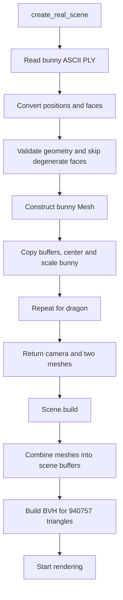

## User

I want to organize everything a little bit

I am no longer using hittable_list, I am no longer using hittable, I am no longer using sphere and triangle, I am no longer using some other things

My mesh header is the longest of them all so I think I will take out all of the static methods and put them in their own headers which will return a mesh on their own

Can you make sure this is a good idea?

## Assistant

I’ll check how `mesh` and the older geometry classes are used, then assess whether separate mesh-factory headers would make the code easier to navigate.

**Tool Call: List the `raytracer` directory's contents**
Status: Completed

# Folders:
raytracer/.cache
raytracer/__pycache__
raytracer/benchmark-results
raytracer/build
raytracer/build-profile
raytracer/include
raytracer/release
raytracer/src
raytracer/third_party

# Files:
raytracer/.clangd
raytracer/.gitignore
raytracer/CMakeLists.txt
raytracer/README.md
raytracer/benchmark.py
raytracer/dump.txt
raytracer/image.ppm
raytracer/image.txt
raytracer/profile.py


**Tool Call: List the `raytracer/include` directory's contents**
Status: Completed


# Files:
raytracer/include/bound_box.h
raytracer/include/bvh.h
raytracer/include/camera.h
raytracer/include/color.h
raytracer/include/hittable.h
raytracer/include/hittable_list.h
raytracer/include/interval.h
raytracer/include/material.h
raytracer/include/mesh.h
raytracer/include/ray.h
raytracer/include/scene.h
raytracer/include/sphere.h
raytracer/include/triangle.h
raytracer/include/utility.h
raytracer/include/vec3.h


**Tool Call: List the `raytracer/src` directory's contents**
Status: Completed


# Files:
raytracer/src/benchmark.cpp
raytracer/src/main.cpp
raytracer/src/new_benchmark_scene.h
raytracer/src/old_benchmark_scene.h
raytracer/src/triangle_test.h


**Tool Call: Read file `CMakeLists.txt`**
Status: Completed

```raytracer/CMakeLists.txt
     1	cmake_minimum_required(VERSION 3.20)
     2
     3	project(raytracer LANGUAGES CXX)
     4
     5	set(CMAKE_CXX_STANDARD 20)
     6	set(CMAKE_CXX_STANDARD_REQUIRED ON)
     7	set(CMAKE_CXX_EXTENSIONS OFF)
     8
     9	add_executable(raytracer
    10	    src/main.cpp
    11	)
    12
    13	add_executable(raytracer_bench src/benchmark.cpp)
    14
    15	target_include_directories(raytracer_bench PRIVATE
    16	    ${CMAKE_CURRENT_SOURCE_DIR}/include
    17	)
    18
    19	target_include_directories(raytracer PRIVATE
    20	    ${CMAKE_CURRENT_SOURCE_DIR}/include
    21	)
    22
    23	foreach(target IN ITEMS raytracer raytracer_bench)
    24	    target_include_directories(${target} SYSTEM PRIVATE
    25	        "${CMAKE_CURRENT_SOURCE_DIR}/third_party/pcg-cpp/include"
    26	    )
    27	endforeach()

```


**Tool Call: Search files for regex `\b(class|struct)\s+mesh\b|\b(hittable_list|hittable|sphere|triangle)\b`**
Status: Completed

Showing matches 1-20 (there were more matches found; use offset: 20 to see next page):

## Matches in raytracer/include/bvh.h

### class BVH › std::optional<BVHHit<T>> hit( ) › const auto &triangle › L299-305
```
        for (size_t i = 0; i < node.primitive_count; ++i) {
          const size_t primitive_index = node.offset + i;
          const auto triangle_id = indexes[primitive_index];
          const auto &triangle = triangles[triangle_id];
          const auto &vertices = triangle.vertices;

          auto candidate = Mesh<T>::intersect_triangle(
```

13 lines remaining in ancestor node. Read the file to see all.

## Matches in raytracer/include/camera.h

### L13-14
```
#include <hittable.h>
#include <interval.h>
```

## Matches in raytracer/include/hittable.h

### class Hittable › L58-61
```
template <std::floating_point T> class Hittable {
public:
  // define the destructor
  virtual ~Hittable() = default;
```

6 lines remaining in ancestor node. Read the file to see all.

## Matches in raytracer/include/hittable_list.h

### L4-5
```
#include <hittable.h>
#include <interval.h>
```

### class HittableList › L12-15
```
template <std::floating_point T> class HittableList : public Hittable<T> {

private:
  BoundingBox<T> _bounding_box;
```

37 lines remaining in ancestor node. Read the file to see all.

### class HittableList › L16-23
```

public:
  std::vector<std::unique_ptr<Hittable<T>>> objects;

  HittableList() {};
  HittableList(std::unique_ptr<Hittable<T>> object) { add(std::move(object)); }

  void clear() {
```

### class HittableList › void add( ) › L26-30
```
  }

  void add(std::unique_ptr<Hittable<T>> object) {
    _bounding_box = BoundingBox(_bounding_box, object->bounding_box());
    objects.push_back(std::move(object));
```

## Matches in raytracer/include/material.h

### L7-8
```
#include <hittable.h>
#include <ray.h>
```

## Matches in raytracer/include/mesh.h

### L17-18
```
#include <hittable.h>
#include <material.h>
```

### class Mesh › L39-42
```
template <std::floating_point T> class Mesh {

private:
  std::vector<point3<T>> positions; // shared triangle vertexes
```

453 lines remaining in ancestor node. Read the file to see all.

### class Mesh › static std::uint32_t get_midpoint_index( ) › L164-167
```
    if (inserted) {
      const auto index = static_cast<std::uint32_t>(mesh.positions.size());

      // The ordinary midpoint lies inside the sphere:
```

19 lines remaining in ancestor node. Read the file to see all.

### class Mesh › static std::uint32_t get_midpoint_index( ) › L171-177
```
      //                  | project radially outward
      //                  v
      //             sphere surface
      //
      // Algebraically, projection onto the unit sphere is:
      //
      //   midpoint = (a + b) / 2
```

### class Mesh › static void subdivide_sphere_once( ) › L199-204
```
    midpoints.reserve((mesh.triangles.size() / 2) * 3);

    for (const auto &triangle : mesh.triangles) {
      const auto a = triangle.v0;
      const auto b = triangle.v1;
      const auto c = triangle.v2;
```

### class Mesh › static void subdivide_sphere_once( ) › L221-225
```
      //   (a, ab, ca), (b, bc, ab), (c, ca, bc)
      //
      // One central triangle:
      //   (ab, bc, ca)
      //
```

### class Mesh › void append_triangles( ) › L281-284
```
                        std::uint32_t material_index) const {

    for (const auto &triangle : triangles) {
      destination.push_back({
```

9 lines remaining in ancestor node. Read the file to see all.

### class Mesh › void append_triangles( ) › L285-288
```
          {
              triangle.v0 + vertex_offset,
              triangle.v1 + vertex_offset,
              triangle.v2 + vertex_offset,
```

1 lines remaining in ancestor node. Read the file to see all.

### class Mesh › L294-298
```

  //
  // general triangle logic
  //

```

### class Mesh › static std::optional<TriangleIntersectionRecord<T>> intersect_triangle( ) › L328-332
```
    const auto t = t_num * inverse_det;

    // make sure the intersection point lies inside the triangle (including
    // its edges) uses barycentric coords (both coords have to be larger than
    // 0 and sum to less than 1)
```

### class Mesh › static BoundingBox<T> bounding_box( ) › L349-353
```
  [[nodiscard]] static BoundingBox<T>
  bounding_box(TriangleIndices triangle, std::span<const point3<T>> positions) {
    const auto &v0 = positions[triangle.v0];
    const auto &v1 = positions[triangle.v1];
    const auto &v2 = positions[triangle.v2];
```

3 lines remaining in ancestor node. Read the file to see all.

### class Mesh › static point3<T> centroid( ) › L367-375
```
  [[nodiscard]] static point3<T>
  centroid(TriangleIndices triangle,
           std::span<const point3<T>> positions) noexcept {
    constexpr T one_third = T{1} / T{3}; // computed at compile time
    const auto &v0 = positions[triangle.v0];
    const auto &v1 = positions[triangle.v1];
    const auto &v2 = positions[triangle.v2];

    return (v0 + v1 + v2) * one_third;
```

1 lines remaining in ancestor node. Read the file to see all.


**Tool Call: Read file `include/mesh.h` (lines 1-295)**
Status: Completed

```raytracer/include/mesh.h
     1	#pragma once
     2
     3	#include <algorithm>
     4	#include <array>
     5	#include <cassert>
     6	#include <cmath>
     7	#include <concepts>
     8	#include <cstdint>
     9	#include <limits>
    10	#include <memory>
    11	#include <optional>
    12	#include <span>
    13	#include <unordered_map>
    14	#include <utility>
    15	#include <vector>
    16
    17	#include <hittable.h>
    18	#include <material.h>
    19
    20	struct TriangleIndices {
    21	  std::uint32_t v0;
    22	  std::uint32_t v1;
    23	  std::uint32_t v2;
    24	};
    25
    26	struct SceneTriangle {
    27	  TriangleIndices vertices;
    28	  std::uint32_t material_id;
    29	};
    30
    31	template <std::floating_point T> struct TriangleIntersectionRecord {
    32	  T t;
    33	  T u;
    34	  T v;
    35	};
    36
    37	using MidpointCache = std::unordered_map<std::uint64_t, std::uint32_t>;
    38
    39	template <std::floating_point T> class Mesh {
    40
    41	private:
    42	  std::vector<point3<T>> positions; // shared triangle vertexes
    43	  // empty normals means flat shading, otherwise normals.size = positions.size
    44	  std::vector<vec3<T>> normals; // normals at those vertexes
    45	  std::vector<TriangleIndices> triangles;
    46	  std::unique_ptr<Material<T>> material;
    47
    48	  [[nodiscard]] static std::vector<TriangleIndices> box_triangle_indices() {
    49	    return std::vector<TriangleIndices>{
    50	        {0, 2, 1}, {2, 3, 1}, // -z
    51	        {4, 5, 6}, {5, 7, 6}, // +z
    52	        {0, 1, 4}, {1, 5, 4}, // -y
    53	        {2, 6, 3}, {6, 7, 3}, // +y
    54	        {0, 4, 2}, {4, 6, 2}, // -x
    55	        {1, 3, 5}, {3, 7, 5}, // +x
    56	    };
    57	  }
    58
    59	  //
    60	  // For icosphere generation
    61	  //
    62	  [[nodiscard]] static Mesh initialize_unit_icosahedron() {
    63	    // Already-normalized coordinate magnitudes for a regular icosahedron:
    64	    //
    65	    //   phi = (1 + sqrt(5)) / 2
    66	    //   a = 1   / sqrt(1 + phi^2)
    67	    //   b = phi / sqrt(1 + phi^2)
    68	    //
    69	    // Thus a^2 + b^2 = 1, up to floating-point rounding.
    70	    constexpr T a = static_cast<T>(0.525731112119133606025669084848L);
    71	    constexpr T b = static_cast<T>(0.850650808352039932181540497063L);
    72
    73	    // The fixed seed geometry is compile-time data.
    74	    // Its coordinates are permutations of (0, +/-a, +/-b).
    75	    static constexpr std::array<point3<T>, 12> seed_positions{{
    76	        {-a, b, T{0}},  // 0
    77	        {a, b, T{0}},   // 1
    78	        {-a, -b, T{0}}, // 2
    79	        {a, -b, T{0}},  // 3
    80	        {T{0}, -a, b},  // 4
    81	        {T{0}, a, b},   // 5
    82	        {T{0}, -a, -b}, // 6
    83	        {T{0}, a, -b},  // 7
    84	        {b, T{0}, -a},  // 8
    85	        {b, T{0}, a},   // 9
    86	        {-b, T{0}, -a}, // 10
    87	        {-b, T{0}, a},  // 11
    88	    }};
    89
    90	    // Each triple indexes seed_positions.
    91	    // Counterclockwise winding viewed from outside makes the normals
    92	    // computed by cross(v1 - v0, v2 - v0) point outward.
    93	    static constexpr std::array<TriangleIndices, 20> seed_triangles{{
    94	        {0, 11, 5}, {0, 5, 1},  {0, 1, 7},   {0, 7, 10}, {0, 10, 11},
    95	        {1, 5, 9},  {5, 11, 4}, {11, 10, 2}, {10, 7, 6}, {7, 1, 8},
    96	        {3, 9, 4},  {3, 4, 2},  {3, 2, 6},   {3, 6, 8},  {3, 8, 9},
    97	        {4, 9, 5},  {2, 4, 11}, {6, 2, 10},  {8, 6, 7},  {9, 8, 1},
    98	    }};
    99
   100	    // The Mesh is a mutable runtime object, initialized from constant data.
   101	    Mesh mesh;
   102	    mesh.positions.assign(seed_positions.begin(), seed_positions.end());
   103	    mesh.triangles.assign(seed_triangles.begin(), seed_triangles.end());
   104
   105	    // Eligible for named return value optimization (NRVO).
   106	    // If NRVO is not applied, the mesh can be moved instead of copied.
   107	    return mesh;
   108	  }
   109
   110	  [[nodiscard]] static int reserve_icosphere_vertices(Mesh &mesh,
   111	                                                      int subdivisions) {
   112	    // In general:
   113	    //   faces    = 20 * 4^n
   114	    //   vertices = 10 * 4^n + 2
   115
   116	    const std::size_t max_vertices = std::min<std::size_t>(
   117	        mesh.positions.max_size(), std::numeric_limits<std::uint32_t>::max());
   118
   119	    const std::size_t max_faces = mesh.triangles.max_size();
   120
   121	    // Even an unsubdivided icosahedron needs 12 vertices and 20 faces.
   122	    assert(max_vertices >= 12 && max_faces >= 20);
   123
   124	    std::size_t factor = 1;
   125	    int clamped_subdivisions = 0;
   126
   127	    // Grow toward the requested level, stopping before the next level
   128	    // would exceed either the vertex-index range or a container limit.
   129	    while (clamped_subdivisions < subdivisions) {
   130	      // Check before multiplying so the calculations cannot overflow.
   131	      if (factor > (max_vertices - 2) / 40 || factor > max_faces / 80) {
   132	        break;
   133	      }
   134
   135	      factor *= 4;
   136	      ++clamped_subdivisions;
   137	    }
   138
   139	    // Reserve enough room for the accepted subdivision count.
   140	    mesh.positions.reserve(10 * factor + 2);
   141
   142	    return clamped_subdivisions;
   143	  }
   144
   145	  [[nodiscard]] static std::uint32_t get_midpoint_index(Mesh &mesh,
   146	                                                        MidpointCache &cache,
   147	                                                        std::uint32_t a,
   148	                                                        std::uint32_t b) {
   149	    // Adjacent faces describe their shared edge in opposite directions.
   150	    // Sorting ensures that (a,b) and (b,a) use the same cache entry.
   151	    if (a > b) {
   152	      std::swap(a, b);
   153	    }
   154
   155	    // Pack the indices into a single edge identifier:
   156	    // | a: upper 32 bits | b : lower 32 bits |
   157	    const std::uint64_t key =
   158	        (static_cast<std::uint64_t>(a) << 32) | static_cast<std::uint64_t>(b);
   159
   160	    // If the edge already exists, reuse its midpoint. Otherwise insert a
   161	    // placeholder and fill in the new vertex index below.
   162	    const auto [entry, inserted] = cache.try_emplace(key, 0);
   163
   164	    if (inserted) {
   165	      const auto index = static_cast<std::uint32_t>(mesh.positions.size());
   166
   167	      // The ordinary midpoint lies inside the sphere:
   168	      //
   169	      //       a *-------m-------* b
   170	      //                  |
   171	      //                  | project radially outward
   172	      //                  v
   173	      //             sphere surface
   174	      //
   175	      // Algebraically, projection onto the unit sphere is:
   176	      //
   177	      //   midpoint = (a + b) / 2
   178	      //   projected = midpoint / length(midpoint)
   179	      //
   180	      // The factor 1/2 cancels during normalization, so normalize(a + b)
   181	      // gives the same result with less arithmetic.
   182	      mesh.positions.push_back(
   183	          unit_vector(mesh.positions[a] + mesh.positions[b]));
   184
   185	      entry->second = index;
   186	    }
   187
   188	    return entry->second;
   189	  }
   190
   191	  static void subdivide_sphere_once(Mesh &mesh) {
   192	    std::vector<TriangleIndices> refined;
   193	    refined.reserve(mesh.triangles.size() * 4);
   194
   195	    // Every edge needs exactly one new vertex, even though two faces use it.
   196	    // For a closed triangular mesh, E = 3F/2:
   197	    // three edges per face, with each edge counted twice.
   198	    MidpointCache midpoints;
   199	    midpoints.reserve((mesh.triangles.size() / 2) * 3);
   200
   201	    for (const auto &triangle : mesh.triangles) {
   202	      const auto a = triangle.v0;
   203	      const auto b = triangle.v1;
   204	      const auto c = triangle.v2;
   205
   206	      const auto ab = get_midpoint_index(mesh, midpoints, a, b);
   207	      const auto bc = get_midpoint_index(mesh, midpoints, b, c);
   208	      const auto ca = get_midpoint_index(mesh, midpoints, c, a);
   209
   210	      // Replace one face with four:
   211	      //
   212	      //             a
   213	      //            / \
   214	      //           /   \
   215	      //         ca-----ab
   216	      //         / \   / \
   217	      //        /   \ /   \
   218	      //       c-----bc----b
   219	      //
   220	      // Three corner triangles:
   221	      //   (a, ab, ca), (b, bc, ab), (c, ca, bc)
   222	      //
   223	      // One central triangle:
   224	      //   (ab, bc, ca)
   225	      //
   226	      // This diagram shows connectivity. In 3D, the projected midpoints
   227	      // bulge outward rather than remaining in the original face's plane.
   228	      //
   229	      // Preserve the parent's winding so all child normals face outward.
   230	      refined.push_back({a, ab, ca});
   231	      refined.push_back({b, bc, ab});
   232	      refined.push_back({c, ca, bc});
   233	      refined.push_back({ab, bc, ca});
   234	    }
   235
   236	    // Take ownership of the new face buffer without copying its elements.
   237	    // The old faces are released when 'refined' leaves this function.
   238	    mesh.triangles.swap(refined);
   239	  }
   240
   241	public:
   242	  // Mesh() noexcept : {}
   243	  Mesh() = default;
   244
   245	  //
   246	  // helper methods for adding mesh to a scene
   247	  //
   248	  [[nodiscard]] std::unique_ptr<Material<T>> move_material() && noexcept {
   249	    return std::move(material);
   250	  }
   251
   252	  [[nodiscard]] size_t vertex_count() const noexcept {
   253	    return positions.size();
   254	  }
   255
   256	  [[nodiscard]] size_t triangle_count() const noexcept {
   257	    return triangles.size();
   258	  }
   259
   260	  void append_positions(std::vector<point3<T>> &root_positions) const {
   261	    root_positions.insert(root_positions.end(), positions.begin(),
   262	                          positions.end());
   263	  }
   264
   265	  void append_normals(std::vector<vec3<T>> &destination) const {
   266	    // make sure that the precondition is met
   267	    assert(normals.empty() || normals.size() == positions.size());
   268
   269	    if (normals.empty()) {
   270	      // use placeholders for non complex geometry
   271	      // - cheap because only have a few triangles (quads, boxes)
   272	      destination.insert(destination.end(), positions.size(),
   273	                         vec3<T>{T{0}, T{0}, T{0}});
   274	    } else {
   275	      destination.insert(destination.end(), normals.begin(), normals.end());
   276	    }
   277	  }
   278
   279	  void append_triangles(std::vector<SceneTriangle> &destination,
   280	                        std::uint32_t vertex_offset,
   281	                        std::uint32_t material_index) const {
   282
   283	    for (const auto &triangle : triangles) {
   284	      destination.push_back({
   285	          {
   286	              triangle.v0 + vertex_offset,
   287	              triangle.v1 + vertex_offset,
   288	              triangle.v2 + vertex_offset,
   289	          },
   290	          material_index,
   291	      });
   292	    }
   293	  }
   294
   295	  //

```


**Tool Call: Read file `include/mesh.h` (lines 294-510)**
Status: Completed

```raytracer/include/mesh.h
   294
   295	  //
   296	  // general triangle logic
   297	  //
   298
   299	  [[nodiscard]] static std::optional<TriangleIntersectionRecord<T>>
   300	  intersect_triangle(const Ray<T> &ray, Interval<T> interval,
   301	                     const point3<T> &v0, const point3<T> &v1,
   302	                     const point3<T> &v2) {
   303
   304	    const vec3<T> direction = ray.direction();
   305	    const auto origin = ray.origin();
   306
   307	    const auto e1 = v1 - v0;
   308	    const auto e2 = v2 - v0;
   309	    const auto normal = cross(e1, e2);
   310	    const auto s = origin - v0;
   311
   312	    const auto w = cross(direction, s);
   313
   314	    const auto determinant = dot(-direction, normal);
   315
   316	    constexpr T epsilon = T{1e-8};
   317	    if (std::abs(determinant) <= epsilon)
   318	      return std::nullopt;
   319
   320	    const auto t_num = dot(s, normal);
   321	    const auto u_num = dot(-e2, w);
   322	    const auto v_num = dot(e1, w);
   323
   324	    const auto inverse_det = T{1} / determinant;
   325
   326	    const auto u = u_num * inverse_det;
   327	    const auto v = v_num * inverse_det;
   328	    const auto t = t_num * inverse_det;
   329
   330	    // make sure the intersection point lies inside the triangle (including
   331	    // its edges) uses barycentric coords (both coords have to be larger than
   332	    // 0 and sum to less than 1)
   333	    if (!(u >= T{0} && v >= T{0} && u + v <= T{1})) {
   334	      return std::nullopt;
   335	    }
   336
   337	    // Reject hits outside the permitted ray range.
   338	    if (!interval.surrounds(t))
   339	      return std::nullopt;
   340
   341	    return TriangleIntersectionRecord<T>(t, u, v);
   342	  }
   343
   344	  [[nodiscard]] static BoundingBox<T>
   345	  bounding_box(const point3<T> &v0, const point3<T> &v1, const point3<T> &v2) {
   346	    return BoundingBox<T>(v0, v1, v2);
   347	  }
   348
   349	  [[nodiscard]] static BoundingBox<T>
   350	  bounding_box(TriangleIndices triangle, std::span<const point3<T>> positions) {
   351	    const auto &v0 = positions[triangle.v0];
   352	    const auto &v1 = positions[triangle.v1];
   353	    const auto &v2 = positions[triangle.v2];
   354
   355	    return BoundingBox<T>(v0, v1, v2);
   356	  }
   357
   358	  [[nodiscard]] constexpr point3<T> centroid(const point3<T> &p1,
   359	                                             const point3<T> &p2,
   360	                                             const point3<T> &p3) noexcept {
   361	    constexpr T one_third = T{1} / T{3}; // computed at compile time
   362	    return point3<T>((p1.x() + p2.x() + p3.x()) * one_third,
   363	                     (p1.y() + p2.y() + p3.y()) * one_third,
   364	                     (p1.z() + p2.z() + p3.z()) * one_third);
   365	  }
   366
   367	  [[nodiscard]] static point3<T>
   368	  centroid(TriangleIndices triangle,
   369	           std::span<const point3<T>> positions) noexcept {
   370	    constexpr T one_third = T{1} / T{3}; // computed at compile time
   371	    const auto &v0 = positions[triangle.v0];
   372	    const auto &v1 = positions[triangle.v1];
   373	    const auto &v2 = positions[triangle.v2];
   374
   375	    return (v0 + v1 + v2) * one_third;
   376	  }
   377
   378	  //
   379	  // static procedural generators
   380	  //
   381	  [[nodiscard]] static Mesh
   382	  make_sphere(const point3<T> &center, T radius, int slices, int stacks,
   383	              std::unique_ptr<Material<T>> surface_material);
   384
   385	  // Uses a icosphere approximation for a true sphere
   386	  [[nodiscard]] static Mesh
   387	  make_sphere(const point3<T> &center, T radius, int subdivisions,
   388	              std::unique_ptr<Material<T>> surface_material) {
   389	    assert(radius > T{0});
   390	    assert(subdivisions >= 0);
   391	    assert(surface_material != nullptr);
   392
   393	    Mesh sphere = initialize_unit_icosahedron();
   394
   395	    // Clamp to the supported subdivision count and reserve vertex storage.
   396	    subdivisions = reserve_icosphere_vertices(sphere, subdivisions);
   397
   398	    for (int level = 0; level < subdivisions; ++level) {
   399	      subdivide_sphere_once(sphere);
   400	    }
   401
   402	    sphere.normals.reserve(sphere.positions.size());
   403
   404	    // Convert the unit sphere into the requested world-space sphere.
   405	    for (auto &position : sphere.positions) {
   406
   407	      // find the normal at each vertex position
   408	      const auto direction = unit_vector(position);
   409	      sphere.normals.push_back(direction);
   410
   411	      position = center + radius * position;
   412	    }
   413
   414	    sphere.material = std::move(surface_material);
   415	    return sphere;
   416	  }
   417
   418	  [[nodiscard]] static Mesh
   419	  make_aligned_box(const point3<T> &min_corner, const point3<T> &max_corner,
   420	                   std::unique_ptr<Material<T>> surface_material) {
   421
   422	    assert(surface_material != nullptr);
   423	    assert(min_corner[0] < max_corner[0] && min_corner[1] < max_corner[1] &&
   424	           min_corner[2] < max_corner[2]);
   425
   426	    Mesh box;
   427
   428	    const T x0 = min_corner[0], y0 = min_corner[1], z0 = min_corner[2];
   429	    const T x1 = max_corner[0], y1 = max_corner[1], z1 = max_corner[2];
   430
   431	    box.positions = {
   432	        point3<T>(x0, y0, z0), // 0: min                  (min)
   433	        point3<T>(x1, y0, z0), // 1: min + u              (max x)
   434	        point3<T>(x0, y1, z0), // 2: min + v              (max y)
   435	        point3<T>(x1, y1, z0), // 3: min + u + v          (max x, y)
   436	        point3<T>(x0, y0, z1), // 4: min + w              (max z)
   437	        point3<T>(x1, y0, z1), // 5: min + u + w          (max x, z)
   438	        point3<T>(x0, y1, z1), // 6: min + v + w          (max y, z)
   439	        point3<T>(x1, y1, z1), // 7: max                  (max)
   440	    };
   441
   442	    box.triangles = box_triangle_indices();
   443
   444	    box.material = std::move(surface_material);
   445	    return box;
   446	  }
   447
   448	  [[nodiscard]] static Mesh
   449	  make_box(const point3<T> origin, const vec3<T> edge_u, const vec3<T> edge_v,
   450	           const vec3<T> edge_w,
   451	           std::unique_ptr<Material<T>> surface_material) {
   452	    // The edges must form a right-handed set, or every face comes out
   453	    // inside-out.
   454	    assert(dot(cross(edge_u, edge_v), edge_w) > 0);
   455	    assert(surface_material != nullptr);
   456
   457	    Mesh box;
   458	    box.positions = {
   459	        origin,                            // 0
   460	        origin + edge_u,                   // 1
   461	        origin + edge_v,                   // 2
   462	        origin + edge_u + edge_v,          // 3
   463	        origin + edge_w,                   // 4
   464	        origin + edge_u + edge_w,          // 5
   465	        origin + edge_v + edge_w,          // 6
   466	        origin + edge_u + edge_v + edge_w, // 7
   467	    };
   468	    box.triangles = box_triangle_indices();
   469	    box.material = std::move(surface_material);
   470	    return box;
   471	  }
   472
   473	  [[nodiscard]] static Mesh
   474	  make_quad(const point3<T> &origin, const vec3<T> &edge_u,
   475	            const vec3<T> &edge_v,
   476	            std::unique_ptr<Material<T>> surface_material) {
   477
   478	    assert(surface_material != nullptr);
   479	    assert(cross(edge_u, edge_v).squared_norm() > T{0});
   480
   481	    Mesh quad;
   482
   483	    quad.positions = {origin, origin + edge_u, origin + edge_v,
   484	                      origin + edge_u + edge_v};
   485
   486	    quad.triangles = {
   487	        TriangleIndices{0, 1, 2},
   488	        TriangleIndices{1, 3, 2},
   489	    };
   490
   491	    quad.material = std::move(surface_material);
   492
   493	    return quad;
   494	  }
   495	};

```


**Tool Call: Read file `include/hittable.h`**
Status: Completed

```raytracer/include/hittable.h
     1	#pragma once
     2
     3	#include <bound_box.h>
     4	#include <interval.h>
     5	#include <ray.h>
     6
     7	#include <cassert>
     8	#include <cmath>
     9	#include <concepts>
    10	#include <functional>
    11	#include <limits>
    12	#include <optional>
    13
    14	// forward declaration to avoid circular imports
    15	template <std::floating_point T> class Material;
    16
    17	template <std::floating_point T> struct HitRecord {
    18	  point3<T> p;
    19	  T t;
    20
    21	  vec3<T> geometric_normal;
    22	  vec3<T> shading_normal;
    23
    24	  std::reference_wrapper<const Material<T>> material;
    25	  bool front_face;
    26	};
    27
    28	// template <std::floating_point T> class HitRecord {
    29	// public:
    30	//   point3<T> p;
    31	//   vec3<T> normal;
    32	//   T t;
    33	//   std::reference_wrapper<const Material<T>> material;
    34	//   bool front_face;
    35
    36	//   HitRecord(point3<T> hit_point, T ray_parameter,
    37	//             const Material<T> &surface_material)
    38	//       : p(hit_point), t(ray_parameter), material(surface_material) {}
    39
    40	//   HitRecord(point3<T> hit_point, T ray_parameter,
    41	//             const Material<T> &surface_material, const Ray<T> &incoming_ray,
    42	//             const vec3<T> &outward_normal)
    43	//       : p(hit_point), t(ray_parameter), material(surface_material) {
    44	//     set_face_normal(incoming_ray, outward_normal);
    45	//   }
    46
    47	//   void set_face_normal(const Ray<T> &r,
    48	//                        const vec3<T> &outward_normal) noexcept {
    49
    50	//     constexpr T tolerance = std::sqrt(std::numeric_limits<T>::epsilon());
    51	//     assert(std::abs(outward_normal.squared_norm() - T{1}) <= tolerance);
    52
    53	//     front_face = dot(r.direction(), outward_normal) < 0;
    54	//     normal = front_face ? outward_normal : -outward_normal;
    55	//   }
    56	// };
    57
    58	template <std::floating_point T> class Hittable {
    59	public:
    60	  // define the destructor
    61	  virtual ~Hittable() = default;
    62
    63	  [[nodiscard]] virtual std::optional<HitRecord<T>>
    64	  hit(const Ray<T> &r, Interval<T> interval) const = 0;
    65
    66	  [[nodiscard]] virtual BoundingBox<T> bounding_box() const = 0;
    67	};

```


**Tool Call: Read file `src/main.cpp`**
Status: Completed

```raytracer/src/main.cpp
     1
     2
     3	#include "new_benchmark_scene.h"
     4	#include "triangle_test.h"
     5
     6	#include <scene.h>
     7
     8	int main() {
     9
    10	  // std::cout << "BVH entry size: " << sizeof(BVHEntry<double>) << " bytes\n";
    11	  // std::cout << "BVH entry alignment: " << alignof(BVHEntry<double>)
    12	  //           << " bytes\n";
    13
    14	  // std::cout << std::flush;
    15
    16	  // // set up the world
    17	  // HittableList<double> world;
    18
    19	  // auto R = std::cos(std::numbers::pi_v<double> / 4);
    20
    21	  // auto material_left =
    22	  //     std::make_unique<Lambertian<double>>(Color(0.0, 0.0, 1.0));
    23	  // auto material_right =
    24	  //     std::make_unique<Lambertian<double>>(Color(1.0, 0.0, 0.0));
    25
    26	  // world.add(std::make_unique<Sphere<double>>(point3(-R, 0.0, -1.0), R,
    27	  //                                            std::move(material_left)));
    28	  // world.add(std::make_unique<Sphere<double>>(point3(R, 0.0, -1.0), R,
    29	  //                                            std::move(material_right)));
    30
    31	  // auto material_ground =
    32	  //     std::make_unique<Lambertian<double>>(Color(0.8, 0.8, 0.0));
    33	  // auto material_center =
    34	  //     std::make_unique<Lambertian<double>>(Color(0.1, 0.2, 0.5));
    35	  // auto material_left = std::make_unique<Metal<double>>(Color(0.8, 0.8, 0.8));
    36	  // auto material_right = std::make_unique<Metal<double>>(Color(0.8, 0.6,
    37	  // 0.2));
    38
    39	  // world.add(std::make_unique<Sphere<double>>(point3(0.0, -100.5, -1.0),
    40	  // 100.0,
    41	  //                                            std::move(material_ground)));
    42	  // world.add(std::make_unique<Sphere<double>>(point3(0.0, 0.0, -1.2), 0.5,
    43	  //                                            std::move(material_center)));
    44	  // world.add(std::make_unique<Sphere<double>>(point3(-1.0, 0.0, -1.0), 0.5,
    45	  //                                            std::move(material_left)));
    46	  // world.add(std::make_unique<Sphere<double>>(point3(1.0, 0.0, -1.0), 0.5,
    47	  //                                            std::move(material_right)));
    48
    49	  // Camera<double> camera;
    50
    51	  // camera.aspect_ratio = 16.0 / 9.0;
    52	  // camera.image_width = 400;
    53	  // camera.samples_per_pixel = 100;
    54	  // camera.max_depth = 50;
    55
    56	  // camera.vfov = 100;
    57	  // camera.look_from = point3<double>(-2, 2, 1);
    58	  // camera.look_at = point3<double>(0, 0, -1);
    59	  // camera.v_up = vec3<double>(0, 1, 0);
    60
    61	  // HittableList<double> world;
    62
    63	  // world.add(std::make_unique<Sphere<double>>(
    64	  //     point3<double>(0, -100.5, -2), 100.0,
    65	  //     std::make_unique<Lambertian<double>>(Color<double>(0.5, 0.5, 0.5))));
    66
    67	  // // Sharp reference sphere.
    68	  // world.add(std::make_unique<Sphere<double>>(
    69	  //     point3<double>(0, 0, -3), 0.4,
    70	  //     std::make_unique<Lambertian<double>>(Color<double>(0.2, 0.3, 0.9))));
    71
    72	  // // Moves left to right during the camera's [0, 1) exposure.
    73	  // world.add(std::make_unique<Sphere<double>>(
    74	  //     point3<double>(-0.8, 0.0, -1.5), point3<double>(-0.8, -0.2, -1.5), 0.3,
    75	  //     std::make_unique<Lambertian<double>>(Color<double>(0.9, 0.15, 0.1))));
    76
    77	  // Camera<double> camera;
    78	  // camera.aspect_ratio = 16.0 / 9.0;
    79	  // camera.image_width = 803;
    80	  // camera.samples_per_pixel = 300;
    81	  // camera.max_depth = 6;
    82	  // camera.vfov = 60;
    83
    84	  // BVHNode<double> bvh(std::move(world));
    85
    86	  // rng::seed(12345, 0);
    87	  // camera.tile_renderer(bvh);
    88
    89	  const int thread_count = 16;
    90	  // camera.render_multi_thread(bvh, thread_count);
    91
    92	  auto [camera, meshes] = create_triangle_test_scene();
    93	  // auto [camera, meshes] = create_new_benchmark_scene();
    94	  Scene<double> scene;
    95	  scene.build(std::move(meshes));
    96	  camera.render_multi_thread(scene, thread_count);
    97	}

```


**Tool Call: Read file `include/scene.h`**
Status: Completed

```raytracer/include/scene.h
     1	#pragma once
     2
     3	#include <concepts>
     4	#include <cstdint>
     5	#include <limits>
     6	#include <utility>
     7	#include <vector>
     8
     9	#include <bvh.h>
    10	#include <hittable_list.h>
    11	#include <mesh.h>
    12
    13	template <std::floating_point T> class Scene {
    14	public:
    15	  Scene() = default;
    16
    17	  void build(std::vector<Mesh<T>> meshes) {
    18	    for (auto &mesh : meshes) {
    19	      add_mesh(std::move(mesh));
    20	    }
    21
    22	    build_bvh();
    23	  }
    24
    25	  [[nodiscard]] std::optional<HitRecord<T>> hit(const Ray<T> &ray,
    26	                                                Interval<T> interval) const {
    27
    28	    const std::optional<BVHHit<T>> candidate =
    29	        _bvh.hit(ray, interval, positions, triangles);
    30
    31	    if (!candidate)
    32	      return std::nullopt;
    33
    34	    const uint32_t triangle_id = candidate->triangle_id;
    35	    const T t = candidate->t;
    36	    const T u = candidate->u;
    37	    const T v = candidate->v;
    38
    39	    const auto &triangle = triangles[triangle_id];
    40	    const auto &indices = triangle.vertices;
    41
    42	    const auto &p0 = positions[indices.v0];
    43	    const auto &p1 = positions[indices.v1];
    44	    const auto &p2 = positions[indices.v2];
    45
    46	    const auto geometric_outward = unit_vector(cross(p1 - p0, p2 - p0));
    47
    48	    const bool front_face = dot(ray.direction(), geometric_outward) < T{0};
    49
    50	    auto shading_outward = geometric_outward;
    51
    52	    // get the normals
    53	    const auto &n0 = normals[indices.v0];
    54	    const auto &n1 = normals[indices.v1];
    55	    const auto &n2 = normals[indices.v2];
    56
    57	    // only get blended normal when vertex normals are not zero
    58	    if (n0.squared_norm() > T{0} && n1.squared_norm() > T{0} &&
    59	        n2.squared_norm() > T{0}) {
    60
    61	      // from the equation T(u,v) = (1-u-v) * v0 + u * v1 + v * v2
    62	      const T w = T{1} - u - v;
    63	      const auto blended = w * n0 + u * n1 + v * n2;
    64
    65	      // makes sure the blend is non zero
    66	      if (blended.squared_norm() > T{0}) {
    67	        shading_outward = unit_vector(blended);
    68	      }
    69
    70	      // Keep shading and geometry in the same outward hemisphere.
    71	      if (dot(shading_outward, geometric_outward) < T{0}) {
    72	        shading_outward = -shading_outward;
    73	      }
    74	    }
    75
    76	    return HitRecord<T>{
    77	        .p = ray.at(t),
    78	        .t = t,
    79	        .geometric_normal = front_face ? geometric_outward : -geometric_outward,
    80	        .shading_normal = front_face ? shading_outward : -shading_outward,
    81	        .material = std::cref(*materials[triangle.material_id]),
    82	        .front_face = front_face,
    83	    };
    84	  }
    85
    86	private:
    87	  std::vector<point3<T>> positions;
    88	  std::vector<vec3<T>> normals;
    89	  std::vector<SceneTriangle> triangles;
    90	  std::vector<std::unique_ptr<Material<T>>> materials;
    91	  BVH<T> _bvh;
    92
    93	  // consumes the mesh object
    94	  void add_mesh(Mesh<T> mesh) {
    95
    96	    // variable takes ownership of material
    97	    auto material = std::move(mesh).move_material();
    98
    99	    // make sure everything is stable
   100	    assert(material != nullptr);
   101	    const auto max_u32_index = std::numeric_limits<std::uint32_t>::max();
   102	    assert(positions.size() < max_u32_index &&
   103	           mesh.vertex_count() < max_u32_index - positions.size());
   104	    assert(materials.size() < max_u32_index);
   105	    assert(mesh.triangle_count() < triangles.max_size() - triangles.size());
   106
   107	    const auto vertex_offset = static_cast<std::uint32_t>(positions.size());
   108
   109	    const auto material_id = static_cast<std::uint32_t>(materials.size());
   110
   111	    // Allocate before changing the logical contents.
   112	    positions.reserve(positions.size() + mesh.vertex_count());
   113	    normals.reserve(normals.size() + mesh.vertex_count());
   114	    triangles.reserve(triangles.size() + mesh.triangle_count());
   115	    materials.reserve(materials.size() + 1);
   116
   117	    mesh.append_positions(positions);
   118	    mesh.append_normals(normals);
   119	    mesh.append_triangles(triangles, vertex_offset, material_id);
   120	    materials.push_back(std::move(material));
   121
   122	    // make sure the precondition holds
   123	    assert(normals.size() == positions.size());
   124	  }
   125
   126	  void build_bvh() { _bvh = BVH<T>(positions, triangles); }
   127	};

```


**Tool Call: Search files for regex `#include.*(hittable|sphere|triangle)|\b(Hittable|HittableList|Sphere|Triangle)\s*<|Mesh<.*>::|Mesh<T>::`**
Status: Completed

Showing matches 1-20 (there were more matches found; use offset: 20 to see next page):

## Matches in raytracer/include/bvh.h

### class BVH › void build( ) › auto leaf_bounds › L55
```
      auto leaf_bounds = Mesh<T>::bounding_box(first_triangle, positions);
```

### class BVH › void build( ) › L61-62
```
        leaf_bounds = BoundingBox<T>(
            leaf_bounds, Mesh<T>::bounding_box(second_triangle, positions));
```

### class BVH › void build( ) › const BoundingBox<T> box › L92
```
    const BoundingBox<T> box = Mesh<T>::bounding_box(first_triangle, positions);
```

### class BVH › void build( ) › const BoundingBox<T> current_box › L107-108
```
      const BoundingBox<T> current_box =
          Mesh<T>::bounding_box(current_triangle, positions);
```

### class BVH › std::optional<BVHHit<T>> hit( ) › auto candidate › L305
```
          auto candidate = Mesh<T>::intersect_triangle(
```

## Matches in raytracer/include/camera.h

### L13-14
```
#include <hittable.h>
#include <interval.h>
```

## Matches in raytracer/include/hittable_list.h

### L4-5
```
#include <hittable.h>
#include <interval.h>
```

### class HittableList › L12-13
```
template <std::floating_point T> class HittableList : public Hittable<T> {

```

39 lines remaining in ancestor node. Read the file to see all.

### class HittableList › L18
```
  std::vector<std::unique_ptr<Hittable<T>>> objects;
```

### class HittableList › HittableList( ) › L21
```
  HittableList(std::unique_ptr<Hittable<T>> object) { add(std::move(object)); }
```

### class HittableList › void add( ) › L28
```
  void add(std::unique_ptr<Hittable<T>> object) {
```

## Matches in raytracer/include/material.h

### L7-8
```
#include <hittable.h>
#include <ray.h>
```

## Matches in raytracer/include/mesh.h

### L17-18
```
#include <hittable.h>
#include <material.h>
```

## Matches in raytracer/include/scene.h

### L10-11
```
#include <hittable_list.h>
#include <mesh.h>
```

## Matches in raytracer/include/sphere.h

### L10-11
```
#include <hittable.h>
#include <material.h>
```

### class Sphere › L14-15
```
template <std::floating_point T> class Sphere : public Hittable<T> {
private:
```

76 lines remaining in ancestor node. Read the file to see all.

## Matches in raytracer/include/triangle.h

### L9-10
```
#include <hittable.h>
#include <material.h>
```

### class Triangle › L19-20
```
template <std::floating_point T> class Triangle : public Hittable<T> {

```

84 lines remaining in ancestor node. Read the file to see all.

## Matches in raytracer/src/benchmark.cpp

### L2-3
```
#include "triangle_test.h"

```

## Matches in raytracer/src/main.cpp

### L4-5
```
#include "triangle_test.h"

```


**Tool Call: Read file `src/benchmark.cpp` (lines 1-95)**
Status: Completed

```raytracer/src/benchmark.cpp
     1	#include "new_benchmark_scene.h"
     2	#include "triangle_test.h"
     3
     4	#include <scene.h>
     5
     6	#include <charconv>
     7	#include <chrono>
     8	#include <iomanip>
     9	#include <iostream>
    10	#include <string_view>
    11	#include <system_error>
    12	#include <utility>
    13
    14	int main(int argc, char *argv[]) {
    15	  int thread_count = 1;
    16
    17	  if (argc > 2) {
    18	    std::cerr << "Usage: " << argv[0] << " [thread_count]\n";
    19	    return 1;
    20	  }
    21
    22	  if (argc == 2) {
    23	    const std::string_view argument{argv[1]};
    24
    25	    const auto [end, error] = std::from_chars(
    26	        argument.data(), argument.data() + argument.size(), thread_count);
    27
    28	    if (error != std::errc{} || end != argument.data() + argument.size() ||
    29	        thread_count <= 0) {
    30	      std::cerr << "Thread count must be a positive integer.\n";
    31	      return 1;
    32	    }
    33	  }
    34
    35	  using Clock = std::chrono::steady_clock;
    36
    37	  const auto t0 = Clock::now();
    38	  // auto [camera, meshes] = create_new_benchmark_scene();
    39	  auto [camera, meshes] = create_triangle_test_scene();
    40	  const auto t1 = Clock::now();
    41
    42	  Scene<double> scene;
    43	  scene.build(std::move(meshes));
    44	  const auto t2 = Clock::now();
    45
    46	  const auto checksum = camera.render_checksum(scene, thread_count, false);
    47	  const auto t3 = Clock::now();
    48
    49	  const auto milliseconds = [](auto begin, auto end) {
    50	    return std::chrono::duration<double, std::milli>(end - begin).count();
    51	  };
    52
    53	  std::cerr << std::setprecision(17) << "checksum: " << checksum.x() << ' '
    54	            << checksum.y() << ' ' << checksum.z() << '\n';
    55
    56	  std::cerr << "\nscene_ms,build_ms,render_ms\n"
    57	            << milliseconds(t0, t1) << ',' << milliseconds(t1, t2) << ','
    58	            << milliseconds(t2, t3) << '\n';
    59
    60	  return 0;
    61	}

```


**Tool Call: Read file `include/bvh.h` (lines 1-95)**
Status: Completed

```raytracer/include/bvh.h
     1	#pragma once
     2
     3	#include <bound_box.h>
     4	#include <mesh.h>
     5
     6	#include <algorithm>
     7	#include <cassert>
     8	#include <cmath>
     9	#include <concepts>
    10	#include <limits>
    11	#include <memory>
    12	#include <optional>
    13	#include <span>
    14	#include <vector>
    15
    16	template <std::floating_point T> struct BVHNode {
    17	  BoundingBox<T> box;
    18
    19	  // Combines two pieces of data (never both so this is fine)
    20	  // internal: right-child index. leaf: first-primitive index.
    21	  size_t offset = 0;
    22	  std::uint32_t primitive_count = 0;
    23	  std::uint8_t split_axis = 0;
    24	};
    25
    26	template <std::floating_point T> struct BVHHit {
    27	  std::uint32_t triangle_id;
    28	  T t;
    29	  T u;
    30	  T v;
    31	};
    32
    33	template <std::floating_point T> class BVH {
    34
    35	private:
    36	  std::vector<BVHNode<T>> nodes;
    37	  std::vector<std::uint32_t> indexes;
    38
    39	  void build(const std::vector<point3<T>> &positions,
    40	             const std::vector<SceneTriangle> &triangles,
    41	             std::vector<std::uint32_t> &triangle_ids, size_t start,
    42	             size_t end) {
    43
    44	    assert(start < end);
    45	    assert(end <= triangle_ids.size());
    46
    47	    const size_t triangle_count = end - start;
    48
    49	    if (triangle_count <= 2) {
    50	      // leaf node so offset identifies the first in entry in the indexes array
    51	      const size_t first_primitive = indexes.size();
    52
    53	      const auto &first_triangle = triangles[triangle_ids[start]].vertices;
    54
    55	      auto leaf_bounds = Mesh<T>::bounding_box(first_triangle, positions);
    56
    57	      if (triangle_count == 2) {
    58	        const auto &second_triangle =
    59	            triangles[triangle_ids[start + 1]].vertices;
    60
    61	        leaf_bounds = BoundingBox<T>(
    62	            leaf_bounds, Mesh<T>::bounding_box(second_triangle, positions));
    63	      }
    64
    65	      nodes.push_back(BVHNode<T>{
    66	          leaf_bounds,
    67	          first_primitive,
    68	          static_cast<std::uint32_t>(triangle_count),
    69	          0,
    70	      });
    71
    72	      for (size_t i = start; i < end; ++i) {
    73	        indexes.push_back(triangle_ids[i]);
    74	      }
    75
    76	      return;
    77	    }
    78
    79	    // not a leaf case
    80	    struct BuildEntry {
    81	      BoundingBox<T> box;
    82	      point3<T> centroid;
    83	      size_t original_index;
    84	    };
    85
    86	    // Cache boxes and centroids contiguously to avoid repeated primitive
    87	    // pointer dereferences during sorting and SAH evaluation.
    88	    std::vector<BuildEntry> entries;
    89	    entries.reserve(triangle_count);
    90
    91	    const auto &first_triangle = triangles[triangle_ids[start]].vertices;
    92	    const BoundingBox<T> box = Mesh<T>::bounding_box(first_triangle, positions);
    93	    entries.push_back(BuildEntry{
    94	        box,
    95	        box.centroid(),

```


**Tool Call: Read file `src/old_benchmark_scene.h` (lines 1-45)**
Status: Completed

```raytracer/src/old_benchmark_scene.h
     1	#pragma once
     2
     3	#include <cmath>
     4	#include <memory>
     5	#include <numbers>
     6	#include <tuple>
     7
     8	#include <camera.h>
     9	#include <hittable_list.h>
    10	#include <material.h>
    11	#include <sphere.h>
    12	#include <vec3.h>
    13
    14	using BenchmarkSetup = std::tuple<Camera<double>, HittableList<double>>;
    15
    16	[[nodiscard]] inline BenchmarkSetup create_scene() {
    17
    18	  HittableList<double> world;
    19
    20	  auto diffuse = [&](point3<double> center, double radius,
    21	                     Color<double> color) {
    22	    world.add(std::make_unique<Sphere<double>>(
    23	        center, radius, std::make_unique<Lambertian<double>>(color)));
    24	  };
    25
    26	  auto metal = [&](point3<double> center, double radius, Color<double> color) {
    27	    world.add(std::make_unique<Sphere<double>>(
    28	        center, radius, std::make_unique<Metal<double>>(color)));
    29	  };
    30
    31	  // Dark ground and a field of small, alternating colored spheres.
    32	  diffuse(point3<double>(0, -1000, 0), 1000, Color<double>(0.12, 0.16, 0.23));
    33
    34	  for (int x = -5; x <= 5; ++x) {
    35	    for (int z = -10; z <= 0; ++z) {
    36	      const bool accent = (x + z + 100) % 4 == 0;
    37	      const auto color = accent ? Color<double>(0.12, 0.55, 0.68)
    38	                                : Color<double>(0.35, 0.23, 0.43);
    39
    40	      diffuse(point3<double>(x * 0.9, 0.11, z * 0.9), 0.11, color);
    41	    }
    42	  }
    43
    44	  // The central mirrored sphere.
    45	  metal(point3<double>(0, 2.7, -5.5), 1.1, Color<double>(0.94, 0.96, 1.0));

```


## Assistant

<thinking>
**Considering recommendations**

I need to make a concise recommendation based on the user's preferences, without any edits requested this time. It seems I have enough information, so I’ll mention the data constructor, though exposure and template deduction will be optional. I’m aiming for about 450 words in my final output, but wait—I also need to keep in mind the possibility of extending it to 650 words if necessary. That should give me flexibility while sticking to the user's request!
</thinking>

**Yes—separating mesh generation from mesh storage is a good idea for this codebase.** I would organize by responsibility, though, rather than simply moving everything marked `static`.

Your [`mesh.h`](raytracer/include/mesh.h) currently combines three distinct responsibilities:

| Responsibility | Current examples | Suggested home |
|---|---|---|
| Mesh storage and transfer into a scene | Positions, normals, indices, material, `append_*` | `mesh.h` |
| Procedural mesh generation | `make_sphere`, `make_box`, `make_aligned_box`, `make_quad`, subdivision helpers | Mesh-factory headers |
| Triangle geometry calculations | `intersect_triangle`, `bounding_box`, `centroid` | A triangle-geometry header |

### Recommended structure

These would be new headers, except for `mesh.h`:

```text
include/
  mesh.h
  hit_record.h
  triangle_geometry.h
  mesh_generators/
    sphere.h
    box.h
    quad.h
```

Group related functions together: both box factories belong in `box.h`, and all icosphere subdivision helpers belong in the sphere generator header. There is no need for one file per method.

Factories can be free function templates in a namespace:

```cpp
mesh_generators::make_sphere<double>(center, radius, subdivisions,
                                     std::move(material));
```

Returning `Mesh<T>` by value is appropriate. Return-value optimization or moving the vectors and `unique_ptr` avoids deep-copying the mesh.

### The important design change: how factories construct a mesh

Your existing factories directly modify **private** mesh members. Moving them outside the class means they need a supported construction API.

I recommend giving `Mesh` a constructor that takes ownership of completed position, normal, triangle, and material buffers. Each generator builds those buffers locally and moves them into the result.

That keeps mesh data private, avoids adding numerous setters or friend declarations, and also gives future file loaders a way to construct meshes. Preserve the existing invariant that normals are either empty or match the position count.

### Your old headers are not all removable yet

The old inheritance-based rendering path appears unused by the current executable entry points, but there are still dependencies to untangle:

- [`hittable.h`](raytracer/include/hittable.h) also defines **`HitRecord`**, which the current renderer still uses. Move that struct into `hit_record.h` before removing the old interface.
- [`scene.h`](raytracer/include/scene.h) still includes `hittable_list.h`, even though its implementation uses meshes and a BVH instead.
- [`old_benchmark_scene.h`](raytracer/src/old_benchmark_scene.h) still uses `HittableList` and `Sphere`. Remove or deliberately preserve that legacy scene when retiring those classes.
- [`bvh.h`](raytracer/include/bvh.h) actively calls `Mesh<T>::bounding_box` and `Mesh<T>::intersect_triangle`. If you extract those calculations, update the BVH too. **Those functions calculate geometry; they should not return meshes.**

Because these are templates, keeping their definitions in headers is the straightforward choice. Also, keep the dependency one-way: generator headers include `mesh.h`, not the reverse.

**Bottom line:** proceed with the split. A small mesh container, separate procedural generators, and independent triangle calculations are a cleaner fit for your current architecture. I haven’t changed files or run builds; this was a structural review.

## User

In mesh all of the fields are private? Should I create accessors and setters

## Assistant

Yes—all four fields in your `Mesh` are currently private: `positions`, `normals`, `triangles`, and `material`.

**I would add a constructor, not individual setters.** Your generators can build their own local buffers, then transfer ownership into a finished mesh:

```cpp
Mesh(std::vector<point3<T>> positions,
     std::vector<vec3<T>> normals,
     std::vector<TriangleIndices> triangles,
     std::unique_ptr<Material<T>> material)
    : positions(std::move(positions)),
      normals(std::move(normals)),
      triangles(std::move(triangles)),
      material(std::move(material)) {
  assert(this->normals.empty() ||
         this->normals.size() == this->positions.size());
  assert(this->material != nullptr);

  for (const auto &triangle : this->triangles) {
    assert(triangle.v0 < this->positions.size());
    assert(triangle.v1 < this->positions.size());
    assert(triangle.v2 < this->positions.size());
  }
}
```

An external generator would then finish with:

```cpp
return Mesh<T>{
    std::move(positions),
    std::move(normals),
    std::move(triangles),
    std::move(material),
};
```

This is useful because your fields have **relationships that must remain valid**:
- Normals must be empty or have one entry per position.
- Triangle indices must reference existing positions.
- A mesh passed into your scene must have a material.

Independent setters make it easier to violate those relationships—for example, replacing positions without updating triangle indices.

### What about getters?

Add **read-only accessors only when something needs them**. Your existing `vertex_count()`, `triangle_count()`, and `append_*()` methods already cover what `Scene` needs.

If another algorithm needs to inspect vertices, a non-owning, read-only view is appropriate:

```cpp
[[nodiscard]] std::span<const point3<T>>
vertex_positions() const noexcept {
  return positions;
}
```

The view remains valid only while the mesh and its underlying storage remain valid.

**For your current refactor: keep the fields private, add the buffer-taking constructor, and let generators manipulate local vectors. You don’t need general-purpose setters or mutable getters.**

## User

Can you pleas go through all of the include/mesh_generators and also  include/triangle.h and make sure that they compile

Please do not change how they work - they are correct as they are right now (but they just need to be refactored a bit)

## Assistant

I’ll inspect the generator headers and `triangle.h`, check that they compile independently, and make only the refactoring fixes needed to preserve their current behavior.

**Tool Call: List the `raytracer/include` directory's contents**
Status: Completed

# Folders:
raytracer/include/mesh_generators

# Files:
raytracer/include/bound_box.h
raytracer/include/bvh.h
raytracer/include/camera.h
raytracer/include/color.h
raytracer/include/hittable.h
raytracer/include/hittable_list.h
raytracer/include/interval.h
raytracer/include/material.h
raytracer/include/mesh.h
raytracer/include/ray.h
raytracer/include/scene.h
raytracer/include/sphere.h
raytracer/include/triangle.h
raytracer/include/utility.h
raytracer/include/vec3.h


**Tool Call: List the `raytracer/include/mesh_generators` directory's contents**
Status: Completed


# Files:
raytracer/include/mesh_generators/box.h
raytracer/include/mesh_generators/quad.h
raytracer/include/mesh_generators/sphere.h


**Tool Call: Read file `include/triangle.h`**
Status: Completed

```raytracer/include/triangle.h
     1	#pragma once
     2
     3	#include <cmath>
     4	#include <concepts>
     5	#include <memory>
     6	#include <optional>
     7	#include <utility>
     8
     9	[[nodiscard]] static std::optional<TriangleIntersectionRecord<T>>
    10	intersect_triangle(const Ray<T> &ray, Interval<T> interval, const point3<T> &v0,
    11	                   const point3<T> &v1, const point3<T> &v2) {
    12
    13	  const vec3<T> direction = ray.direction();
    14	  const auto origin = ray.origin();
    15
    16	  const auto e1 = v1 - v0;
    17	  const auto e2 = v2 - v0;
    18	  const auto normal = cross(e1, e2);
    19	  const auto s = origin - v0;
    20
    21	  const auto w = cross(direction, s);
    22
    23	  const auto determinant = dot(-direction, normal);
    24
    25	  constexpr T epsilon = T{1e-8};
    26	  if (std::abs(determinant) <= epsilon)
    27	    return std::nullopt;
    28
    29	  const auto t_num = dot(s, normal);
    30	  const auto u_num = dot(-e2, w);
    31	  const auto v_num = dot(e1, w);
    32
    33	  const auto inverse_det = T{1} / determinant;
    34
    35	  const auto u = u_num * inverse_det;
    36	  const auto v = v_num * inverse_det;
    37	  const auto t = t_num * inverse_det;
    38
    39	  // make sure the intersection point lies inside the triangle (including
    40	  // its edges) uses barycentric coords (both coords have to be larger than
    41	  // 0 and sum to less than 1)
    42	  if (!(u >= T{0} && v >= T{0} && u + v <= T{1})) {
    43	    return std::nullopt;
    44	  }
    45
    46	  // Reject hits outside the permitted ray range.
    47	  if (!interval.surrounds(t))
    48	    return std::nullopt;
    49
    50	  return TriangleIntersectionRecord<T>(t, u, v);
    51	}
    52
    53	[[nodiscard]] static BoundingBox<T>
    54	bounding_box(const point3<T> &v0, const point3<T> &v1, const point3<T> &v2) {
    55	  return BoundingBox<T>(v0, v1, v2);
    56	}
    57
    58	[[nodiscard]] static BoundingBox<T>
    59	bounding_box(TriangleIndices triangle, std::span<const point3<T>> positions) {
    60	  const auto &v0 = positions[triangle.v0];
    61	  const auto &v1 = positions[triangle.v1];
    62	  const auto &v2 = positions[triangle.v2];
    63
    64	  return BoundingBox<T>(v0, v1, v2);
    65	}
    66
    67	[[nodiscard]] constexpr point3<T> centroid(const point3<T> &p1,
    68	                                           const point3<T> &p2,
    69	                                           const point3<T> &p3) noexcept {
    70	  constexpr T one_third = T{1} / T{3}; // computed at compile time
    71	  return point3<T>((p1.x() + p2.x() + p3.x()) * one_third,
    72	                   (p1.y() + p2.y() + p3.y()) * one_third,
    73	                   (p1.z() + p2.z() + p3.z()) * one_third);
    74	}
    75
    76	[[nodiscard]] static point3<T>
    77	centroid(TriangleIndices triangle,
    78	         std::span<const point3<T>> positions) noexcept {
    79	  constexpr T one_third = T{1} / T{3}; // computed at compile time
    80	  const auto &v0 = positions[triangle.v0];
    81	  const auto &v1 = positions[triangle.v1];
    82	  const auto &v2 = positions[triangle.v2];
    83
    84	  return (v0 + v1 + v2) * one_third;
    85	}

```


**Tool Call: Read file `include/mesh.h`**
Status: Completed

```raytracer/include/mesh.h
     1	#pragma once
     2
     3	#include <algorithm>
     4	#include <array>
     5	#include <cassert>
     6	#include <cmath>
     7	#include <concepts>
     8	#include <cstdint>
     9	#include <limits>
    10	#include <memory>
    11	#include <optional>
    12	#include <span>
    13	#include <unordered_map>
    14	#include <utility>
    15	#include <vector>
    16
    17	#include <hittable.h>
    18	#include <material.h>
    19
    20	struct TriangleIndices {
    21	  std::uint32_t v0;
    22	  std::uint32_t v1;
    23	  std::uint32_t v2;
    24	};
    25
    26	struct SceneTriangle {
    27	  TriangleIndices vertices;
    28	  std::uint32_t material_id;
    29	};
    30
    31	template <std::floating_point T> struct TriangleIntersectionRecord {
    32	  T t;
    33	  T u;
    34	  T v;
    35	};
    36
    37	using MidpointCache = std::unordered_map<std::uint64_t, std::uint32_t>;
    38
    39	template <std::floating_point T> class Mesh {
    40
    41	private:
    42	  std::vector<point3<T>> positions; // shared triangle vertexes
    43	  // empty normals means flat shading, otherwise normals.size = positions.size
    44	  std::vector<vec3<T>> normals; // normals at those vertexes
    45	  std::vector<TriangleIndices> triangles;
    46	  std::unique_ptr<Material<T>> material;
    47
    48	public:
    49	  Mesh() = default;
    50
    51	  Mesh(std::vector<point3<T>> positions, std::vector<vec3<T>> normals,
    52	       std::vector<TriangleIndices> triangles,
    53	       std::unique_ptr<Material<T>> material)
    54	      : positions(std::move(positions)), normals(std::move(normals)),
    55	        triangles(std::move(triangles)), material(std::move(material)) {
    56	    assert(this->normals.empty() ||
    57	           this->normals.size() == this->positions.size());
    58	    assert(this->material != nullptr);
    59
    60	    for (const auto &triangle : this->triangles) {
    61	      assert(triangle.v0 < this->positions.size());
    62	      assert(triangle.v1 < this->positions.size());
    63	      assert(triangle.v2 < this->positions.size());
    64	    }
    65	  }
    66
    67	  //
    68	  // helper methods for adding mesh to a scene
    69	  //
    70	  [[nodiscard]] std::unique_ptr<Material<T>> move_material() && noexcept {
    71	    return std::move(material);
    72	  }
    73
    74	  [[nodiscard]] size_t vertex_count() const noexcept {
    75	    return positions.size();
    76	  }
    77
    78	  [[nodiscard]] size_t triangle_count() const noexcept {
    79	    return triangles.size();
    80	  }
    81
    82	  void append_positions(std::vector<point3<T>> &root_positions) const {
    83	    root_positions.insert(root_positions.end(), positions.begin(),
    84	                          positions.end());
    85	  }
    86
    87	  void append_normals(std::vector<vec3<T>> &destination) const {
    88	    // make sure that the precondition is met
    89	    assert(normals.empty() || normals.size() == positions.size());
    90
    91	    if (normals.empty()) {
    92	      // use placeholders for non complex geometry
    93	      // - cheap because only have a few triangles (quads, boxes)
    94	      destination.insert(destination.end(), positions.size(),
    95	                         vec3<T>{T{0}, T{0}, T{0}});
    96	    } else {
    97	      destination.insert(destination.end(), normals.begin(), normals.end());
    98	    }
    99	  }
   100
   101	  void append_triangles(std::vector<SceneTriangle> &destination,
   102	                        std::uint32_t vertex_offset,
   103	                        std::uint32_t material_index) const {
   104
   105	    for (const auto &triangle : triangles) {
   106	      destination.push_back({
   107	          {
   108	              triangle.v0 + vertex_offset,
   109	              triangle.v1 + vertex_offset,
   110	              triangle.v2 + vertex_offset,
   111	          },
   112	          material_index,
   113	      });
   114	    }
   115	  }
   116	};

```


**Tool Call: git --no-pager diff --stat; git --no-optional-locks status --short**
Status: Completed

```
include/mesh.h     | 409 +----------------------
 include/triangle.h | 149 ++++-----
 2 files changed, 80 insertions(+), 478 deletions(-)
 M include/mesh.h
 M include/triangle.h
?? include/mesh_generators/
```

**Tool Call: Read file `include/mesh_generators/box.h`**
Status: Completed

```raytracer/include/mesh_generators/box.h
     1	#pragma once
     2
     3	[[nodiscard]] static std::vector<TriangleIndices> box_triangle_indices() {
     4	  return std::vector<TriangleIndices>{
     5	      {0, 2, 1}, {2, 3, 1}, // -z
     6	      {4, 5, 6}, {5, 7, 6}, // +z
     7	      {0, 1, 4}, {1, 5, 4}, // -y
     8	      {2, 6, 3}, {6, 7, 3}, // +y
     9	      {0, 4, 2}, {4, 6, 2}, // -x
    10	      {1, 3, 5}, {3, 7, 5}, // +x
    11	  };
    12	}
    13
    14	[[nodiscard]] static Mesh
    15	make_aligned_box(const point3<T> &min_corner, const point3<T> &max_corner,
    16	                 std::unique_ptr<Material<T>> surface_material) {
    17
    18	  assert(surface_material != nullptr);
    19	  assert(min_corner[0] < max_corner[0] && min_corner[1] < max_corner[1] &&
    20	         min_corner[2] < max_corner[2]);
    21
    22	  Mesh box;
    23
    24	  const T x0 = min_corner[0], y0 = min_corner[1], z0 = min_corner[2];
    25	  const T x1 = max_corner[0], y1 = max_corner[1], z1 = max_corner[2];
    26
    27	  box.positions = {
    28	      point3<T>(x0, y0, z0), // 0: min                  (min)
    29	      point3<T>(x1, y0, z0), // 1: min + u              (max x)
    30	      point3<T>(x0, y1, z0), // 2: min + v              (max y)
    31	      point3<T>(x1, y1, z0), // 3: min + u + v          (max x, y)
    32	      point3<T>(x0, y0, z1), // 4: min + w              (max z)
    33	      point3<T>(x1, y0, z1), // 5: min + u + w          (max x, z)
    34	      point3<T>(x0, y1, z1), // 6: min + v + w          (max y, z)
    35	      point3<T>(x1, y1, z1), // 7: max                  (max)
    36	  };
    37
    38	  box.triangles = box_triangle_indices();
    39
    40	  box.material = std::move(surface_material);
    41	  return box;
    42	}
    43
    44	[[nodiscard]] static Mesh
    45	make_box(const point3<T> origin, const vec3<T> edge_u, const vec3<T> edge_v,
    46	         const vec3<T> edge_w, std::unique_ptr<Material<T>> surface_material) {
    47	  // The edges must form a right-handed set, or every face comes out
    48	  // inside-out.
    49	  assert(dot(cross(edge_u, edge_v), edge_w) > 0);
    50	  assert(surface_material != nullptr);
    51
    52	  Mesh box;
    53	  box.positions = {
    54	      origin,                            // 0
    55	      origin + edge_u,                   // 1
    56	      origin + edge_v,                   // 2
    57	      origin + edge_u + edge_v,          // 3
    58	      origin + edge_w,                   // 4
    59	      origin + edge_u + edge_w,          // 5
    60	      origin + edge_v + edge_w,          // 6
    61	      origin + edge_u + edge_v + edge_w, // 7
    62	  };
    63	  box.triangles = box_triangle_indices();
    64	  box.material = std::move(surface_material);
    65	  return box;
    66	}

```


**Tool Call: Read file `include/mesh_generators/quad.h`**
Status: Completed

```raytracer/include/mesh_generators/quad.h
     1	#pragma once
     2
     3	[[nodiscard]] static Mesh
     4	make_quad(const point3<T> &origin, const vec3<T> &edge_u, const vec3<T> &edge_v,
     5	          std::unique_ptr<Material<T>> surface_material) {
     6
     7	  assert(surface_material != nullptr);
     8	  assert(cross(edge_u, edge_v).squared_norm() > T{0});
     9
    10	  Mesh quad;
    11
    12	  quad.positions = {origin, origin + edge_u, origin + edge_v,
    13	                    origin + edge_u + edge_v};
    14
    15	  quad.triangles = {
    16	      TriangleIndices{0, 1, 2},
    17	      TriangleIndices{1, 3, 2},
    18	  };
    19
    20	  quad.material = std::move(surface_material);
    21
    22	  return quad;
    23	}

```


**Tool Call: Read file `include/mesh_generators/sphere.h`**
Status: Completed

```raytracer/include/mesh_generators/sphere.h
     1	#pragma once
     2
     3	#include <mesh.h>
     4
     5	//
     6	// For icosphere generation
     7	//
     8	[[nodiscard]] static Mesh<T> initialize_unit_icosahedron() {
     9	  // Already-normalized coordinate magnitudes for a regular icosahedron:
    10	  //
    11	  //   phi = (1 + sqrt(5)) / 2
    12	  //   a = 1   / sqrt(1 + phi^2)
    13	  //   b = phi / sqrt(1 + phi^2)
    14	  //
    15	  // Thus a^2 + b^2 = 1, up to floating-point rounding.
    16	  constexpr T a = static_cast<T>(0.525731112119133606025669084848L);
    17	  constexpr T b = static_cast<T>(0.850650808352039932181540497063L);
    18
    19	  // The fixed seed geometry is compile-time data.
    20	  // Its coordinates are permutations of (0, +/-a, +/-b).
    21	  static constexpr std::array<point3<T>, 12> seed_positions{{
    22	      {-a, b, T{0}},  // 0
    23	      {a, b, T{0}},   // 1
    24	      {-a, -b, T{0}}, // 2
    25	      {a, -b, T{0}},  // 3
    26	      {T{0}, -a, b},  // 4
    27	      {T{0}, a, b},   // 5
    28	      {T{0}, -a, -b}, // 6
    29	      {T{0}, a, -b},  // 7
    30	      {b, T{0}, -a},  // 8
    31	      {b, T{0}, a},   // 9
    32	      {-b, T{0}, -a}, // 10
    33	      {-b, T{0}, a},  // 11
    34	  }};
    35
    36	  // Each triple indexes seed_positions.
    37	  // Counterclockwise winding viewed from outside makes the normals
    38	  // computed by cross(v1 - v0, v2 - v0) point outward.
    39	  static constexpr std::array<TriangleIndices, 20> seed_triangles{{
    40	      {0, 11, 5}, {0, 5, 1},  {0, 1, 7},   {0, 7, 10}, {0, 10, 11},
    41	      {1, 5, 9},  {5, 11, 4}, {11, 10, 2}, {10, 7, 6}, {7, 1, 8},
    42	      {3, 9, 4},  {3, 4, 2},  {3, 2, 6},   {3, 6, 8},  {3, 8, 9},
    43	      {4, 9, 5},  {2, 4, 11}, {6, 2, 10},  {8, 6, 7},  {9, 8, 1},
    44	  }};
    45
    46	  // The Mesh is a mutable runtime object, initialized from constant data.
    47	  Mesh mesh;
    48	  mesh.positions.assign(seed_positions.begin(), seed_positions.end());
    49	  mesh.triangles.assign(seed_triangles.begin(), seed_triangles.end());
    50
    51	  // Eligible for named return value optimization (NRVO).
    52	  // If NRVO is not applied, the mesh can be moved instead of copied.
    53	  return mesh;
    54	}
    55
    56	[[nodiscard]] static int reserve_icosphere_vertices(Mesh &mesh,
    57	                                                    int subdivisions) {
    58	  // In general:
    59	  //   faces    = 20 * 4^n
    60	  //   vertices = 10 * 4^n + 2
    61
    62	  const std::size_t max_vertices = std::min<std::size_t>(
    63	      mesh.positions.max_size(), std::numeric_limits<std::uint32_t>::max());
    64
    65	  const std::size_t max_faces = mesh.triangles.max_size();
    66
    67	  // Even an unsubdivided icosahedron needs 12 vertices and 20 faces.
    68	  assert(max_vertices >= 12 && max_faces >= 20);
    69
    70	  std::size_t factor = 1;
    71	  int clamped_subdivisions = 0;
    72
    73	  // Grow toward the requested level, stopping before the next level
    74	  // would exceed either the vertex-index range or a container limit.
    75	  while (clamped_subdivisions < subdivisions) {
    76	    // Check before multiplying so the calculations cannot overflow.
    77	    if (factor > (max_vertices - 2) / 40 || factor > max_faces / 80) {
    78	      break;
    79	    }
    80
    81	    factor *= 4;
    82	    ++clamped_subdivisions;
    83	  }
    84
    85	  // Reserve enough room for the accepted subdivision count.
    86	  mesh.positions.reserve(10 * factor + 2);
    87
    88	  return clamped_subdivisions;
    89	}
    90
    91	[[nodiscard]] static std::uint32_t get_midpoint_index(Mesh &mesh,
    92	                                                      MidpointCache &cache,
    93	                                                      std::uint32_t a,
    94	                                                      std::uint32_t b) {
    95	  // Adjacent faces describe their shared edge in opposite directions.
    96	  // Sorting ensures that (a,b) and (b,a) use the same cache entry.
    97	  if (a > b) {
    98	    std::swap(a, b);
    99	  }
   100
   101	  // Pack the indices into a single edge identifier:
   102	  // | a: upper 32 bits | b : lower 32 bits |
   103	  const std::uint64_t key =
   104	      (static_cast<std::uint64_t>(a) << 32) | static_cast<std::uint64_t>(b);
   105
   106	  // If the edge already exists, reuse its midpoint. Otherwise insert a
   107	  // placeholder and fill in the new vertex index below.
   108	  const auto [entry, inserted] = cache.try_emplace(key, 0);
   109
   110	  if (inserted) {
   111	    const auto index = static_cast<std::uint32_t>(mesh.positions.size());
   112
   113	    // The ordinary midpoint lies inside the sphere:
   114	    //
   115	    //       a *-------m-------* b
   116	    //                  |
   117	    //                  | project radially outward
   118	    //                  v
   119	    //             sphere surface
   120	    //
   121	    // Algebraically, projection onto the unit sphere is:
   122	    //
   123	    //   midpoint = (a + b) / 2
   124	    //   projected = midpoint / length(midpoint)
   125	    //
   126	    // The factor 1/2 cancels during normalization, so normalize(a + b)
   127	    // gives the same result with less arithmetic.
   128	    mesh.positions.push_back(
   129	        unit_vector(mesh.positions[a] + mesh.positions[b]));
   130
   131	    entry->second = index;
   132	  }
   133
   134	  return entry->second;
   135	}
   136
   137	static void subdivide_sphere_once(Mesh &mesh) {
   138	  std::vector<TriangleIndices> refined;
   139	  refined.reserve(mesh.triangles.size() * 4);
   140
   141	  // Every edge needs exactly one new vertex, even though two faces use it.
   142	  // For a closed triangular mesh, E = 3F/2:
   143	  // three edges per face, with each edge counted twice.
   144	  MidpointCache midpoints;
   145	  midpoints.reserve((mesh.triangles.size() / 2) * 3);
   146
   147	  for (const auto &triangle : mesh.triangles) {
   148	    const auto a = triangle.v0;
   149	    const auto b = triangle.v1;
   150	    const auto c = triangle.v2;
   151
   152	    const auto ab = get_midpoint_index(mesh, midpoints, a, b);
   153	    const auto bc = get_midpoint_index(mesh, midpoints, b, c);
   154	    const auto ca = get_midpoint_index(mesh, midpoints, c, a);
   155
   156	    // Replace one face with four:
   157	    //
   158	    //             a
   159	    //            / \
   160	    //           /   \
   161	    //         ca-----ab
   162	    //         / \   / \
   163	    //        /   \ /   \
   164	    //       c-----bc----b
   165	    //
   166	    // Three corner triangles:
   167	    //   (a, ab, ca), (b, bc, ab), (c, ca, bc)
   168	    //
   169	    // One central triangle:
   170	    //   (ab, bc, ca)
   171	    //
   172	    // This diagram shows connectivity. In 3D, the projected midpoints
   173	    // bulge outward rather than remaining in the original face's plane.
   174	    //
   175	    // Preserve the parent's winding so all child normals face outward.
   176	    refined.push_back({a, ab, ca});
   177	    refined.push_back({b, bc, ab});
   178	    refined.push_back({c, ca, bc});
   179	    refined.push_back({ab, bc, ca});
   180	  }
   181
   182	  // Take ownership of the new face buffer without copying its elements.
   183	  // The old faces are released when 'refined' leaves this function.
   184	  mesh.triangles.swap(refined);
   185	}
   186
   187	// Uses a icosphere approximation for a true sphere
   188	[[nodiscard]] static Mesh
   189	make_sphere(const point3<T> &center, T radius, int subdivisions,
   190	            std::unique_ptr<Material<T>> surface_material) {
   191	  assert(radius > T{0});
   192	  assert(subdivisions >= 0);
   193	  assert(surface_material != nullptr);
   194
   195	  Mesh sphere = initialize_unit_icosahedron();
   196
   197	  // Clamp to the supported subdivision count and reserve vertex storage.
   198	  subdivisions = reserve_icosphere_vertices(sphere, subdivisions);
   199
   200	  for (int level = 0; level < subdivisions; ++level) {
   201	    subdivide_sphere_once(sphere);
   202	  }
   203
   204	  sphere.normals.reserve(sphere.positions.size());
   205
   206	  // Convert the unit sphere into the requested world-space sphere.
   207	  for (auto &position : sphere.positions) {
   208
   209	    // find the normal at each vertex position
   210	    const auto direction = unit_vector(position);
   211	    sphere.normals.push_back(direction);
   212
   213	    position = center + radius * position;
   214	  }
   215
   216	  sphere.material = std::move(surface_material);
   217	  return sphere;
   218	}
   219
   220	// uses uv sphere approximation
   221	[[nodiscard]] static Mesh
   222	make_sphere(const point3<T> &center, T radius, int slices, int stacks,
   223	            std::unique_ptr<Material<T>> surface_material);

```


**Tool Call: Search files for regex `Mesh<.*>::|#include.*(mesh|triangle)|make_(sphere|box|aligned_box|quad)`**
Status: Completed

Found 12 matches:

## Matches in raytracer/src/benchmark.cpp

### L2-3
```
#include "triangle_test.h"

```

## Matches in raytracer/src/main.cpp

### L4-5
```
#include "triangle_test.h"

```

## Matches in raytracer/src/new_benchmark_scene.h

### L13-14
```
#include <mesh.h>
#include <vec3.h>
```

### inline BenchmarkSetup create_new_benchmark_scene() › auto diffuse › L24-25
```
    meshes.push_back(
        Mesh<double>::make_sphere(center, radius, subdivisions,
```

1 lines remaining in ancestor node. Read the file to see all.

### inline BenchmarkSetup create_new_benchmark_scene() › auto metal › L30-31
```
                   int subdivisions = 2) {
    meshes.push_back(Mesh<double>::make_sphere(
```

2 lines remaining in ancestor node. Read the file to see all.

### inline BenchmarkSetup create_new_benchmark_scene() › L35-37
```
  // Flat ground with its normal facing upward.
  meshes.push_back(Mesh<double>::make_quad(
      point3<double>(-100, 0, 100), vec3<double>(200, 0, 0),
```

## Matches in raytracer/src/triangle_test.h

### L13-14
```
#include <mesh.h>
#include <vec3.h>
```

### inline std::tuple<Camera<double>, std::vector<Mesh<double>>> create_triangle_test_scene() › auto quad › L31-32
```
                  const Colour &color) {
    meshes.push_back(Mesh<double>::make_quad(origin, u, v, diffuse(color)));
```

1 lines remaining in ancestor node. Read the file to see all.

### inline std::tuple<Camera<double>, std::vector<Mesh<double>>> create_triangle_test_scene() › auto cuboid › L49-51
```
    const Point origin = Point(center_x, 0, center_z) - 0.5 * (u + w);
    meshes.push_back(Mesh<double>::make_box(origin, u, v, w, diffuse(white)));
  };
```

### inline std::tuple<Camera<double>, std::vector<Mesh<double>>> create_triangle_test_scene() › L58-59
```
  meshes.push_back(
      Mesh<double>::make_sphere(Point(-2.5, 0.2 * 0.8506508083520399, -0.45),
```

1 lines remaining in ancestor node. Read the file to see all.

### inline std::tuple<Camera<double>, std::vector<Mesh<double>>> create_triangle_test_scene() › L60-62
```
                                0.2, 0, diffuse(Colour(0.85, 0.45, 0.08))));
  meshes.push_back(Mesh<double>::make_sphere(
      Point(-0.2, 0.3, -0.55), 0.3, 3,
```

### inline std::tuple<Camera<double>, std::vector<Mesh<double>>> create_triangle_test_scene() › L63-69
```
      std::make_unique<Metal<double>>(Colour(0.85, 0.65, 0.25))));
  meshes.push_back(Mesh<double>::make_sphere(Point(1.25, 0.45, -1.0), 0.45, 2,
                                             diffuse(Colour(0.12, 0.3, 0.75))));
  meshes.push_back(Mesh<double>::make_sphere(Point(-2.05, 0.65, -4.65), 0.65, 3,
                                             diffuse(Colour(0.45, 0.18, 0.6))));
  meshes.push_back(Mesh<double>::make_sphere(
      Point(-1.2, 1.8 + 0.55, -2.0), 0.55, 6,
```


**Tool Call: Read file `CMakeLists.txt`**
Status: Completed

```raytracer/CMakeLists.txt
     1	cmake_minimum_required(VERSION 3.20)
     2
     3	project(raytracer LANGUAGES CXX)
     4
     5	set(CMAKE_CXX_STANDARD 20)
     6	set(CMAKE_CXX_STANDARD_REQUIRED ON)
     7	set(CMAKE_CXX_EXTENSIONS OFF)
     8
     9	add_executable(raytracer
    10	    src/main.cpp
    11	)
    12
    13	add_executable(raytracer_bench src/benchmark.cpp)
    14
    15	target_include_directories(raytracer_bench PRIVATE
    16	    ${CMAKE_CURRENT_SOURCE_DIR}/include
    17	)
    18
    19	target_include_directories(raytracer PRIVATE
    20	    ${CMAKE_CURRENT_SOURCE_DIR}/include
    21	)
    22
    23	foreach(target IN ITEMS raytracer raytracer_bench)
    24	    target_include_directories(${target} SYSTEM PRIVATE
    25	        "${CMAKE_CURRENT_SOURCE_DIR}/third_party/pcg-cpp/include"
    26	    )
    27	endforeach()

```


## Assistant

The extracted functions still need template declarations and direct includes, and the generators still access private `Mesh` fields. I’ll switch them to local buffers passed into your new constructor, preserve the existing geometry calculations, and update the old call sites so both executables build.

**Tool Call: Refactor sphere generator**
Status: Completed

Updated only `raytracer/include/mesh_generators/sphere.h`.

- Added explicit standard-library includes and floating-point template declarations.
- Moved generation helpers into `sphere_detail`, using `SphereBuffers<T>` instead of accessing private `Mesh` fields.
- Kept global `make_sphere<T>` and constructed the final `Mesh<T>` through its public constructor with moved positions, normals, triangles, and material.
- Preserved generation math, ordering, assertions, and clamping.
- Left the UV sphere overload declaration-only and explicitly marked it as unimplemented.

**Validation:** A standalone C++20 translation unit including only this header compiled and ran for `float` and `double`. Checks passed for subdivision levels 0–3: vertex/triangle counts, radius, unit outward normals, and material ownership.

The compiler reported two warnings from existing ASCII-diagram comments ending in backslashes. No broader build or call-site changes were made.

**Tool Call: Read file `src/triangle_test.h`**
Status: Completed

```raytracer/src/triangle_test.h
     1	#pragma once
     2
     3	#include <cmath>
     4	#include <memory>
     5	#include <numbers>
     6	#include <tuple>
     7	#include <utility>
     8	#include <vector>
     9
    10	#include <camera.h>
    11	#include <color.h>
    12	#include <material.h>
    13	#include <mesh.h>
    14	#include <vec3.h>
    15
    16	[[nodiscard]] inline std::tuple<Camera<double>, std::vector<Mesh<double>>>
    17	create_triangle_test_scene() {
    18	  using Point = point3<double>;
    19	  using Vector = vec3<double>;
    20	  using Colour = Color<double>;
    21
    22	  std::vector<Mesh<double>> meshes;
    23	  meshes.reserve(11);
    24	  const Colour white(0.73, 0.73, 0.73);
    25	  const Colour red(0.65, 0.05, 0.05);
    26	  const Colour green(0.12, 0.45, 0.15);
    27	  auto diffuse = [](const Colour &color) {
    28	    return std::make_unique<Lambertian<double>>(color);
    29	  };
    30	  auto quad = [&](const Point &origin, const Vector &u, const Vector &v,
    31	                  const Colour &color) {
    32	    meshes.push_back(Mesh<double>::make_quad(origin, u, v, diffuse(color)));
    33	  };
    34
    35	  // Interior: x in [-3, 3], y in [0, 6], z in [-6, 0].
    36	  // Cross(u, v) points inward; front and ceiling remain open to the sky.
    37	  quad(Point(-3, 0, 0), Vector(6, 0, 0), Vector(0, 0, -6), white); // +Y
    38	  quad(Point(-3, 0, -6), Vector(6, 0, 0), Vector(0, 6, 0), white); // +Z
    39	  quad(Point(-3, 0, 0), Vector(0, 0, -6), Vector(0, 6, 0), red);   // +X
    40	  quad(Point(3, 0, -6), Vector(0, 0, 6), Vector(0, 6, 0), green);  // -X
    41
    42	  auto cuboid = [&](double center_x, double center_z, double width,
    43	                    double height, double depth, double angle_degrees) {
    44	    const double angle = angle_degrees * std::numbers::pi_v<double> / 180.0;
    45	    const double cosine = std::cos(angle), sine = std::sin(angle);
    46	    const Vector u(width * cosine, 0, -width * sine);
    47	    const Vector v(0, height, 0);
    48	    const Vector w(depth * sine, 0, depth * cosine);
    49	    const Point origin = Point(center_x, 0, center_z) - 0.5 * (u + w);
    50	    meshes.push_back(Mesh<double>::make_box(origin, u, v, w, diffuse(white)));
    51	  };
    52	  cuboid(-1.2, -2.0, 1.5, 1.8, 1.6, -18.0);
    53	  cuboid(1.1, -4.0, 1.6, 3.0, 1.7, 20.0);
    54
    55	  // These are faceted triangle meshes, not spheres with smooth normals.
    56	  // The unsubdivided seed's lowest vertex is at -0.8506508 * radius;
    57	  // levels 1+ have a vertex at -radius, so each mesh rests on its support.
    58	  meshes.push_back(
    59	      Mesh<double>::make_sphere(Point(-2.5, 0.2 * 0.8506508083520399, -0.45),
    60	                                0.2, 0, diffuse(Colour(0.85, 0.45, 0.08))));
    61	  meshes.push_back(Mesh<double>::make_sphere(
    62	      Point(-0.2, 0.3, -0.55), 0.3, 3,
    63	      std::make_unique<Metal<double>>(Colour(0.85, 0.65, 0.25))));
    64	  meshes.push_back(Mesh<double>::make_sphere(Point(1.25, 0.45, -1.0), 0.45, 2,
    65	                                             diffuse(Colour(0.12, 0.3, 0.75))));
    66	  meshes.push_back(Mesh<double>::make_sphere(Point(-2.05, 0.65, -4.65), 0.65, 3,
    67	                                             diffuse(Colour(0.45, 0.18, 0.6))));
    68	  meshes.push_back(Mesh<double>::make_sphere(
    69	      Point(-1.2, 1.8 + 0.55, -2.0), 0.55, 6,
    70	      std::make_unique<Metal<double>>(Colour(0.88, 0.9, 0.95))));
    71
    72	  Camera<double> camera;
    73	  camera.aspect_ratio = 1.0;
    74	  camera.image_width = 800;
    75	  camera.samples_per_pixel = 600;
    76	  camera.max_depth = 20;
    77	  camera.vfov = 50;
    78	  camera.look_from = Point(0, 3.2, 9);
    79	  camera.look_at = Point(0, 2.5, -3);
    80	  camera.v_up = Vector(0, 1, 0);
    81
    82	  return std::make_tuple(std::move(camera), std::move(meshes));
    83	}

```


**Tool Call: Read file `src/new_benchmark_scene.h`**
Status: Completed

```raytracer/src/new_benchmark_scene.h
     1	#pragma once
     2
     3	#include <cmath>
     4	#include <memory>
     5	#include <numbers>
     6	#include <tuple>
     7	#include <utility>
     8	#include <vector>
     9
    10	#include <camera.h>
    11	#include <color.h>
    12	#include <material.h>
    13	#include <mesh.h>
    14	#include <vec3.h>
    15
    16	using BenchmarkSetup = std::tuple<Camera<double>, std::vector<Mesh<double>>>;
    17
    18	[[nodiscard]] inline BenchmarkSetup create_new_benchmark_scene() {
    19	  std::vector<Mesh<double>> meshes;
    20	  meshes.reserve(317);
    21
    22	  auto diffuse = [&](point3<double> center, double radius, Color<double> color,
    23	                     int subdivisions = 2) {
    24	    meshes.push_back(
    25	        Mesh<double>::make_sphere(center, radius, subdivisions,
    26	                                  std::make_unique<Lambertian<double>>(color)));
    27	  };
    28
    29	  auto metal = [&](point3<double> center, double radius, Color<double> color,
    30	                   int subdivisions = 2) {
    31	    meshes.push_back(Mesh<double>::make_sphere(
    32	        center, radius, subdivisions, std::make_unique<Metal<double>>(color)));
    33	  };
    34
    35	  // Flat ground with its normal facing upward.
    36	  meshes.push_back(Mesh<double>::make_quad(
    37	      point3<double>(-100, 0, 100), vec3<double>(200, 0, 0),
    38	      vec3<double>(0, 0, -200),
    39	      std::make_unique<Lambertian<double>>(Color<double>(0.12, 0.16, 0.23))));
    40
    41	  // Field of small, alternating colored spheres.
    42	  for (int x = -5; x <= 5; ++x) {
    43	    for (int z = -10; z <= 0; ++z) {
    44	      const bool accent = (x + z + 100) % 4 == 0;
    45
    46	      const auto color = accent ? Color<double>(0.12, 0.55, 0.68)
    47	                                : Color<double>(0.35, 0.23, 0.43);
    48
    49	      diffuse(point3<double>(x * 0.9, 0.11, z * 0.9), 0.11, color);
    50	    }
    51	  }
    52
    53	  // Finer geometry for the central mirrored sphere.
    54	  metal(point3<double>(0, 2.7, -5.5), 1.1, Color<double>(0.94, 0.96, 1.0), 4);
    55
    56	  constexpr double pi = std::numbers::pi_v<double>;
    57
    58	  // Inner orbit of alternating gold and cyan spheres.
    59	  for (int i = 0; i < 48; ++i) {
    60	    const double angle = 2.0 * pi * i / 48.0;
    61
    62	    const point3<double> center(2.0 * std::cos(angle),
    63	                                2.7 + 2.0 * std::sin(angle),
    64	                                -5.5 + 0.25 * std::sin(3.0 * angle));
    65
    66	    if (i % 2 == 0) {
    67	      metal(center, 0.15, Color<double>(0.95, 0.66, 0.24));
    68	    } else {
    69	      diffuse(center, 0.15, Color<double>(0.12, 0.72, 0.85));
    70	    }
    71	  }
    72
    73	  // Second orbit, offset in depth from the first.
    74	  for (int i = 0; i < 64; ++i) {
    75	    const double angle = 2.0 * pi * (i + 0.5) / 64.0;
    76
    77	    const point3<double> center(2.75 * std::cos(angle),
    78	                                3.1 + 2.75 * std::sin(angle),
    79	                                -5.5 + 0.55 * std::cos(2.0 * angle));
    80
    81	    if (i % 4 == 0) {
    82	      metal(center, 0.095, Color<double>(0.95, 0.82, 0.55));
    83	    } else {
    84	      diffuse(center, 0.095, Color<double>(0.65, 0.22, 0.55));
    85	    }
    86	  }
    87
    88	  // Outer orbit of smaller spheres.
    89	  for (int i = 0; i < 80; ++i) {
    90	    const double angle = 2.0 * pi * (i + 0.25) / 80.0;
    91
    92	    const point3<double> center(3.35 * std::cos(angle),
    93	                                3.55 + 3.35 * std::sin(angle),
    94	                                -5.5 + 0.4 * std::sin(4.0 * angle));
    95
    96	    if (i % 5 == 0) {
    97	      metal(center, 0.075, Color<double>(0.96, 0.78, 0.38));
    98	    } else {
    99	      diffuse(center, 0.075, Color<double>(0.32, 0.55, 0.88));
   100	    }
   101	  }
   102
   103	  // Larger foreground accents use finer geometry.
   104	  metal(point3<double>(-3.7, 0.45, -4.7), 0.45, Color<double>(0.87, 0.65, 0.31),
   105	        3);
   106
   107	  metal(point3<double>(3.7, 0.45, -6.3), 0.45, Color<double>(0.58, 0.83, 0.94),
   108	        3);
   109
   110	  Camera<double> camera;
   111	  camera.aspect_ratio = 16.0 / 9.0;
   112	  camera.image_width = 1600;
   113	  camera.samples_per_pixel = 250;
   114	  camera.max_depth = 20;
   115	  camera.vfov = 38;
   116	  camera.look_from = point3<double>(6, 4.3, 7);
   117	  camera.look_at = point3<double>(0, 2.2, -5.5);
   118	  camera.v_up = vec3<double>(0, 1, 0);
   119
   120	  return std::make_tuple(std::move(camera), std::move(meshes));
   121	}

```


**Tool Call: Read file `include/bvh.h` (lines 285-325)**
Status: Completed

```raytracer/include/bvh.h
   285	          // the higher-coordinate child first for negative directions. Push
   286	          // order is reversed because the stack is LIFO.
   287	          if (r.direction()[node.split_axis] < T{0}) {
   288	            stack.push_back(left);
   289	            index = right;
   290	          } else {
   291	            stack.push_back(right);
   292	            index = left;
   293	          }
   294
   295	          continue;
   296	        }
   297
   298	        // leaf
   299	        for (size_t i = 0; i < node.primitive_count; ++i) {
   300	          const size_t primitive_index = node.offset + i;
   301	          const auto triangle_id = indexes[primitive_index];
   302	          const auto &triangle = triangles[triangle_id];
   303	          const auto &vertices = triangle.vertices;
   304
   305	          auto candidate = Mesh<T>::intersect_triangle(
   306	              r, interval, positions[vertices.v0], positions[vertices.v1],
   307	              positions[vertices.v2]);
   308
   309	          if (candidate) {
   310	            interval = Interval<T>{interval.min(), candidate->t};
   311	            closest_hit = BVHHit<T>{
   312	                triangle_id,
   313	                candidate->t,
   314	                candidate->u,
   315	                candidate->v,
   316	            };
   317	          }
   318	        }
   319	      }
   320
   321	      // A miss or completed leaf finishes this branch.
   322	      if (stack.empty())
   323	        break;
   324
   325	      index = stack.back();

```


**Tool Call: command -v c++; command -v cmake; command -v clang-format; ls build**
Status: Completed

```
/usr/bin/c++
/usr/bin/cmake
CMakeCache.txt	       Makefile
CMakeFiles	       raytracer
cmake_install.cmake    raytracer_bench
compile_commands.json
```

**Tool Call: include/mesh\_generators/box.h**
Status: Failed

```json
{
  "error": "Edit 3 matched multiple locations in the file at lines: 35, 61. Please provide more context in old_text to uniquely identify the location.",
  "input_path": "raytracer/include/mesh_generators/box.h",
  "diff": "@@ -1,5 +1,13 @@\n #pragma once\n \n+#include <cassert>\n+#include <concepts>\n+#include <memory>\n+#include <utility>\n+#include <vector>\n+\n+#include <mesh.h>\n+\n [[nodiscard]] static std::vector<TriangleIndices> box_triangle_indices() {\n   return std::vector<TriangleIndices>{\n       {0, 2, 1}, {2, 3, 1}, // -z\n@@ -11,15 +19,14 @@\n   };\n }\n \n-[[nodiscard]] static Mesh\n+template <std::floating_point T>\n+[[nodiscard]] Mesh<T>\n make_aligned_box(const point3<T> &min_corner, const point3<T> &max_corner,\n                  std::unique_ptr<Material<T>> surface_material) {\n \n   assert(surface_material != nullptr);\n   assert(min_corner[0] < max_corner[0] && min_corner[1] < max_corner[1] &&\n          min_corner[2] < max_corner[2]);\n-\n-  Mesh box;\n \n   const T x0 = min_corner[0], y0 = min_corner[1], z0 = min_corner[2];\n   const T x1 = max_corner[0], y1 = max_corner[1], z1 = max_corner[2];\n"
}
```

**Tool Call: include/mesh\_generators/box.h**
Status: Completed

Diff: raytracer/include/mesh_generators/box.h
```
#pragma once

#include <cassert>
#include <concepts>
#include <memory>
#include <utility>
#include <vector>

#include <mesh.h>

[[nodiscard]] inline std::vector<TriangleIndices> box_triangle_indices() {
  return std::vector<TriangleIndices>{
      {0, 2, 1}, {2, 3, 1}, // -z
      {4, 5, 6}, {5, 7, 6}, // +z
      {0, 1, 4}, {1, 5, 4}, // -y
      {2, 6, 3}, {6, 7, 3}, // +y
      {0, 4, 2}, {4, 6, 2}, // -x
      {1, 3, 5}, {3, 7, 5}, // +x
  };
}

template <std::floating_point T>
[[nodiscard]] Mesh<T>
make_aligned_box(const point3<T> &min_corner, const point3<T> &max_corner,
                 std::unique_ptr<Material<T>> surface_material) {
  assert(surface_material != nullptr);
  assert(min_corner[0] < max_corner[0] && min_corner[1] < max_corner[1] &&
         min_corner[2] < max_corner[2]);

  const T x0 = min_corner[0], y0 = min_corner[1], z0 = min_corner[2];
  const T x1 = max_corner[0], y1 = max_corner[1], z1 = max_corner[2];

  std::vector<point3<T>> positions = {
      point3<T>(x0, y0, z0), // 0: min                  (min)
      point3<T>(x1, y0, z0), // 1: min + u              (max x)
      point3<T>(x0, y1, z0), // 2: min + v              (max y)
      point3<T>(x1, y1, z0), // 3: min + u + v          (max x, y)
      point3<T>(x0, y0, z1), // 4: min + w              (max z)
      point3<T>(x1, y0, z1), // 5: min + u + w          (max x, z)
      point3<T>(x0, y1, z1), // 6: min + v + w          (max y, z)
      point3<T>(x1, y1, z1), // 7: max                  (max)
  };

  return Mesh<T>{std::move(positions),
                 {},
                 box_triangle_indices(),
                 std::move(surface_material)};
}

template <std::floating_point T>
[[nodiscard]] Mesh<T> make_box(const point3<T> origin, const vec3<T> edge_u,
                               const vec3<T> edge_v, const vec3<T> edge_w,
                               std::unique_ptr<Material<T>> surface_material) {
  // The edges must form a right-handed set, or every face comes out
  // inside-out.
  assert(dot(cross(edge_u, edge_v), edge_w) > 0);
  assert(surface_material != nullptr);

  std::vector<point3<T>> positions = {
      origin,                            // 0
      origin + edge_u,                   // 1
      origin + edge_v,                   // 2
      origin + edge_u + edge_v,          // 3
      origin + edge_w,                   // 4
      origin + edge_u + edge_w,          // 5
      origin + edge_v + edge_w,          // 6
      origin + edge_u + edge_v + edge_w, // 7
  };
  return Mesh<T>{std::move(positions),
                 {},
                 box_triangle_indices(),
                 std::move(surface_material)};
}

```


**Tool Call: include/mesh\_generators/quad.h**
Status: Completed

Diff: raytracer/include/mesh_generators/quad.h
```
#pragma once

#include <cassert>
#include <concepts>
#include <memory>
#include <utility>
#include <vector>

#include <mesh.h>

template <std::floating_point T>
[[nodiscard]] Mesh<T> make_quad(const point3<T> &origin, const vec3<T> &edge_u,
                                const vec3<T> &edge_v,
                                std::unique_ptr<Material<T>> surface_material) {

  assert(surface_material != nullptr);
  assert(cross(edge_u, edge_v).squared_norm() > T{0});

  std::vector<point3<T>> positions = {origin, origin + edge_u, origin + edge_v,
                                      origin + edge_u + edge_v};

  std::vector<TriangleIndices> triangles = {
      TriangleIndices{0, 1, 2},
      TriangleIndices{1, 3, 2},
  };

  return Mesh<T>{std::move(positions),
                 {},
                 std::move(triangles),
                 std::move(surface_material)};
}

```


**Tool Call: include/triangle.h**
Status: Completed

Diff: raytracer/include/triangle.h
```
#pragma once

#include <cmath>
#include <concepts>
#include <optional>
#include <span>

#include <bound_box.h>
#include <interval.h>
#include <mesh.h>
#include <ray.h>
#include <vec3.h>

template <std::floating_point T>
[[nodiscard]] std::optional<TriangleIntersectionRecord<T>>
intersect_triangle(const Ray<T> &ray, Interval<T> interval, const point3<T> &v0,
                   const point3<T> &v1, const point3<T> &v2) {

  const vec3<T> direction = ray.direction();
  const auto origin = ray.origin();

  const auto e1 = v1 - v0;
  const auto e2 = v2 - v0;
  const auto normal = cross(e1, e2);
  const auto s = origin - v0;

  const auto w = cross(direction, s);

  const auto determinant = dot(-direction, normal);

  constexpr T epsilon = T{1e-8};
  if (std::abs(determinant) <= epsilon)
    return std::nullopt;

  const auto t_num = dot(s, normal);
  const auto u_num = dot(-e2, w);
  const auto v_num = dot(e1, w);

  const auto inverse_det = T{1} / determinant;

  const auto u = u_num * inverse_det;
  const auto v = v_num * inverse_det;
  const auto t = t_num * inverse_det;

  // make sure the intersection point lies inside the triangle (including
  // its edges) uses barycentric coords (both coords have to be larger than
  // 0 and sum to less than 1)
  if (!(u >= T{0} && v >= T{0} && u + v <= T{1})) {
    return std::nullopt;
  }

  // Reject hits outside the permitted ray range.
  if (!interval.surrounds(t))
    return std::nullopt;

  return TriangleIntersectionRecord<T>(t, u, v);
}

template <std::floating_point T>
[[nodiscard]] BoundingBox<T>
bounding_box(const point3<T> &v0, const point3<T> &v1, const point3<T> &v2) {
  return BoundingBox<T>(v0, v1, v2);
}

template <std::floating_point T>
[[nodiscard]] BoundingBox<T>
bounding_box(TriangleIndices triangle, std::span<const point3<T>> positions) {
  const auto &v0 = positions[triangle.v0];
  const auto &v1 = positions[triangle.v1];
  const auto &v2 = positions[triangle.v2];

  return BoundingBox<T>(v0, v1, v2);
}

template <std::floating_point T>
[[nodiscard]] constexpr point3<T> centroid(const point3<T> &p1,
                                           const point3<T> &p2,
                                           const point3<T> &p3) noexcept {
  constexpr T one_third = T{1} / T{3}; // computed at compile time
  return point3<T>((p1.x() + p2.x() + p3.x()) * one_third,
                   (p1.y() + p2.y() + p3.y()) * one_third,
                   (p1.z() + p2.z() + p3.z()) * one_third);
}

template <std::floating_point T>
[[nodiscard]] point3<T>
centroid(TriangleIndices triangle,
         std::span<const point3<T>> positions) noexcept {
  constexpr T one_third = T{1} / T{3}; // computed at compile time
  const auto &v0 = positions[triangle.v0];
  const auto &v1 = positions[triangle.v1];
  const auto &v2 = positions[triangle.v2];

  return (v0 + v1 + v2) * one_third;
}

```


**Tool Call: include/bvh.h**
Status: Failed

```json
{
  "error": "Edit 1 matched multiple locations in the file at lines: 56, 93. Please provide more context in old_text to uniquely identify the location.",
  "input_path": "raytracer/include/bvh.h",
  "diff": "@@ -2,6 +2,7 @@\n \n #include <bound_box.h>\n #include <mesh.h>\n+#include <triangle.h>\n \n #include <algorithm>\n #include <cassert>\n"
}
```

**Tool Call: include/bvh.h**
Status: Completed

Diff: raytracer/include/bvh.h
```
#pragma once

#include <bound_box.h>
#include <mesh.h>
#include <triangle.h>

#include <algorithm>
#include <cassert>
#include <cmath>
#include <concepts>
#include <limits>
#include <memory>
#include <optional>
#include <span>
#include <vector>

template <std::floating_point T> struct BVHNode {
  BoundingBox<T> box;

  // Combines two pieces of data (never both so this is fine)
  // internal: right-child index. leaf: first-primitive index.
  size_t offset = 0;
  std::uint32_t primitive_count = 0;
  std::uint8_t split_axis = 0;
};

template <std::floating_point T> struct BVHHit {
  std::uint32_t triangle_id;
  T t;
  T u;
  T v;
};

template <std::floating_point T> class BVH {

private:
  std::vector<BVHNode<T>> nodes;
  std::vector<std::uint32_t> indexes;

  void build(const std::vector<point3<T>> &positions,
             const std::vector<SceneTriangle> &triangles,
             std::vector<std::uint32_t> &triangle_ids, size_t start,
             size_t end) {

    assert(start < end);
    assert(end <= triangle_ids.size());

    const size_t triangle_count = end - start;

    if (triangle_count <= 2) {
      // leaf node so offset identifies the first in entry in the indexes array
      const size_t first_primitive = indexes.size();

      const auto &first_triangle = triangles[triangle_ids[start]].vertices;

      auto leaf_bounds = bounding_box<T>(first_triangle, positions);

      if (triangle_count == 2) {
        const auto &second_triangle =
            triangles[triangle_ids[start + 1]].vertices;

        leaf_bounds = BoundingBox<T>(
            leaf_bounds, bounding_box<T>(second_triangle, positions));
      }

      nodes.push_back(BVHNode<T>{
          leaf_bounds,
          first_primitive,
          static_cast<std::uint32_t>(triangle_count),
          0,
      });

      for (size_t i = start; i < end; ++i) {
        indexes.push_back(triangle_ids[i]);
      }

      return;
    }

    // not a leaf case
    struct BuildEntry {
      BoundingBox<T> box;
      point3<T> centroid;
      size_t original_index;
    };

    // Cache boxes and centroids contiguously to avoid repeated primitive
    // pointer dereferences during sorting and SAH evaluation.
    std::vector<BuildEntry> entries;
    entries.reserve(triangle_count);

    const auto &first_triangle = triangles[triangle_ids[start]].vertices;
    const BoundingBox<T> box = bounding_box<T>(first_triangle, positions);
    entries.push_back(BuildEntry{
        box,
        box.centroid(),
        start,
    });

    // get parent surface area
    BoundingBox<T> parent_bounding_box = entries.front().box;

    // loop combines two things
    // - calculates parent surface area
    // caches boxes and centroids contiguously
    for (size_t i = start + 1; i < end; ++i) {
      auto &current_triangle = triangles[triangle_ids[i]].vertices;
      const BoundingBox<T> current_box =
          bounding_box<T>(current_triangle, positions);

      parent_bounding_box = BoundingBox<T>(parent_bounding_box, current_box);

      entries.push_back(BuildEntry{
          current_box,
          current_box.centroid(),
          i,
      });
    }

    const T parent_surface_area = parent_bounding_box.surface_area();

    assert(std::isfinite(parent_surface_area) && parent_surface_area > T{0});

    int best_axis = -1;
    size_t best_split_point = -1;
    T lowest_sah = std::numeric_limits<T>::infinity();

    auto comparator_for_axis = [](int axis) {
      return [axis](const BuildEntry &a, const BuildEntry &b) {
        const T ca = a.centroid[axis];
        const T cb = b.centroid[axis];

        if (ca < cb)
          return true;
        if (cb < ca)
          return false;

        return a.original_index < b.original_index;
      };
    };

    std::vector<BoundingBox<T>> right_boxes(triangle_count,
                                            BoundingBox<T>::empty());

    for (int axis = 0; axis < 3; ++axis) {
      std::sort(entries.begin(), entries.end(), comparator_for_axis(axis));

      // Build suffix bounds: right_boxes[k] encloses entries [k, span).
      right_boxes[triangle_count - 1] = entries[triangle_count - 1].box;

      for (size_t k = triangle_count - 1; k > 0; --k) {
        right_boxes[k - 1] = BoundingBox<T>(entries[k - 1].box, right_boxes[k]);
      }

      // Start the left-side bounds with the first entry; expand as the split
      // advances.
      BoundingBox<T> left_box = entries[0].box;

      for (size_t k = 1; k < triangle_count; ++k) {
        const BoundingBox<T> &right_box = right_boxes[k];

        const T sah = (left_box.surface_area() / parent_surface_area) * T(k) +
                      (right_box.surface_area() / parent_surface_area) *
                          T(triangle_count - k);

        if (sah < lowest_sah) {
          lowest_sah = sah;
          best_axis = axis;
          best_split_point = start + k;
        }

        left_box = BoundingBox<T>(left_box, entries[k].box);
      }
    }

    assert(best_axis >= 0 && best_axis < 3);
    assert(best_split_point > start && best_split_point < end);

    // leaf creation criterion
    const T C_isect = T{0.5}; // relative cost of a primitive intersection
    const T C_trav = T{1};    // relative cost of traversing an internal node

    const T leaf_cost = T(triangle_count) * C_isect;
    const T split_cost = C_trav + C_isect * lowest_sah;

    if (leaf_cost <= split_cost) {
      size_t primitive_index = indexes.size();

      for (size_t i = start; i < end; ++i) {
        indexes.push_back(triangle_ids[i]);
      }

      assert(triangle_count < std::numeric_limits<std::uint32_t>::max());
      nodes.push_back(BVHNode<T>{parent_bounding_box, primitive_index,
                                 static_cast<std::uint32_t>(triangle_count),
                                 0});

      return;
    }

    // if best axis is the last axis (z) then no need to run sorting again
    if (best_axis != 2)
      std::sort(entries.begin(), entries.end(), comparator_for_axis(best_axis));

    std::vector<std::uint32_t> reordered;
    reordered.reserve(triangle_count);

    for (const BuildEntry &entry : entries) {
      reordered.push_back(triangle_ids[entry.original_index]);
    }

    std::copy(reordered.begin(), reordered.end(), triangle_ids.begin() + start);

    // Append the parent before any of the subtrees.
    const size_t current_entry_index = nodes.size();
    nodes.push_back(BVHNode<T>{parent_bounding_box, 0, 0,
                               static_cast<std::uint8_t>(best_axis)});

    // The left child's root is now at current_entry_index + 1.
    build(positions, triangles, triangle_ids, start, best_split_point);

    // The right child's root will be at the next available position.
    const size_t right_index = nodes.size();
    build(positions, triangles, triangle_ids, best_split_point, end);

    // Use the index: recursive appends may have invalidated references.
    nodes[current_entry_index].offset = right_index;
  }

public:
  BVH() = default;

  BVH(const std::vector<point3<T>> &positions,
      const std::vector<SceneTriangle> &triangles) {

    assert(!triangles.empty());
    assert(triangles.size() < std::numeric_limits<std::uint32_t>::max());

    std::vector<std::uint32_t> triangle_ids(triangles.size());
    std::iota(triangle_ids.begin(), triangle_ids.end(), std::uint32_t{0});

    indexes.reserve(triangles.size());
    build(positions, triangles, triangle_ids, 0, triangle_ids.size());
  }

  [[nodiscard]] constexpr BoundingBox<T> bounding_box() const {
    return nodes.front().box;
  }

  [[nodiscard]] std::optional<BVHHit<T>>
  hit(const Ray<T> &r, Interval<T> interval,
      std::span<const point3<T>> positions,
      std::span<const SceneTriangle> triangles) const {

    // Each thread gets its own persistent stack, reused across calls.
    // clear() removes elements but preserves capacity to avoid reallocations.
    thread_local std::vector<size_t> stack;
    stack.clear();

    std::optional<BVHHit<T>> closest_hit;
    const auto axis_direction_inv = r.invert_direction();

    size_t index = 0;

    while (true) {
      assert(index < nodes.size());
      const BVHNode<T> &node = nodes[index];

      // Test the box
      if (node.box.hit(r, interval, axis_direction_inv)) {

        // internal node
        if (node.primitive_count == 0) {
          assert(node.offset < nodes.size());
          assert(index + 1 < nodes.size());
          assert(node.split_axis < 3);

          const size_t left = index + 1;
          const size_t right = node.offset;

          // Defer one child; visit the preferred child without a push/pop pair.

          // Heuristic for skipping less likely subtrees
          //
          // Try the lower-coordinate child first for positive directions, and
          // the higher-coordinate child first for negative directions. Push
          // order is reversed because the stack is LIFO.
          if (r.direction()[node.split_axis] < T{0}) {
            stack.push_back(left);
            index = right;
          } else {
            stack.push_back(right);
            index = left;
          }

          continue;
        }

        // leaf
        for (size_t i = 0; i < node.primitive_count; ++i) {
          const size_t primitive_index = node.offset + i;
          const auto triangle_id = indexes[primitive_index];
          const auto &triangle = triangles[triangle_id];
          const auto &vertices = triangle.vertices;

          auto candidate = intersect_triangle<T>(
              r, interval, positions[vertices.v0], positions[vertices.v1],
              positions[vertices.v2]);

          if (candidate) {
            interval = Interval<T>{interval.min(), candidate->t};
            closest_hit = BVHHit<T>{
                triangle_id,
                candidate->t,
                candidate->u,
                candidate->v,
            };
          }
        }
      }

      // A miss or completed leaf finishes this branch.
      if (stack.empty())
        break;

      index = stack.back();
      stack.pop_back();
    }

    return closest_hit;
  }
};

```


**Tool Call: python3 -c 'from pathlib import Path; files = [Path("src/triangle_test.h"), Path("src/new_benchmark_scene.h")]; names = ("sphere", "box", "quad");
for p in files:
 s = p.read_text()
 for name in names:
  old = "Mesh<double>::make_" + name
  if old in s:
   s = s.replace("#include <mesh.h>", "#include <mesh.h>\n#include <mesh_generators/" + name + ".h>")
   s = s.replace(old, "make_" + name + "<double>")
 p.write_text(s)'**
Status: Completed

Command executed successfully.

**Tool Call: cmake --build build -j 2**
Status: Completed

Command "cmake --build build -j 2" failed with exit code 2.

```
[ 25%] Building CXX object CMakeFiles/raytracer_bench.dir/src/benchmark.cpp.o
[ 50%] Building CXX object CMakeFiles/raytracer.dir/src/main.cpp.o
In file included from /home/hephaestus/prometheus/cornell/cs4621/raytracer/include/scene.h:9,
                 from /home/hephaestus/prometheus/cornell/cs4621/raytracer/include/camera.h:15,
                 from /home/hephaestus/prometheus/cornell/cs4621/raytracer/src/new_benchmark_scene.h:10,
                 from /home/hephaestus/prometheus/cornell/cs4621/raytracer/src/main.cpp:3:
/home/hephaestus/prometheus/cornell/cs4621/raytracer/include/bvh.h: In instantiation of ‘void BVH<T>::build(const std::vector<vec3<T> >&, const std::vector<SceneTriangle>&, std::vector<unsigned int>&, size_t, size_t) [with T = double; size_t = long unsigned int]’:
/home/hephaestus/prometheus/cornell/cs4621/raytracer/include/bvh.h:243:5:   required from ‘BVH<T>::BVH(const std::vector<vec3<T> >&, const std::vector<SceneTriangle>&) [with T = double]’
/home/hephaestus/prometheus/cornell/cs4621/raytracer/include/scene.h:126:29:   required from ‘void Scene<T>::build_bvh() [with T = double]’
/home/hephaestus/prometheus/cornell/cs4621/raytracer/include/scene.h:22:5:   required from ‘void Scene<T>::build(std::vector<Mesh<T> >) [with T = double]’
/home/hephaestus/prometheus/cornell/cs4621/raytracer/src/main.cpp:95:14:   required from here
/home/hephaestus/prometheus/cornell/cs4621/raytracer/include/bvh.h:56:41: error: no matching function for call to ‘BVH<double>::bounding_box<double>(const TriangleIndices&, const std::vector<vec3<double>, std::allocator<vec3<double> > >&)’
   56 |       auto leaf_bounds = bounding_box<T>(first_triangle, positions);
      |                          ~~~~~~~~~~~~~~~^~~~~~~~~~~~~~~~~~~~~~~~~~~
/home/hephaestus/prometheus/cornell/cs4621/raytracer/include/bvh.h:63:41: error: no matching function for call to ‘BVH<double>::bounding_box<double>(const TriangleIndices&, const std::vector<vec3<double>, std::allocator<vec3<double> > >&)’
   63 |             leaf_bounds, bounding_box<T>(second_triangle, positions));
      |                          ~~~~~~~~~~~~~~~^~~~~~~~~~~~~~~~~~~~~~~~~~~~
/home/hephaestus/prometheus/cornell/cs4621/raytracer/include/bvh.h:93:47: error: no matching function for call to ‘BVH<double>::bounding_box<double>(const TriangleIndices&, const std::vector<vec3<double>, std::allocator<vec3<double> > >&)’
   93 |     const BoundingBox<T> box = bounding_box<T>(first_triangle, positions);
      |                                ~~~~~~~~~~~~~~~^~~~~~~~~~~~~~~~~~~~~~~~~~~
/home/hephaestus/prometheus/cornell/cs4621/raytracer/include/bvh.h:109:26: error: no matching function for call to ‘BVH<double>::bounding_box<double>(const TriangleIndices&, const std::vector<vec3<double>, std::allocator<vec3<double> > >&)’
  109 |           bounding_box<T>(current_triangle, positions);
      |           ~~~~~~~~~~~~~~~^~~~~~~~~~~~~~~~~~~~~~~~~~~~~
In file included from /home/hephaestus/prometheus/cornell/cs4621/raytracer/include/scene.h:9,
                 from /home/hephaestus/prometheus/cornell/cs4621/raytracer/include/camera.h:15,
                 from /home/hephaestus/prometheus/cornell/cs4621/raytracer/src/new_benchmark_scene.h:10,
                 from /home/hephaestus/prometheus/cornell/cs4621/raytracer/src/benchmark.cpp:1:
/home/hephaestus/prometheus/cornell/cs4621/raytracer/include/bvh.h: In instantiation of ‘void BVH<T>::build(const std::vector<vec3<T> >&, const std::vector<SceneTriangle>&, std::vector<unsigned int>&, size_t, size_t) [with T = double; size_t = long unsigned int]’:
/home/hephaestus/prometheus/cornell/cs4621/raytracer/include/bvh.h:243:5:   required from ‘BVH<T>::BVH(const std::vector<vec3<T> >&, const std::vector<SceneTriangle>&) [with T = double]’
/home/hephaestus/prometheus/cornell/cs4621/raytracer/include/scene.h:126:29:   required from ‘void Scene<T>::build_bvh() [with T = double]’
/home/hephaestus/prometheus/cornell/cs4621/raytracer/include/scene.h:22:5:   required from ‘void Scene<T>::build(std::vector<Mesh<T> >) [with T = double]’
/home/hephaestus/prometheus/cornell/cs4621/raytracer/src/benchmark.cpp:43:14:   required from here
/home/hephaestus/prometheus/cornell/cs4621/raytracer/include/bvh.h:56:41: error: no matching function for call to ‘BVH<double>::bounding_box<double>(const TriangleIndices&, const std::vector<vec3<double>, std::allocator<vec3<double> > >&)’
   56 |       auto leaf_bounds = bounding_box<T>(first_triangle, positions);
      |                          ~~~~~~~~~~~~~~~^~~~~~~~~~~~~~~~~~~~~~~~~~~
/home/hephaestus/prometheus/cornell/cs4621/raytracer/include/bvh.h:63:41: error: no matching function for call to ‘BVH<double>::bounding_box<double>(const TriangleIndices&, const std::vector<vec3<double>, std::allocator<vec3<double> > >&)’
   63 |             leaf_bounds, bounding_box<T>(second_triangle, positions));
      |                          ~~~~~~~~~~~~~~~^~~~~~~~~~~~~~~~~~~~~~~~~~~~
/home/hephaestus/prometheus/cornell/cs4621/raytracer/include/bvh.h:93:47: error: no matching function for call to ‘BVH<double>::bounding_box<double>(const TriangleIndices&, const std::vector<vec3<double>, std::allocator<vec3<double> > >&)’
   93 |     const BoundingBox<T> box = bounding_box<T>(first_triangle, positions);
      |                                ~~~~~~~~~~~~~~~^~~~~~~~~~~~~~~~~~~~~~~~~~~
/home/hephaestus/prometheus/cornell/cs4621/raytracer/include/bvh.h:109:26: error: no matching function for call to ‘BVH<double>::bounding_box<double>(const TriangleIndices&, const std::vector<vec3<double>, std::allocator<vec3<double> > >&)’
  109 |           bounding_box<T>(current_triangle, positions);
      |           ~~~~~~~~~~~~~~~^~~~~~~~~~~~~~~~~~~~~~~~~~~~~
gmake[2]: *** [CMakeFiles/raytracer.dir/build.make:76: CMakeFiles/raytracer.dir/src/main.cpp.o] Error 1
gmake[1]: *** [CMakeFiles/Makefile2:85: CMakeFiles/raytracer.dir/all] Error 2
gmake[1]: *** Waiting for unfinished jobs....
gmake[2]: *** [CMakeFiles/raytracer_bench.dir/build.make:76: CMakeFiles/raytracer_bench.dir/src/benchmark.cpp.o] Error 1
gmake[1]: *** [CMakeFiles/Makefile2:111: CMakeFiles/raytracer_bench.dir/all] Error 2
gmake: *** [Makefile:91: all] Error 2
```

**Tool Call: List the `raytracer/build` directory's contents**
Status: Completed

raytracer/build is empty.


**Tool Call: Read file `include/mesh_generators/sphere.h` (lines 1-90)**
Status: Completed

```raytracer/include/mesh_generators/sphere.h
     1	#pragma once
     2
     3	#include <algorithm>
     4	#include <array>
     5	#include <cassert>
     6	#include <concepts>
     7	#include <cstddef>
     8	#include <cstdint>
     9	#include <limits>
    10	#include <memory>
    11	#include <utility>
    12	#include <vector>
    13
    14	#include <mesh.h>
    15
    16	namespace sphere_detail {
    17
    18	template <std::floating_point T> struct SphereBuffers {
    19	  std::vector<point3<T>> positions;
    20	  std::vector<vec3<T>> normals;
    21	  std::vector<TriangleIndices> triangles;
    22	};
    23
    24	//
    25	// For icosphere generation
    26	//
    27	template <std::floating_point T>
    28	[[nodiscard]] static SphereBuffers<T> initialize_unit_icosahedron() {
    29	  // Already-normalized coordinate magnitudes for a regular icosahedron:
    30	  //
    31	  //   phi = (1 + sqrt(5)) / 2
    32	  //   a = 1   / sqrt(1 + phi^2)
    33	  //   b = phi / sqrt(1 + phi^2)
    34	  //
    35	  // Thus a^2 + b^2 = 1, up to floating-point rounding.
    36	  constexpr T a = static_cast<T>(0.525731112119133606025669084848L);
    37	  constexpr T b = static_cast<T>(0.850650808352039932181540497063L);
    38
    39	  // The fixed seed geometry is compile-time data.
    40	  // Its coordinates are permutations of (0, +/-a, +/-b).
    41	  static constexpr std::array<point3<T>, 12> seed_positions{{
    42	      {-a, b, T{0}},  // 0
    43	      {a, b, T{0}},   // 1
    44	      {-a, -b, T{0}}, // 2
    45	      {a, -b, T{0}},  // 3
    46	      {T{0}, -a, b},  // 4
    47	      {T{0}, a, b},   // 5
    48	      {T{0}, -a, -b}, // 6
    49	      {T{0}, a, -b},  // 7
    50	      {b, T{0}, -a},  // 8
    51	      {b, T{0}, a},   // 9
    52	      {-b, T{0}, -a}, // 10
    53	      {-b, T{0}, a},  // 11
    54	  }};
    55
    56	  // Each triple indexes seed_positions.
    57	  // Counterclockwise winding viewed from outside makes the normals
    58	  // computed by cross(v1 - v0, v2 - v0) point outward.
    59	  static constexpr std::array<TriangleIndices, 20> seed_triangles{{
    60	      {0, 11, 5}, {0, 5, 1},  {0, 1, 7},   {0, 7, 10}, {0, 10, 11},
    61	      {1, 5, 9},  {5, 11, 4}, {11, 10, 2}, {10, 7, 6}, {7, 1, 8},
    62	      {3, 9, 4},  {3, 4, 2},  {3, 2, 6},   {3, 6, 8},  {3, 8, 9},
    63	      {4, 9, 5},  {2, 4, 11}, {6, 2, 10},  {8, 6, 7},  {9, 8, 1},
    64	  }};
    65
    66	  // The buffers are mutable runtime data, initialized from constant data.
    67	  SphereBuffers<T> mesh;
    68	  mesh.positions.assign(seed_positions.begin(), seed_positions.end());
    69	  mesh.triangles.assign(seed_triangles.begin(), seed_triangles.end());
    70
    71	  // Eligible for named return value optimization (NRVO).
    72	  // If NRVO is not applied, the mesh can be moved instead of copied.
    73	  return mesh;
    74	}
    75
    76	template <std::floating_point T>
    77	[[nodiscard]] static int reserve_icosphere_vertices(SphereBuffers<T> &mesh,
    78	                                                    int subdivisions) {
    79	  // In general:
    80	  //   faces    = 20 * 4^n
    81	  //   vertices = 10 * 4^n + 2
    82
    83	  const std::size_t max_vertices = std::min<std::size_t>(
    84	      mesh.positions.max_size(), std::numeric_limits<std::uint32_t>::max());
    85
    86	  const std::size_t max_faces = mesh.triangles.max_size();
    87
    88	  // Even an unsubdivided icosahedron needs 12 vertices and 20 faces.
    89	  assert(max_vertices >= 12 && max_faces >= 20);
    90

```


**Tool Call: Read file `include/ray.h` (lines 1-65)**
Status: Completed

```raytracer/include/ray.h
     1	#pragma once
     2
     3	#include <concepts>
     4	#include <vec3.h>
     5
     6	template <std::floating_point T> using point3 = vec3<T>;
     7
     8	template <std::floating_point T> class Ray {
     9
    10	private:
    11	  point3<T> orig;
    12	  vec3<T> dir;
    13	  T t;
    14
    15	  [[nodiscard]] static constexpr T inverse_component(T value) noexcept {
    16	    return value == T{0} ? T{0} : T{1} / value;
    17	  }
    18
    19	public:
    20	  constexpr Ray() noexcept = default;
    21
    22	  constexpr Ray(const point3<T> &o, const vec3<T> &d, T t)
    23	      : orig(o), dir(d), t(t) {}
    24
    25	  constexpr Ray(const point3<T> &o, const vec3<T> &d) noexcept
    26	      : Ray(o, d, T{0}) {}
    27
    28	  constexpr Ray(const point3<T> &o) noexcept
    29	      : Ray(o, vec3<T>(T{0}, T{0}, T{0})) {}
    30
    31	  // uses a const reference so after the underlying object is
    32	  // destroyedcannot retain the reference
    33	  [[nodiscard]] constexpr const point3<T> &origin() const noexcept {
    34	    return orig;
    35	  }
    36
    37	  // uses a const reference so after the underlying object is destroyedcannot
    38	  // retain the reference
    39	  [[nodiscard]] constexpr const vec3<T> &direction() const noexcept {
    40	    return dir;
    41	  }
    42
    43	  [[nodiscard]] constexpr T time() const noexcept { return t; }
    44
    45	  [[nodiscard]] constexpr point3<T> at(T t) const noexcept {
    46	    return orig + t * dir;
    47	  }
    48
    49	  [[nodiscard]] constexpr vec3<T> invert_direction() const noexcept {
    50	    return vec3<T>(inverse_component(dir.x()), inverse_component(dir.y()),
    51	                   inverse_component(dir.z()));
    52	  }
    53	};

```


## Assistant

<thinking>
**Fixing terminal mechanics**

I need to fix the terminal's mechanical aspects. I’m thinking about testing with Python to compile standard input without files during the binary build process. Maybe I’ll add a temporary .cpp file and remove redundant parts. My aim is to ensure that all components can compile independently. I want to compare the baseline against the latest commits while verifying geometry outputs with separate binaries, using macro calls rather than complicating the process unnecessarily. I'll explore creating temporary code for testing.
</thinking>

**Tool Call: python3 -c 'from pathlib import Path; p = Path("include/bvh.h"); s = p.read_text().replace("bounding_box<T>(", "::bounding_box<T>("); p.write_text(s)'**
Status: Completed

Command executed successfully.

## Assistant

<thinking>
**Testing geometry assertions**

I’m figuring out how many tokens I have left — maybe 8k or 16? I think I have enough for what I'm going to do next. I want to build a test file that asserts each geometry counts triangles correctly and hits the centroid, even with overloaded values. It seems like it would be a standard size, so I’m looking at making sure everything checks out properly. Let's see how this goes!
</thinking>

The first build caught a name collision: `BVH::bounding_box()` hides the extracted free function. I’ve qualified those calls. Next I’ll compile each header independently and exercise the generators and triangle helpers with both `float` and `double`.

**Tool Call: build/mesh\_refactor\_check.cpp**
Status: Completed

Diff: raytracer/build/mesh_refactor_check.cpp
```
#include <mesh_generators/box.h>
#include <mesh_generators/quad.h>
#include <mesh_generators/sphere.h>
#include <triangle.h>

#include <cassert>
#include <cmath>
#include <vector>

template <std::floating_point T> void check() {
  using P = point3<T>;
  const auto material = []() -> std::unique_ptr<Material<T>> {
    return std::make_unique<Lambertian<T>>(Color<T>{T{1}, T{1}, T{1}});
  };
  const P origin{T{0}, T{0}, T{0}};
  const P x{T{1}, T{0}, T{0}};
  const P y{T{0}, T{1}, T{0}};
  const P z{T{0}, T{0}, T{1}};
  const auto verify = [](const Mesh<T> &mesh, std::size_t vertices,
                         std::size_t faces, bool smooth) {
    assert(mesh.vertex_count() == vertices);
    assert(mesh.triangle_count() == faces);
    std::vector<P> positions;
    std::vector<vec3<T>> normals;
    std::vector<SceneTriangle> triangles;
    mesh.append_positions(positions);
    mesh.append_normals(normals);
    mesh.append_triangles(triangles, 0, 7);
    assert(positions.size() == vertices && normals.size() == vertices);
    assert(triangles.size() == faces);
    for (const auto &n : normals) {
      assert(smooth ? std::abs(n.squared_norm() - T{1}) < T{1e-5}
                    : n.squared_norm() == T{0});
    }
    for (const auto &triangle : triangles) {
      assert(triangle.vertices.v0 < vertices);
      assert(triangle.vertices.v1 < vertices);
      assert(triangle.vertices.v2 < vertices);
      assert(triangle.material_id == 7);
    }
  };
  auto aligned = make_aligned_box<T>(origin, P{T{1}, T{1}, T{1}}, material());
  auto box = make_box<T>(origin, x, y, z, material());
  auto quad = make_quad<T>(origin, x, y, material());
  verify(aligned, 8, 12, false);
  verify(box, 8, 12, false);
  verify(quad, 4, 2, false);
  std::size_t factor = 1;
  for (int level = 0; level <= 3; ++level, factor *= 4) {
    auto sphere = make_sphere<T>(P{T{2}, T{3}, T{4}}, T{2}, level, material());
    verify(sphere, 10 * factor + 2, 20 * factor, true);
    assert(std::move(sphere).move_material());
  }
  const std::vector<P> positions{origin, x, y};
  const TriangleIndices indices{0, 1, 2};
  const auto bounds1 = bounding_box<T>(origin, x, y);
  const auto bounds2 = bounding_box<T>(indices, positions);
  (void)bounds1;
  (void)bounds2;
  const auto c1 = centroid<T>(origin, x, y);
  const auto c2 = centroid<T>(indices, positions);
  assert((c1 - c2).squared_norm() < T{1e-10});
  const Ray<T> ray{P{T{0.25}, T{0.25}, T{1}}, -z};
  const auto hit =
      intersect_triangle<T>(ray, Interval<T>{T{0}, T{2}}, origin, x, y);
  assert(hit && hit->t == T{1} && hit->u == T{0.25} && hit->v == T{0.25});
  assert(!intersect_triangle<T>(ray, Interval<T>{T{0}, T{0.5}}, origin, x, y));
}

int main() {
  check<float>();
  check<double>();
}

```


**Tool Call: cmake --build build -j 2**
Status: Completed

```
[ 25%] Building CXX object CMakeFiles/raytracer.dir/src/main.cpp.o
[ 50%] Building CXX object CMakeFiles/raytracer_bench.dir/src/benchmark.cpp.o
[ 75%] Linking CXX executable raytracer_bench
[ 75%] Built target raytracer_bench
[100%] Linking CXX executable raytracer
[100%] Built target raytracer
```

**Tool Call: c++ -std=c++20 -Iinclude -Ithird_party/pcg-cpp/include build/mesh_refactor_check.cpp -o build/mesh_refactor_check && build/mesh_refactor_check && python3 -c 'import subprocess; headers = ["mesh_generators/box.h", "mesh_generators/quad.h", "mesh_generators/sphere.h", "triangle.h"];
for header in headers:
 subprocess.run(["c++", "-std=c++20", "-Iinclude", "-Ithird_party/pcg-cpp/include", "-x", "c++", "-fsyntax-only", "-"], input="#include <" + header + ">\n", text=True, check=True)
 print(header + ": standalone compile passed")'**
Status: Completed

```
mesh_generators/box.h: standalone compile passed
mesh_generators/quad.h: standalone compile passed
mesh_generators/sphere.h: standalone compile passed
triangle.h: standalone compile passed
```

**Tool Call: git --no-pager diff --check; git --no-pager diff -- include/bvh.h src/new_benchmark_scene.h src/triangle_test.h include/triangle.h; git --no-optional-locks status --short**
Status: Completed

```
diff --git a/include/bvh.h b/include/bvh.h
index 0fc4a6e..d107416 100644
--- a/include/bvh.h
+++ b/include/bvh.h
@@ -2,6 +2,7 @@

 #include <bound_box.h>
 #include <mesh.h>
+#include <triangle.h>

 #include <algorithm>
 #include <cassert>
@@ -52,14 +53,14 @@ private:

       const auto &first_triangle = triangles[triangle_ids[start]].vertices;

-      auto leaf_bounds = Mesh<T>::bounding_box(first_triangle, positions);
+      auto leaf_bounds = ::bounding_box<T>(first_triangle, positions);

       if (triangle_count == 2) {
         const auto &second_triangle =
             triangles[triangle_ids[start + 1]].vertices;

         leaf_bounds = BoundingBox<T>(
-            leaf_bounds, Mesh<T>::bounding_box(second_triangle, positions));
+            leaf_bounds, ::bounding_box<T>(second_triangle, positions));
       }

       nodes.push_back(BVHNode<T>{
@@ -89,7 +90,7 @@ private:
     entries.reserve(triangle_count);

     const auto &first_triangle = triangles[triangle_ids[start]].vertices;
-    const BoundingBox<T> box = Mesh<T>::bounding_box(first_triangle, positions);
+    const BoundingBox<T> box = ::bounding_box<T>(first_triangle, positions);
     entries.push_back(BuildEntry{
         box,
         box.centroid(),
@@ -105,7 +106,7 @@ private:
     for (size_t i = start + 1; i < end; ++i) {
       auto &current_triangle = triangles[triangle_ids[i]].vertices;
       const BoundingBox<T> current_box =
-          Mesh<T>::bounding_box(current_triangle, positions);
+          ::bounding_box<T>(current_triangle, positions);

       parent_bounding_box = BoundingBox<T>(parent_bounding_box, current_box);

@@ -302,7 +303,7 @@ public:
           const auto &triangle = triangles[triangle_id];
           const auto &vertices = triangle.vertices;

-          auto candidate = Mesh<T>::intersect_triangle(
+          auto candidate = intersect_triangle<T>(
               r, interval, positions[vertices.v0], positions[vertices.v1],
               positions[vertices.v2]);

diff --git a/include/triangle.h b/include/triangle.h
index 648d33f..f715e53 100644
--- a/include/triangle.h
+++ b/include/triangle.h
@@ -2,103 +2,94 @@

 #include <cmath>
 #include <concepts>
-#include <memory>
 #include <optional>
-#include <utility>
-
-#include <hittable.h>
-#include <material.h>
-
-template <std::floating_point T> struct TriangleIntersection {
-  // barycentric coordinates
-  T u;
-  T v;
-  T t;
-};
-
-template <std::floating_point T> class Triangle : public Hittable<T> {
-
-public:
-  Triangle(const point3<T> &v0, const point3<T> &v1, const point3<T> &v2,
-           std::unique_ptr<Material<T>> surface_material) noexcept
-      : v0(v0), v1(v1), v2(v2), material(std::move(surface_material)) {
-    assert(material != nullptr);
-
-    e1 = v1 - v0;
-    e2 = v2 - v0;
-    normal = cross(e1, e2);
-    _bounding_box =
-        BoundingBox<T>(BoundingBox<T>(v0, v1), BoundingBox<T>(v2, v2));
-  }
+#include <span>

-  [[nodiscard]] BoundingBox<T> bounding_box() const override {
-    return _bounding_box;
-  }
+#include <bound_box.h>
+#include <interval.h>
+#include <mesh.h>
+#include <ray.h>
+#include <vec3.h>

-  [[nodiscard]] std::optional<HitRecord<T>>
-  hit(const Ray<T> &ray, Interval<T> interval) const override {
+template <std::floating_point T>
+[[nodiscard]] std::optional<TriangleIntersectionRecord<T>>
+intersect_triangle(const Ray<T> &ray, Interval<T> interval, const point3<T> &v0,
+                   const point3<T> &v1, const point3<T> &v2) {

-    if (auto intersection = intersect_triangle(ray)) {
-      // make sure the intersection point lies inside the triangle (including
-      // its edges) uses barycentric coords (both coords have to be larger than
-      // 0 and sum to less than 1)
-      if (!(intersection->u >= T{0} && intersection->v >= T{0} &&
-            intersection->u + intersection->v <= T{1})) {
-        return std::nullopt;
-      }
+  const vec3<T> direction = ray.direction();
+  const auto origin = ray.origin();

-      // Reject hits outside the permitted ray range.
-      if (!interval.surrounds(intersection->t))
-        return std::nullopt;
+  const auto e1 = v1 - v0;
+  const auto e2 = v2 - v0;
+  const auto normal = cross(e1, e2);
+  const auto s = origin - v0;

-      const auto outward_normal = unit_vector(normal);
+  const auto w = cross(direction, s);

-      return HitRecord<T>(ray.at(intersection->t), intersection->t, *material,
-                          ray, outward_normal);
-    }
+  const auto determinant = dot(-direction, normal);

+  constexpr T epsilon = T{1e-8};
+  if (std::abs(determinant) <= epsilon)
     return std::nullopt;
-  }
-
-private:
-  point3<T> v0;
-  point3<T> v1;
-  point3<T> v2;
-  std::unique_ptr<Material<T>> material;
-  BoundingBox<T> _bounding_box;
-
-  vec3<T> e1;
-  vec3<T> e2;
-  vec3<T> normal;
-
-  [[nodiscard]] std::optional<TriangleIntersection<T>>
-  intersect_triangle(const Ray<T> &r) const {
-
-    const vec3<T> direction = r.direction();
-    const auto origin = r.origin();

-    const auto S = origin - v0;
+  const auto t_num = dot(s, normal);
+  const auto u_num = dot(-e2, w);
+  const auto v_num = dot(e1, w);

-    const auto w = cross(direction, S);
+  const auto inverse_det = T{1} / determinant;

-    const auto determinant = dot(-direction, normal);
+  const auto u = u_num * inverse_det;
+  const auto v = v_num * inverse_det;
+  const auto t = t_num * inverse_det;

-    constexpr T epsilon = T{1e-8};
-    if (std::abs(determinant) <= epsilon)
-      return std::nullopt;
-
-    const auto t_num = dot(S, normal);
-    const auto u_num = dot(-e2, w);
-    const auto v_num = dot(e1, w);
-
```

## Assistant

<thinking>
**Finalizing test notes**

I'm thinking about whether the final version is adequate and if I should remove the temporary tests I've ignored. It seems there's no need to mention them since they aren't tracked anyway. I want to ensure I note unsupported UV explicitly. Keeping things concise in the final document is essential. It’s all about clarity, so I’ll focus on presenting everything clearly without unnecessary details!
</thinking>

Done—all headers in `include/mesh_generators/` and `include/triangle.h` now compile.

### Changes
- Added missing template declarations and direct includes.
- Refactored generators to build local buffers and pass them into your existing `Mesh` constructor—no accessors, setters, or public fields needed.
- Kept the existing geometry calculations, triangle winding, normals, subdivision logic, and assertions.
- Updated the BVH and scene call sites to use the extracted free functions, such as `make_sphere<double>(...)`.

### Validation
- Both executables built successfully with `cmake --build build -j 2`.
- Each of the four headers compiled independently.
- Runtime checks passed for `float` and `double`, covering mesh counts, normals, triangle indices, and triangle intersection/centroid helpers.

**One existing limitation remains:** the UV-sphere overload taking `slices` and `stacks` is still declaration-only. Calling it would cause a linker error; I left it unimplemented rather than introduce new behavior.

## User

You updated triangle_test and new_benchmark scene as well?

## Assistant

Yes—I updated both [`src/triangle_test.h`](raytracer/src/triangle_test.h) and [`src/new_benchmark_scene.h`](raytracer/src/new_benchmark_scene.h):

- Added the required `mesh_generators/*.h` includes.
- Replaced calls such as `Mesh<double>::make_sphere(...)` with `make_sphere<double>(...)`, and likewise for boxes and quads where used.

No scene geometry, materials, generator arguments, or camera settings were changed.

## User

hephaestus@forge:~/prometheus/cornell/cs4621/raytracer$ cmake --build build
[ 25%] Building CXX object CMakeFiles/raytracer.dir/src/main.cpp.o
In file included from /home/hephaestus/prometheus/cornell/cs4621/raytracer/include/camera.h:14,
                 from /home/hephaestus/prometheus/cornell/cs4621/raytracer/src/new_benchmark_scene.h:10,
                 from /home/hephaestus/prometheus/cornell/cs4621/raytracer/src/main.cpp:3:
/home/hephaestus/prometheus/cornell/cs4621/raytracer/include/scene.h:25:53: error: type/value mismatch at argument 1 in template parameter list for ‘template<class _Tp> class std::optional’
   25 |   [[nodiscard]] std::optional<Material<T>::HitRecord>
      |                                                     ^
/home/hephaestus/prometheus/cornell/cs4621/raytracer/include/scene.h:25:53: note:   expected a type, got ‘Material<T>::HitRecord’
/home/hephaestus/prometheus/cornell/cs4621/raytracer/include/scene.h:25:22: error: ‘<expression error>’ in namespace ‘std’ does not name a type
   25 |   [[nodiscard]] std::optional<Material<T>::HitRecord>
      |                      ^~~~~~~~~~~~~~~~~~~~~~~~~~~~~~~~
/home/hephaestus/prometheus/cornell/cs4621/raytracer/include/camera.h: In instantiation of ‘Color<T> Camera<T>::ray_color(const Ray<T>&, int, const Scene<T>&) const [with T = double; Color<T> = vec3<double>]’:
/home/hephaestus/prometheus/cornell/cs4621/raytracer/include/camera.h:277:26:   required from ‘void Camera<T>::render_tile(int, int, const Scene<T>&, std::vector<vec3<T> >&) [with T = double]’
/home/hephaestus/prometheus/cornell/cs4621/raytracer/include/camera.h:98:9:   required from ‘void Camera<T>::render_multi_thread(const Scene<T>&, int) [with T = double]’
/home/hephaestus/prometheus/cornell/cs4621/raytracer/src/main.cpp:96:29:   required from here
/home/hephaestus/prometheus/cornell/cs4621/raytracer/include/camera.h:315:36: error: ‘const class Scene<double>’ has no member named ‘hit’
  315 |     if (auto candidate_hit = scene.hit(r, interval)) {
      |                              ~~~~~~^~~
gmake[2]: *** [CMakeFiles/raytracer.dir/build.make:76: CMakeFiles/raytracer.dir/src/main.cpp.o] Error 1
gmake[1]: *** [CMakeFiles/Makefile2:85: CMakeFiles/raytracer.dir/all] Error 2
gmake: *** [Makefile:91: all] Error 2
hephaestus@forge:~/prometheus/cornell/cs4621/raytracer$

## Assistant

This looks like a missing `typename` for the nested `Material<T>::HitRecord` type. I’ll check its current definition and uses before making the fix.

**Tool Call: Read file `include/scene.h` (lines 1-90)**
Status: Completed

```raytracer/include/scene.h
     1	#pragma once
     2
     3	#include <concepts>
     4	#include <cstdint>
     5	#include <limits>
     6	#include <utility>
     7	#include <vector>
     8
     9	#include <bvh.h>
    10	#include <material.h>
    11	#include <mesh.h>
    12
    13	template <std::floating_point T> class Scene {
    14	public:
    15	  Scene() = default;
    16
    17	  void build(std::vector<Mesh<T>> meshes) {
    18	    for (auto &mesh : meshes) {
    19	      add_mesh(std::move(mesh));
    20	    }
    21
    22	    build_bvh();
    23	  }
    24
    25	  [[nodiscard]] std::optional<Material<T>::HitRecord>
    26	  hit(const Ray<T> &ray, Interval<T> interval) const {
    27
    28	    const std::optional<BVHHit<T>> candidate =
    29	        _bvh.hit(ray, interval, positions, triangles);
    30
    31	    if (!candidate)
    32	      return std::nullopt;
    33
    34	    const uint32_t triangle_id = candidate->triangle_id;
    35	    const T t = candidate->t;
    36	    const T u = candidate->u;
    37	    const T v = candidate->v;
    38
    39	    const auto &triangle = triangles[triangle_id];
    40	    const auto &indices = triangle.vertices;
    41
    42	    const auto &p0 = positions[indices.v0];
    43	    const auto &p1 = positions[indices.v1];
    44	    const auto &p2 = positions[indices.v2];
    45
    46	    const auto geometric_outward = unit_vector(cross(p1 - p0, p2 - p0));
    47
    48	    const bool front_face = dot(ray.direction(), geometric_outward) < T{0};
    49
    50	    auto shading_outward = geometric_outward;
    51
    52	    // get the normals
    53	    const auto &n0 = normals[indices.v0];
    54	    const auto &n1 = normals[indices.v1];
    55	    const auto &n2 = normals[indices.v2];
    56
    57	    // only get blended normal when vertex normals are not zero
    58	    if (n0.squared_norm() > T{0} && n1.squared_norm() > T{0} &&
    59	        n2.squared_norm() > T{0}) {
    60
    61	      // from the equation T(u,v) = (1-u-v) * v0 + u * v1 + v * v2
    62	      const T w = T{1} - u - v;
    63	      const auto blended = w * n0 + u * n1 + v * n2;
    64
    65	      // makes sure the blend is non zero
    66	      if (blended.squared_norm() > T{0}) {
    67	        shading_outward = unit_vector(blended);
    68	      }
    69
    70	      // Keep shading and geometry in the same outward hemisphere.
    71	      if (dot(shading_outward, geometric_outward) < T{0}) {
    72	        shading_outward = -shading_outward;
    73	      }
    74	    }
    75
    76	    return Material<T>::HitRecord{
    77	        .p = ray.at(t),
    78	        .t = t,
    79	        .geometric_normal = front_face ? geometric_outward : -geometric_outward,
    80	        .shading_normal = front_face ? shading_outward : -shading_outward,
    81	        .material = std::cref(*materials[triangle.material_id]),
    82	        .front_face = front_face,
    83	    };
    84	  }
    85
    86	private:
    87	  std::vector<point3<T>> positions;
    88	  std::vector<vec3<T>> normals;
    89	  std::vector<SceneTriangle> triangles;
    90	  std::vector<std::unique_ptr<Material<T>>> materials;

```


**Tool Call: Read file `include/material.h` (lines 1-160)**
Status: Completed

```raytracer/include/material.h
     1	#pragma once
     2
     3	#include <concepts>
     4	#include <optional>
     5
     6	#include <color.h>
     7	#include <ray.h>
     8
     9	template <std::floating_point T> struct ScatterRecord {
    10	  Ray<T> scattered;
    11	  Color<T> attenuation;
    12	};
    13
    14	template <std::floating_point T> class Material {
    15	public:
    16	  virtual ~Material() = default;
    17
    18	  struct HitRecord {
    19	    point3<T> p;
    20	    T t;
    21
    22	    vec3<T> geometric_normal;
    23	    vec3<T> shading_normal;
    24
    25	    std::reference_wrapper<const Material<T>> material;
    26	    bool front_face;
    27	  };
    28
    29	  virtual std::optional<ScatterRecord<T>>
    30	  scatter(const Ray<T> &ray_in, const Material<T>::HitRecord &hit) const = 0;
    31	};
    32
    33	template <std::floating_point T> class Lambertian : public Material<T> {
    34	private:
    35	  Color<T> albedo;
    36
    37	public:
    38	  constexpr Lambertian(const Color<T> &albedo) noexcept : albedo(albedo) {}
    39
    40	  std::optional<ScatterRecord<T>>
    41	  scatter(const Ray<T> &ray_in,
    42	          const Material<T>::HitRecord &hit) const override {
    43	    auto scatter_dir = hit.shading_normal + vec3<T>::random_unit_vector();
    44
    45	    // catch degenerate scatter direction if the random unit vector is almost
    46	    // the exact opposite of the shading_normal at the hit point
    47	    scatter_dir = scatter_dir.near_zero() ? hit.shading_normal : scatter_dir;
    48
    49	    if (dot(scatter_dir, hit.geometric_normal) <= T{0})
    50	      return std::nullopt;
    51
    52	    auto scattered = Ray(hit.p, scatter_dir, ray_in.time());
    53	    auto attenuation = albedo;
    54
    55	    return ScatterRecord<T>(scattered, attenuation);
    56	  }
    57	};
    58
    59	template <std::floating_point T> class Metal : public Material<T> {
    60	private:
    61	  Color<T> albedo;
    62
    63	public:
    64	  constexpr Metal(const Color<T> &albedo) noexcept : albedo(albedo) {}
    65
    66	  std::optional<ScatterRecord<T>>
    67	  scatter(const Ray<T> &ray_in,
    68	          const Material<T>::HitRecord &hit) const override {
    69	    vec3<T> reflection =
    70	        vec3<T>::reflect(ray_in.direction(), hit.shading_normal);
    71
    72	    if (dot(reflection, hit.geometric_normal) <= T{0})
    73	      return std::nullopt;
    74
    75	    auto scattered = Ray(hit.p, reflection, ray_in.time());
    76	    auto attenuation = albedo;
    77
    78	    return ScatterRecord<T>(scattered, attenuation);
    79	  }
    80	};

```


**Tool Call: Search files for regex `Material<T>::HitRecord`**
Status: Completed

Found 5 matches:

## Matches in raytracer/include/material.h

### class Material › std::optional<ScatterRecord<T>> scatter( ) › L29-30
```
  virtual std::optional<ScatterRecord<T>>
  scatter(const Ray<T> &ray_in, const Material<T>::HitRecord &hit) const = 0;
```

### class Lambertian › std::optional<ScatterRecord<T>> scatter( ) › L40-50
```
  std::optional<ScatterRecord<T>>
  scatter(const Ray<T> &ray_in,
          const Material<T>::HitRecord &hit) const override {
    auto scatter_dir = hit.shading_normal + vec3<T>::random_unit_vector();

    // catch degenerate scatter direction if the random unit vector is almost
    // the exact opposite of the shading_normal at the hit point
    scatter_dir = scatter_dir.near_zero() ? hit.shading_normal : scatter_dir;

    if (dot(scatter_dir, hit.geometric_normal) <= T{0})
      return std::nullopt;
```

6 lines remaining in ancestor node. Read the file to see all.

### class Metal › std::optional<ScatterRecord<T>> scatter( ) › L66-76
```
  std::optional<ScatterRecord<T>>
  scatter(const Ray<T> &ray_in,
          const Material<T>::HitRecord &hit) const override {
    vec3<T> reflection =
        vec3<T>::reflect(ray_in.direction(), hit.shading_normal);

    if (dot(reflection, hit.geometric_normal) <= T{0})
      return std::nullopt;

    auto scattered = Ray(hit.p, reflection, ray_in.time());
    auto attenuation = albedo;
```

3 lines remaining in ancestor node. Read the file to see all.

## Matches in raytracer/include/scene.h

### class Scene › std::optional<Material<T>::HitRecord> hit( ) › L23-27
```
  }

  [[nodiscard]] std::optional<Material<T>::HitRecord>
  hit(const Ray<T> &ray, Interval<T> interval) const {

```

### class Scene › std::optional<Material<T>::HitRecord> hit( ) › L74-78
```
    }

    return Material<T>::HitRecord{
        .p = ray.at(t),
        .t = t,
```


**Tool Call: Fix dependent HitRecord type**
Status: Completed

Confirmed both missing `typename` keywords in `raytracer/include/scene.h` and the absent `<functional>` include in `raytracer/include/material.h`.

**No files were changed:** this session has no edit or terminal tools. The exact minimal patch is:

```diff
--- a/include/scene.h
+++ b/include/scene.h
@@
-  [[nodiscard]] std::optional<Material<T>::HitRecord>
+  [[nodiscard]] std::optional<typename Material<T>::HitRecord>
@@
-    return Material<T>::HitRecord{
+    return typename Material<T>::HitRecord{
--- a/include/material.h
+++ b/include/material.h
@@
 #include <concepts>
+#include <functional>
 #include <optional>
```

**Build not run:** I could not execute `cmake --build build` with the requested `120000` ms timeout, so there is no actual build result to report.

## Assistant

`HitRecord` is now nested inside `Material<T>`, so the compiler needs **`typename`** in these two places in [`include/scene.h`](raytracer/include/scene.h):

```cpp
[[nodiscard]] std::optional<typename Material<T>::HitRecord>
hit(const Ray<T> &ray, Interval<T> interval) const {
```

And for the returned record:

```cpp
return typename Material<T>::HitRecord{
    // Existing fields stay unchanged.
};
```

Also add this direct include to [`include/material.h`](raytracer/include/material.h), since it uses `std::reference_wrapper`:

```cpp
#include <functional>
```

The “`Scene<double>` has no member named `hit`” message is a cascading error: the invalid return type prevents the compiler from recognizing the method.

These are syntax/include fixes only; they do not change behavior. **I couldn’t apply them or rerun the build because editing and terminal tools aren’t available in this turn.**

## User

Why do I need to add typename?

## Assistant

Because **`Material<T>::HitRecord` depends on the template parameter `T`**, C++ does not automatically assume that `HitRecord` names a type in every context.

A name inside a class could refer to either:

```cpp
struct Example {
  using HitRecord = int;       // A type
};
```

or:

```cpp
struct Example {
  static constexpr int HitRecord = 42; // A value
};
```

When parsing your template, the compiler hasn’t yet substituted a concrete `T`. The `typename` keyword explicitly tells it:

> “Treat this dependent name as a type.”

So in:

```cpp
std::optional<typename Material<T>::HitRecord>
```

- `Material<T>` depends on `T`.
- `HitRecord` is a name inside that dependent class.
- `typename` establishes that it is a type, which `std::optional` requires.

You also need it here:

```cpp
return typename Material<T>::HitRecord{
    // ...
};
```

That tells the compiler you’re constructing an object of that type.

### Why not everywhere?

C++20 allows `typename` to be omitted in some contexts where the name must be a type. That’s why your parameter declaration can work without it:

```cpp
const Material<T>::HitRecord &hit
```

But a template argument and a return expression are not those contexts.

If you want to avoid repeating it, introduce an alias inside `Scene`:

```cpp
using HitRecord = typename Material<T>::HitRecord;
```

Then you can write:

```cpp
std::optional<HitRecord> hit(/* ... */) const {
  // ...
  return HitRecord{/* ... */};
}
```

## User

I refactored everything for clarify can you make sure everything looks good?

## Assistant

I’ll review the refactored headers, dependencies, and call sites for correctness and clarity, and check what validation is available. I’ll keep any suggested changes focused on the refactor.

**Tool Call: List the `raytracer` directory's contents**
Status: Completed

# Folders:
raytracer/.cache
raytracer/__pycache__
raytracer/benchmark-results
raytracer/build
raytracer/build-profile
raytracer/include
raytracer/release
raytracer/src
raytracer/third_party

# Files:
raytracer/.clangd
raytracer/.gitignore
raytracer/CMakeLists.txt
raytracer/README.md
raytracer/benchmark.py
raytracer/dump.txt
raytracer/image.ppm
raytracer/image.txt
raytracer/profile.py


**Tool Call: List the `raytracer/include` directory's contents**
Status: Completed

# Folders:
raytracer/include/mesh_generators

# Files:
raytracer/include/bound_box.h
raytracer/include/bvh.h
raytracer/include/camera.h
raytracer/include/color.h
raytracer/include/interval.h
raytracer/include/material.h
raytracer/include/mesh.h
raytracer/include/ray.h
raytracer/include/scene.h
raytracer/include/triangle.h
raytracer/include/utility.h
raytracer/include/vec3.h


**Tool Call: List the `raytracer/src` directory's contents**
Status: Completed


# Files:
raytracer/src/benchmark.cpp
raytracer/src/main.cpp
raytracer/src/new_benchmark_scene.h
raytracer/src/old_benchmark_scene.h
raytracer/src/triangle_test.h


**Tool Call: Read file `CMakeLists.txt`**
Status: Completed

```raytracer/CMakeLists.txt
     1	cmake_minimum_required(VERSION 3.20)
     2
     3	project(raytracer LANGUAGES CXX)
     4
     5	set(CMAKE_CXX_STANDARD 20)
     6	set(CMAKE_CXX_STANDARD_REQUIRED ON)
     7	set(CMAKE_CXX_EXTENSIONS OFF)
     8
     9	add_executable(raytracer
    10	    src/main.cpp
    11	)
    12
    13	add_executable(raytracer_bench src/benchmark.cpp)
    14
    15	target_include_directories(raytracer_bench PRIVATE
    16	    ${CMAKE_CURRENT_SOURCE_DIR}/include
    17	)
    18
    19	target_include_directories(raytracer PRIVATE
    20	    ${CMAKE_CURRENT_SOURCE_DIR}/include
    21	)
    22
    23	foreach(target IN ITEMS raytracer raytracer_bench)
    24	    target_include_directories(${target} SYSTEM PRIVATE
    25	        "${CMAKE_CURRENT_SOURCE_DIR}/third_party/pcg-cpp/include"
    26	    )
    27	endforeach()

```


**Tool Call: Check project diagnostics**
Status: Completed

Diagnostics successfully refreshed.

/home/hephaestus/prometheus/cornell/cs4621/raytracer/src/main.cpp: 0 error(s), 1 warning(s)
/home/hephaestus/prometheus/cornell/cs4621/raytracer/include/mesh.h: 0 error(s), 4 warning(s)
/home/hephaestus/prometheus/cornell/cs4621/raytracer/include/sphere.h: 11 error(s), 1 warning(s)
/home/hephaestus/prometheus/cornell/cs4621/raytracer/src/old_benchmark_scene.h: 6 error(s), 1 warning(s)
/home/hephaestus/prometheus/cornell/cs4621/raytracer/include/hittable_list.h: 12 error(s), 4 warning(s)
/home/hephaestus/prometheus/cornell/cs4621/raytracer/src/benchmark.cpp: 0 error(s), 1 warning(s)


**Tool Call: Read file `include/mesh.h`**
Status: Completed

```raytracer/include/mesh.h
     1	#pragma once
     2
     3	#include <algorithm>
     4	#include <array>
     5	#include <cassert>
     6	#include <cmath>
     7	#include <concepts>
     8	#include <cstdint>
     9	#include <limits>
    10	#include <memory>
    11	#include <optional>
    12	#include <span>
    13	#include <unordered_map>
    14	#include <utility>
    15	#include <vector>
    16
    17	#include <material.h>
    18
    19	struct TriangleIndices {
    20	  std::uint32_t v0;
    21	  std::uint32_t v1;
    22	  std::uint32_t v2;
    23	};
    24
    25	struct SceneTriangle {
    26	  TriangleIndices vertices;
    27	  std::uint32_t material_id;
    28	};
    29
    30	template <std::floating_point T> struct TriangleIntersectionRecord {
    31	  T t;
    32	  T u;
    33	  T v;
    34	};
    35
    36	using MidpointCache = std::unordered_map<std::uint64_t, std::uint32_t>;
    37
    38	template <std::floating_point T> class Mesh {
    39
    40	private:
    41	  std::vector<point3<T>> positions; // shared triangle vertexes
    42	  // empty normals means flat shading, otherwise normals.size = positions.size
    43	  std::vector<vec3<T>> normals; // normals at those vertexes
    44	  std::vector<TriangleIndices> triangles;
    45	  std::unique_ptr<Material<T>> material;
    46
    47	public:
    48	  Mesh() = default;
    49
    50	  Mesh(std::vector<point3<T>> positions, std::vector<vec3<T>> normals,
    51	       std::vector<TriangleIndices> triangles,
    52	       std::unique_ptr<Material<T>> material)
    53	      : positions(std::move(positions)), normals(std::move(normals)),
    54	        triangles(std::move(triangles)), material(std::move(material)) {
    55	    assert(this->normals.empty() ||
    56	           this->normals.size() == this->positions.size());
    57	    assert(this->material != nullptr);
    58
    59	    for (const auto &triangle : this->triangles) {
    60	      assert(triangle.v0 < this->positions.size());
    61	      assert(triangle.v1 < this->positions.size());
    62	      assert(triangle.v2 < this->positions.size());
    63	    }
    64	  }
    65
    66	  //
    67	  // helper methods for adding mesh to a scene
    68	  //
    69	  [[nodiscard]] std::unique_ptr<Material<T>> move_material() && noexcept {
    70	    return std::move(material);
    71	  }
    72
    73	  [[nodiscard]] size_t vertex_count() const noexcept {
    74	    return positions.size();
    75	  }
    76
    77	  [[nodiscard]] size_t triangle_count() const noexcept {
    78	    return triangles.size();
    79	  }
    80
    81	  void append_positions(std::vector<point3<T>> &root_positions) const {
    82	    root_positions.insert(root_positions.end(), positions.begin(),
    83	                          positions.end());
    84	  }
    85
    86	  void append_normals(std::vector<vec3<T>> &destination) const {
    87	    // make sure that the precondition is met
    88	    assert(normals.empty() || normals.size() == positions.size());
    89
    90	    if (normals.empty()) {
    91	      // use placeholders for non complex geometry
    92	      // - cheap because only have a few triangles (quads, boxes)
    93	      destination.insert(destination.end(), positions.size(),
    94	                         vec3<T>{T{0}, T{0}, T{0}});
    95	    } else {
    96	      destination.insert(destination.end(), normals.begin(), normals.end());
    97	    }
    98	  }
    99
   100	  void append_triangles(std::vector<SceneTriangle> &destination,
   101	                        std::uint32_t vertex_offset,
   102	                        std::uint32_t material_index) const {
   103
   104	    for (const auto &triangle : triangles) {
   105	      destination.push_back({
   106	          {
   107	              triangle.v0 + vertex_offset,
   108	              triangle.v1 + vertex_offset,
   109	              triangle.v2 + vertex_offset,
   110	          },
   111	          material_index,
   112	      });
   113	    }
   114	  }
   115	};

```


**Tool Call: Read file `include/triangle.h`**
Status: Completed

```raytracer/include/triangle.h
     1	#pragma once
     2
     3	#include <cmath>
     4	#include <concepts>
     5	#include <optional>
     6	#include <span>
     7
     8	#include <bound_box.h>
     9	#include <interval.h>
    10	#include <mesh.h>
    11	#include <ray.h>
    12	#include <vec3.h>
    13
    14	template <std::floating_point T>
    15	[[nodiscard]] std::optional<TriangleIntersectionRecord<T>>
    16	intersect_triangle(const Ray<T> &ray, Interval<T> interval, const point3<T> &v0,
    17	                   const point3<T> &v1, const point3<T> &v2) {
    18
    19	  const vec3<T> direction = ray.direction();
    20	  const auto origin = ray.origin();
    21
    22	  const auto e1 = v1 - v0;
    23	  const auto e2 = v2 - v0;
    24	  const auto normal = cross(e1, e2);
    25	  const auto s = origin - v0;
    26
    27	  const auto w = cross(direction, s);
    28
    29	  const auto determinant = dot(-direction, normal);
    30
    31	  constexpr T epsilon = T{1e-8};
    32	  if (std::abs(determinant) <= epsilon)
    33	    return std::nullopt;
    34
    35	  const auto t_num = dot(s, normal);
    36	  const auto u_num = dot(-e2, w);
    37	  const auto v_num = dot(e1, w);
    38
    39	  const auto inverse_det = T{1} / determinant;
    40
    41	  const auto u = u_num * inverse_det;
    42	  const auto v = v_num * inverse_det;
    43	  const auto t = t_num * inverse_det;
    44
    45	  // make sure the intersection point lies inside the triangle (including
    46	  // its edges) uses barycentric coords (both coords have to be larger than
    47	  // 0 and sum to less than 1)
    48	  if (!(u >= T{0} && v >= T{0} && u + v <= T{1})) {
    49	    return std::nullopt;
    50	  }
    51
    52	  // Reject hits outside the permitted ray range.
    53	  if (!interval.surrounds(t))
    54	    return std::nullopt;
    55
    56	  return TriangleIntersectionRecord<T>(t, u, v);
    57	}
    58
    59	template <std::floating_point T>
    60	[[nodiscard]] BoundingBox<T>
    61	bounding_box(const point3<T> &v0, const point3<T> &v1, const point3<T> &v2) {
    62	  return BoundingBox<T>(v0, v1, v2);
    63	}
    64
    65	template <std::floating_point T>
    66	[[nodiscard]] BoundingBox<T>
    67	bounding_box(TriangleIndices triangle, std::span<const point3<T>> positions) {
    68	  const auto &v0 = positions[triangle.v0];
    69	  const auto &v1 = positions[triangle.v1];
    70	  const auto &v2 = positions[triangle.v2];
    71
    72	  return BoundingBox<T>(v0, v1, v2);
    73	}
    74
    75	template <std::floating_point T>
    76	[[nodiscard]] constexpr point3<T> centroid(const point3<T> &p1,
    77	                                           const point3<T> &p2,
    78	                                           const point3<T> &p3) noexcept {
    79	  constexpr T one_third = T{1} / T{3}; // computed at compile time
    80	  return point3<T>((p1.x() + p2.x() + p3.x()) * one_third,
    81	                   (p1.y() + p2.y() + p3.y()) * one_third,
    82	                   (p1.z() + p2.z() + p3.z()) * one_third);
    83	}
    84
    85	template <std::floating_point T>
    86	[[nodiscard]] point3<T>
    87	centroid(TriangleIndices triangle,
    88	         std::span<const point3<T>> positions) noexcept {
    89	  constexpr T one_third = T{1} / T{3}; // computed at compile time
    90	  const auto &v0 = positions[triangle.v0];
    91	  const auto &v1 = positions[triangle.v1];
    92	  const auto &v2 = positions[triangle.v2];
    93
    94	  return (v0 + v1 + v2) * one_third;
    95	}

```


**Tool Call: Read file `include/material.h`**
Status: Completed

```raytracer/include/material.h
     1	#pragma once
     2
     3	#include <concepts>
     4	#include <optional>
     5
     6	#include <color.h>
     7	#include <ray.h>
     8
     9	template <std::floating_point T> struct ScatterRecord {
    10	  Ray<T> scattered;
    11	  Color<T> attenuation;
    12	};
    13
    14	template <std::floating_point T> class Material {
    15	public:
    16	  virtual ~Material() = default;
    17
    18	  struct HitRecord {
    19	    point3<T> p;
    20	    T t;
    21
    22	    vec3<T> geometric_normal;
    23	    vec3<T> shading_normal;
    24
    25	    std::reference_wrapper<const Material<T>> material;
    26	    bool front_face;
    27	  };
    28
    29	  virtual std::optional<ScatterRecord<T>>
    30	  scatter(const Ray<T> &ray_in, const Material<T>::HitRecord &hit) const = 0;
    31	};
    32
    33	template <std::floating_point T> class Lambertian : public Material<T> {
    34	private:
    35	  Color<T> albedo;
    36
    37	public:
    38	  constexpr Lambertian(const Color<T> &albedo) noexcept : albedo(albedo) {}
    39
    40	  std::optional<ScatterRecord<T>>
    41	  scatter(const Ray<T> &ray_in,
    42	          const Material<T>::HitRecord &hit) const override {
    43	    auto scatter_dir = hit.shading_normal + vec3<T>::random_unit_vector();
    44
    45	    // catch degenerate scatter direction if the random unit vector is almost
    46	    // the exact opposite of the shading_normal at the hit point
    47	    scatter_dir = scatter_dir.near_zero() ? hit.shading_normal : scatter_dir;
    48
    49	    if (dot(scatter_dir, hit.geometric_normal) <= T{0})
    50	      return std::nullopt;
    51
    52	    auto scattered = Ray(hit.p, scatter_dir, ray_in.time());
    53	    auto attenuation = albedo;
    54
    55	    return ScatterRecord<T>(scattered, attenuation);
    56	  }
    57	};
    58
    59	template <std::floating_point T> class Metal : public Material<T> {
    60	private:
    61	  Color<T> albedo;
    62
    63	public:
    64	  constexpr Metal(const Color<T> &albedo) noexcept : albedo(albedo) {}
    65
    66	  std::optional<ScatterRecord<T>>
    67	  scatter(const Ray<T> &ray_in,
    68	          const Material<T>::HitRecord &hit) const override {
    69	    vec3<T> reflection =
    70	        vec3<T>::reflect(ray_in.direction(), hit.shading_normal);
    71
    72	    if (dot(reflection, hit.geometric_normal) <= T{0})
    73	      return std::nullopt;
    74
    75	    auto scattered = Ray(hit.p, reflection, ray_in.time());
    76	    auto attenuation = albedo;
    77
    78	    return ScatterRecord<T>(scattered, attenuation);
    79	  }
    80	};

```


**Tool Call: Read file `include/scene.h`**
Status: Completed

```raytracer/include/scene.h
     1	#pragma once
     2
     3	#include <concepts>
     4	#include <cstdint>
     5	#include <limits>
     6	#include <utility>
     7	#include <vector>
     8
     9	#include <bvh.h>
    10	#include <material.h>
    11	#include <mesh.h>
    12
    13	template <std::floating_point T> class Scene {
    14	public:
    15	  Scene() = default;
    16
    17	  void build(std::vector<Mesh<T>> meshes) {
    18	    for (auto &mesh : meshes) {
    19	      add_mesh(std::move(mesh));
    20	    }
    21
    22	    build_bvh();
    23	  }
    24
    25	  [[nodiscard]] std::optional<typename Material<T>::HitRecord>
    26	  hit(const Ray<T> &ray, Interval<T> interval) const {
    27
    28	    const std::optional<BVHHit<T>> candidate =
    29	        _bvh.hit(ray, interval, positions, triangles);
    30
    31	    if (!candidate)
    32	      return std::nullopt;
    33
    34	    const uint32_t triangle_id = candidate->triangle_id;
    35	    const T t = candidate->t;
    36	    const T u = candidate->u;
    37	    const T v = candidate->v;
    38
    39	    const auto &triangle = triangles[triangle_id];
    40	    const auto &indices = triangle.vertices;
    41
    42	    const auto &p0 = positions[indices.v0];
    43	    const auto &p1 = positions[indices.v1];
    44	    const auto &p2 = positions[indices.v2];
    45
    46	    const auto geometric_outward = unit_vector(cross(p1 - p0, p2 - p0));
    47
    48	    const bool front_face = dot(ray.direction(), geometric_outward) < T{0};
    49
    50	    auto shading_outward = geometric_outward;
    51
    52	    // get the normals
    53	    const auto &n0 = normals[indices.v0];
    54	    const auto &n1 = normals[indices.v1];
    55	    const auto &n2 = normals[indices.v2];
    56
    57	    // only get blended normal when vertex normals are not zero
    58	    if (n0.squared_norm() > T{0} && n1.squared_norm() > T{0} &&
    59	        n2.squared_norm() > T{0}) {
    60
    61	      // from the equation T(u,v) = (1-u-v) * v0 + u * v1 + v * v2
    62	      const T w = T{1} - u - v;
    63	      const auto blended = w * n0 + u * n1 + v * n2;
    64
    65	      // makes sure the blend is non zero
    66	      if (blended.squared_norm() > T{0}) {
    67	        shading_outward = unit_vector(blended);
    68	      }
    69
    70	      // Keep shading and geometry in the same outward hemisphere.
    71	      if (dot(shading_outward, geometric_outward) < T{0}) {
    72	        shading_outward = -shading_outward;
    73	      }
    74	    }
    75
    76	    return typename Material<T>::HitRecord{
    77	        .p = ray.at(t),
    78	        .t = t,
    79	        .geometric_normal = front_face ? geometric_outward : -geometric_outward,
    80	        .shading_normal = front_face ? shading_outward : -shading_outward,
    81	        .material = std::cref(*materials[triangle.material_id]),
    82	        .front_face = front_face,
    83	    };
    84	  }
    85
    86	private:
    87	  std::vector<point3<T>> positions;
    88	  std::vector<vec3<T>> normals;
    89	  std::vector<SceneTriangle> triangles;
    90	  std::vector<std::unique_ptr<Material<T>>> materials;
    91	  BVH<T> _bvh;
    92
    93	  // consumes the mesh object
    94	  void add_mesh(Mesh<T> mesh) {
    95
    96	    // variable takes ownership of material
    97	    auto material = std::move(mesh).move_material();
    98
    99	    // make sure everything is stable
   100	    assert(material != nullptr);
   101	    const auto max_u32_index = std::numeric_limits<std::uint32_t>::max();
   102	    assert(positions.size() < max_u32_index &&
   103	           mesh.vertex_count() < max_u32_index - positions.size());
   104	    assert(materials.size() < max_u32_index);
   105	    assert(mesh.triangle_count() < triangles.max_size() - triangles.size());
   106
   107	    const auto vertex_offset = static_cast<std::uint32_t>(positions.size());
   108
   109	    const auto material_id = static_cast<std::uint32_t>(materials.size());
   110
   111	    // Allocate before changing the logical contents.
   112	    positions.reserve(positions.size() + mesh.vertex_count());
   113	    normals.reserve(normals.size() + mesh.vertex_count());
   114	    triangles.reserve(triangles.size() + mesh.triangle_count());
   115	    materials.reserve(materials.size() + 1);
   116
   117	    mesh.append_positions(positions);
   118	    mesh.append_normals(normals);
   119	    mesh.append_triangles(triangles, vertex_offset, material_id);
   120	    materials.push_back(std::move(material));
   121
   122	    // make sure the precondition holds
   123	    assert(normals.size() == positions.size());
   124	  }
   125
   126	  void build_bvh() { _bvh = BVH<T>(positions, triangles); }
   127	};

```


**Tool Call: List the `raytracer/include/mesh_generators` directory's contents**
Status: Completed


# Files:
raytracer/include/mesh_generators/box.h
raytracer/include/mesh_generators/quad.h
raytracer/include/mesh_generators/sphere.h


**Tool Call: Read file `src/main.cpp`**
Status: Completed

```raytracer/src/main.cpp
     1
     2
     3	#include "new_benchmark_scene.h"
     4	#include "triangle_test.h"
     5
     6	#include <scene.h>
     7
     8	int main() {
     9
    10	  // std::cout << "BVH entry size: " << sizeof(BVHEntry<double>) << " bytes\n";
    11	  // std::cout << "BVH entry alignment: " << alignof(BVHEntry<double>)
    12	  //           << " bytes\n";
    13
    14	  // std::cout << std::flush;
    15
    16	  // // set up the world
    17	  // HittableList<double> world;
    18
    19	  // auto R = std::cos(std::numbers::pi_v<double> / 4);
    20
    21	  // auto material_left =
    22	  //     std::make_unique<Lambertian<double>>(Color(0.0, 0.0, 1.0));
    23	  // auto material_right =
    24	  //     std::make_unique<Lambertian<double>>(Color(1.0, 0.0, 0.0));
    25
    26	  // world.add(std::make_unique<Sphere<double>>(point3(-R, 0.0, -1.0), R,
    27	  //                                            std::move(material_left)));
    28	  // world.add(std::make_unique<Sphere<double>>(point3(R, 0.0, -1.0), R,
    29	  //                                            std::move(material_right)));
    30
    31	  // auto material_ground =
    32	  //     std::make_unique<Lambertian<double>>(Color(0.8, 0.8, 0.0));
    33	  // auto material_center =
    34	  //     std::make_unique<Lambertian<double>>(Color(0.1, 0.2, 0.5));
    35	  // auto material_left = std::make_unique<Metal<double>>(Color(0.8, 0.8, 0.8));
    36	  // auto material_right = std::make_unique<Metal<double>>(Color(0.8, 0.6,
    37	  // 0.2));
    38
    39	  // world.add(std::make_unique<Sphere<double>>(point3(0.0, -100.5, -1.0),
    40	  // 100.0,
    41	  //                                            std::move(material_ground)));
    42	  // world.add(std::make_unique<Sphere<double>>(point3(0.0, 0.0, -1.2), 0.5,
    43	  //                                            std::move(material_center)));
    44	  // world.add(std::make_unique<Sphere<double>>(point3(-1.0, 0.0, -1.0), 0.5,
    45	  //                                            std::move(material_left)));
    46	  // world.add(std::make_unique<Sphere<double>>(point3(1.0, 0.0, -1.0), 0.5,
    47	  //                                            std::move(material_right)));
    48
    49	  // Camera<double> camera;
    50
    51	  // camera.aspect_ratio = 16.0 / 9.0;
    52	  // camera.image_width = 400;
    53	  // camera.samples_per_pixel = 100;
    54	  // camera.max_depth = 50;
    55
    56	  // camera.vfov = 100;
    57	  // camera.look_from = point3<double>(-2, 2, 1);
    58	  // camera.look_at = point3<double>(0, 0, -1);
    59	  // camera.v_up = vec3<double>(0, 1, 0);
    60
    61	  // HittableList<double> world;
    62
    63	  // world.add(std::make_unique<Sphere<double>>(
    64	  //     point3<double>(0, -100.5, -2), 100.0,
    65	  //     std::make_unique<Lambertian<double>>(Color<double>(0.5, 0.5, 0.5))));
    66
    67	  // // Sharp reference sphere.
    68	  // world.add(std::make_unique<Sphere<double>>(
    69	  //     point3<double>(0, 0, -3), 0.4,
    70	  //     std::make_unique<Lambertian<double>>(Color<double>(0.2, 0.3, 0.9))));
    71
    72	  // // Moves left to right during the camera's [0, 1) exposure.
    73	  // world.add(std::make_unique<Sphere<double>>(
    74	  //     point3<double>(-0.8, 0.0, -1.5), point3<double>(-0.8, -0.2, -1.5), 0.3,
    75	  //     std::make_unique<Lambertian<double>>(Color<double>(0.9, 0.15, 0.1))));
    76
    77	  // Camera<double> camera;
    78	  // camera.aspect_ratio = 16.0 / 9.0;
    79	  // camera.image_width = 803;
    80	  // camera.samples_per_pixel = 300;
    81	  // camera.max_depth = 6;
    82	  // camera.vfov = 60;
    83
    84	  // BVHNode<double> bvh(std::move(world));
    85
    86	  // rng::seed(12345, 0);
    87	  // camera.tile_renderer(bvh);
    88
    89	  const int thread_count = 16;
    90	  // camera.render_multi_thread(bvh, thread_count);
    91
    92	  auto [camera, meshes] = create_triangle_test_scene();
    93	  // auto [camera, meshes] = create_new_benchmark_scene();
    94	  Scene<double> scene;
    95	  scene.build(std::move(meshes));
    96	  camera.render_multi_thread(scene, thread_count);
    97	}

```


**Tool Call: Review renderer and BVH**
Status: Completed

### Actionable findings

1. **`Camera<float>` and `Camera<long double>` cannot instantiate rendering.**
   `raytracer/include/camera.h:331–333` constructs the background with deduced `Color<double>` values, then returns it as `Color<T>`. `vec3` has no cross-specialization conversion, so rendering fails to compile for `T != double`. Use `T`-typed constants and `Color<T>` here.
   **Classification:** Existing template/API limitation; not evidence of a refactor regression.

2. **The threaded render entry points omit the tile-size precondition.**
   `raytracer/include/camera.h:65–71` and `132–140` divide by `tile_size` without checking it. Only `tile_renderer()` checks it (`:38`), and shared `initialize()` does not (`:214–218`). Setting the public `tile_size` to zero therefore causes division by zero even in assertion-enabled builds through either threaded API. Put the check in shared initialization; use runtime validation if invalid configuration must also be handled in release builds.
   **Classification:** Concrete validation inconsistency.

3. **Default-constructed BVHs expose operations that access nonexistent nodes.**
   `raytracer/include/bvh.h:230` permits an empty BVH, but `bounding_box()` unconditionally calls `nodes.front()` (`:245–246`), and `hit()` immediately attempts node zero (`:262–266`). The latter asserts in debug and accesses out of bounds in release. Either define empty behavior—empty bounds and no hit—or make the unbuilt-state restriction explicit and enforce it consistently.
   **Impact:** Default/unbuilt scene queries can crash; coordinate the scene-side policy with the parent review.
   **Classification:** Existing lifecycle/design limitation, not a demonstrated refactor regression.

4. **Default-initialized rays leave their time indeterminate.**
   `raytracer/include/ray.h:13,20` leaves `t` without an initializer. With `Ray<double> r;`, the vector members are zero-initialized internally, but `r.time()` (`:43`) reads an indeterminate scalar. Initialize `t` to `T{0}` to match the other constructors’ default-time behavior.
   **Classification:** Concrete default-construction correctness issue.

5. **The new triangle/BVH boundary still imports the full mesh/material dependency chain.**
   `raytracer/include/bvh.h:4,39–40,251–252` needs `SceneTriangle`, but obtains it from `mesh.h`, which includes `material.h`. `triangle.h` also obtains its lightweight records from `mesh.h`. Consequently, BVH-only users still depend on mesh ownership and material/scattering definitions. Extract `TriangleIndices`, `SceneTriangle`, and `TriangleIntersectionRecord` into a lightweight shared header, and include that from the consumers.
   **Impact:** The geometry refactor does not yet isolate acceleration/intersection code from materials; material changes still propagate through BVH compilation.
   **Classification:** Refactor/dependency issue, not a runtime bug.

6. **BVH compilation relies on an unrelated transitive standard-library include.**
   `raytracer/include/bvh.h:239` uses `std::iota` without including `<numeric>`. It currently receives that declaration through `bound_box.h → interval.h`. Include `<numeric>` directly in `bvh.h`; otherwise cleaning up interval dependencies can break BVH compilation.
   **Classification:** Concrete header-dependency fragility.

Source review only; no files changed or build/tests run because no terminal tool is available. Historical regression status cannot be established from the current source alone.

**Tool Call: Read file `include/mesh_generators/sphere.h`**
Status: Completed

```raytracer/include/mesh_generators/sphere.h
     1	#pragma once
     2
     3	#include <algorithm>
     4	#include <array>
     5	#include <cassert>
     6	#include <concepts>
     7	#include <cstddef>
     8	#include <cstdint>
     9	#include <limits>
    10	#include <memory>
    11	#include <utility>
    12	#include <vector>
    13
    14	#include <mesh.h>
    15
    16	namespace sphere_detail {
    17
    18	template <std::floating_point T> struct SphereBuffers {
    19	  std::vector<point3<T>> positions;
    20	  std::vector<vec3<T>> normals;
    21	  std::vector<TriangleIndices> triangles;
    22	};
    23
    24	//
    25	// For icosphere generation
    26	//
    27	template <std::floating_point T>
    28	[[nodiscard]] static SphereBuffers<T> initialize_unit_icosahedron() {
    29	  // Already-normalized coordinate magnitudes for a regular icosahedron:
    30	  //
    31	  //   phi = (1 + sqrt(5)) / 2
    32	  //   a = 1   / sqrt(1 + phi^2)
    33	  //   b = phi / sqrt(1 + phi^2)
    34	  //
    35	  // Thus a^2 + b^2 = 1, up to floating-point rounding.
    36	  constexpr T a = static_cast<T>(0.525731112119133606025669084848L);
    37	  constexpr T b = static_cast<T>(0.850650808352039932181540497063L);
    38
    39	  // The fixed seed geometry is compile-time data.
    40	  // Its coordinates are permutations of (0, +/-a, +/-b).
    41	  static constexpr std::array<point3<T>, 12> seed_positions{{
    42	      {-a, b, T{0}},  // 0
    43	      {a, b, T{0}},   // 1
    44	      {-a, -b, T{0}}, // 2
    45	      {a, -b, T{0}},  // 3
    46	      {T{0}, -a, b},  // 4
    47	      {T{0}, a, b},   // 5
    48	      {T{0}, -a, -b}, // 6
    49	      {T{0}, a, -b},  // 7
    50	      {b, T{0}, -a},  // 8
    51	      {b, T{0}, a},   // 9
    52	      {-b, T{0}, -a}, // 10
    53	      {-b, T{0}, a},  // 11
    54	  }};
    55
    56	  // Each triple indexes seed_positions.
    57	  // Counterclockwise winding viewed from outside makes the normals
    58	  // computed by cross(v1 - v0, v2 - v0) point outward.
    59	  static constexpr std::array<TriangleIndices, 20> seed_triangles{{
    60	      {0, 11, 5}, {0, 5, 1},  {0, 1, 7},   {0, 7, 10}, {0, 10, 11},
    61	      {1, 5, 9},  {5, 11, 4}, {11, 10, 2}, {10, 7, 6}, {7, 1, 8},
    62	      {3, 9, 4},  {3, 4, 2},  {3, 2, 6},   {3, 6, 8},  {3, 8, 9},
    63	      {4, 9, 5},  {2, 4, 11}, {6, 2, 10},  {8, 6, 7},  {9, 8, 1},
    64	  }};
    65
    66	  // The buffers are mutable runtime data, initialized from constant data.
    67	  SphereBuffers<T> mesh;
    68	  mesh.positions.assign(seed_positions.begin(), seed_positions.end());
    69	  mesh.triangles.assign(seed_triangles.begin(), seed_triangles.end());
    70
    71	  // Eligible for named return value optimization (NRVO).
    72	  // If NRVO is not applied, the mesh can be moved instead of copied.
    73	  return mesh;
    74	}
    75
    76	template <std::floating_point T>
    77	[[nodiscard]] static int reserve_icosphere_vertices(SphereBuffers<T> &mesh,
    78	                                                    int subdivisions) {
    79	  // In general:
    80	  //   faces    = 20 * 4^n
    81	  //   vertices = 10 * 4^n + 2
    82
    83	  const std::size_t max_vertices = std::min<std::size_t>(
    84	      mesh.positions.max_size(), std::numeric_limits<std::uint32_t>::max());
    85
    86	  const std::size_t max_faces = mesh.triangles.max_size();
    87
    88	  // Even an unsubdivided icosahedron needs 12 vertices and 20 faces.
    89	  assert(max_vertices >= 12 && max_faces >= 20);
    90
    91	  std::size_t factor = 1;
    92	  int clamped_subdivisions = 0;
    93
    94	  // Grow toward the requested level, stopping before the next level
    95	  // would exceed either the vertex-index range or a container limit.
    96	  while (clamped_subdivisions < subdivisions) {
    97	    // Check before multiplying so the calculations cannot overflow.
    98	    if (factor > (max_vertices - 2) / 40 || factor > max_faces / 80) {
    99	      break;
   100	    }
   101
   102	    factor *= 4;
   103	    ++clamped_subdivisions;
   104	  }
   105
   106	  // Reserve enough room for the accepted subdivision count.
   107	  mesh.positions.reserve(10 * factor + 2);
   108
   109	  return clamped_subdivisions;
   110	}
   111
   112	template <std::floating_point T>
   113	[[nodiscard]] static std::uint32_t
   114	get_midpoint_index(SphereBuffers<T> &mesh, MidpointCache &cache,
   115	                   std::uint32_t a, std::uint32_t b) {
   116	  // Adjacent faces describe their shared edge in opposite directions.
   117	  // Sorting ensures that (a,b) and (b,a) use the same cache entry.
   118	  if (a > b) {
   119	    std::swap(a, b);
   120	  }
   121
   122	  // Pack the indices into a single edge identifier:
   123	  // | a: upper 32 bits | b : lower 32 bits |
   124	  const std::uint64_t key =
   125	      (static_cast<std::uint64_t>(a) << 32) | static_cast<std::uint64_t>(b);
   126
   127	  // If the edge already exists, reuse its midpoint. Otherwise insert a
   128	  // placeholder and fill in the new vertex index below.
   129	  const auto [entry, inserted] = cache.try_emplace(key, 0);
   130
   131	  if (inserted) {
   132	    const auto index = static_cast<std::uint32_t>(mesh.positions.size());
   133
   134	    // The ordinary midpoint lies inside the sphere:
   135	    //
   136	    //       a *-------m-------* b
   137	    //                  |
   138	    //                  | project radially outward
   139	    //                  v
   140	    //             sphere surface
   141	    //
   142	    // Algebraically, projection onto the unit sphere is:
   143	    //
   144	    //   midpoint = (a + b) / 2
   145	    //   projected = midpoint / length(midpoint)
   146	    //
   147	    // The factor 1/2 cancels during normalization, so normalize(a + b)
   148	    // gives the same result with less arithmetic.
   149	    mesh.positions.push_back(
   150	        unit_vector(mesh.positions[a] + mesh.positions[b]));
   151
   152	    entry->second = index;
   153	  }
   154
   155	  return entry->second;
   156	}
   157
   158	template <std::floating_point T>
   159	static void subdivide_sphere_once(SphereBuffers<T> &mesh) {
   160	  std::vector<TriangleIndices> refined;
   161	  refined.reserve(mesh.triangles.size() * 4);
   162
   163	  // Every edge needs exactly one new vertex, even though two faces use it.
   164	  // For a closed triangular mesh, E = 3F/2:
   165	  // three edges per face, with each edge counted twice.
   166	  MidpointCache midpoints;
   167	  midpoints.reserve((mesh.triangles.size() / 2) * 3);
   168
   169	  for (const auto &triangle : mesh.triangles) {
   170	    const auto a = triangle.v0;
   171	    const auto b = triangle.v1;
   172	    const auto c = triangle.v2;
   173
   174	    const auto ab = get_midpoint_index(mesh, midpoints, a, b);
   175	    const auto bc = get_midpoint_index(mesh, midpoints, b, c);
   176	    const auto ca = get_midpoint_index(mesh, midpoints, c, a);
   177
   178	    // Replace one face with four:
   179	    //
   180	    //             a
   181	    //            / \
   182	    //           /   \
   183	    //         ca-----ab
   184	    //         / \   / \
   185	    //        /   \ /   \
   186	    //       c-----bc----b
   187	    //
   188	    // Three corner triangles:
   189	    //   (a, ab, ca), (b, bc, ab), (c, ca, bc)
   190	    //
   191	    // One central triangle:
   192	    //   (ab, bc, ca)
   193	    //
   194	    // This diagram shows connectivity. In 3D, the projected midpoints
   195	    // bulge outward rather than remaining in the original face's plane.
   196	    //
   197	    // Preserve the parent's winding so all child normals face outward.
   198	    refined.push_back({a, ab, ca});
   199	    refined.push_back({b, bc, ab});
   200	    refined.push_back({c, ca, bc});
   201	    refined.push_back({ab, bc, ca});
   202	  }
   203
   204	  // Take ownership of the new face buffer without copying its elements.
   205	  // The old faces are released when 'refined' leaves this function.
   206	  mesh.triangles.swap(refined);
   207	}
   208
   209	} // namespace sphere_detail
   210
   211	// Uses a icosphere approximation for a true sphere
   212	template <std::floating_point T>
   213	[[nodiscard]] static Mesh<T>
   214	make_sphere(const point3<T> &center, T radius, int subdivisions,
   215	            std::unique_ptr<Material<T>> surface_material) {
   216	  assert(radius > T{0});
   217	  assert(subdivisions >= 0);
   218	  assert(surface_material != nullptr);
   219
   220	  auto sphere = sphere_detail::initialize_unit_icosahedron<T>();
   221
   222	  // Clamp to the supported subdivision count and reserve vertex storage.
   223	  subdivisions =
   224	      sphere_detail::reserve_icosphere_vertices(sphere, subdivisions);
   225
   226	  for (int level = 0; level < subdivisions; ++level) {
   227	    sphere_detail::subdivide_sphere_once(sphere);
   228	  }
   229
   230	  sphere.normals.reserve(sphere.positions.size());
   231
   232	  // Convert the unit sphere into the requested world-space sphere.
   233	  for (auto &position : sphere.positions) {
   234
   235	    // find the normal at each vertex position
   236	    const auto direction = unit_vector(position);
   237	    sphere.normals.push_back(direction);
   238
   239	    position = center + radius * position;
   240	  }
   241
   242	  return Mesh<T>(std::move(sphere.positions), std::move(sphere.normals),
   243	                 std::move(sphere.triangles), std::move(surface_material));
   244	}
   245
   246	// Uses a UV sphere approximation (declaration only; not implemented).
   247	template <std::floating_point T>
   248	[[nodiscard]] static Mesh<T>
   249	make_sphere(const point3<T> &center, T radius, int slices, int stacks,
   250	            std::unique_ptr<Material<T>> surface_material);

```


**Tool Call: Read file `include/mesh_generators/box.h`**
Status: Completed

```raytracer/include/mesh_generators/box.h
     1	#pragma once
     2
     3	#include <cassert>
     4	#include <concepts>
     5	#include <memory>
     6	#include <utility>
     7	#include <vector>
     8
     9	#include <mesh.h>
    10
    11	[[nodiscard]] inline std::vector<TriangleIndices> box_triangle_indices() {
    12	  return std::vector<TriangleIndices>{
    13	      {0, 2, 1}, {2, 3, 1}, // -z
    14	      {4, 5, 6}, {5, 7, 6}, // +z
    15	      {0, 1, 4}, {1, 5, 4}, // -y
    16	      {2, 6, 3}, {6, 7, 3}, // +y
    17	      {0, 4, 2}, {4, 6, 2}, // -x
    18	      {1, 3, 5}, {3, 7, 5}, // +x
    19	  };
    20	}
    21
    22	template <std::floating_point T>
    23	[[nodiscard]] Mesh<T>
    24	make_aligned_box(const point3<T> &min_corner, const point3<T> &max_corner,
    25	                 std::unique_ptr<Material<T>> surface_material) {
    26	  assert(surface_material != nullptr);
    27	  assert(min_corner[0] < max_corner[0] && min_corner[1] < max_corner[1] &&
    28	         min_corner[2] < max_corner[2]);
    29
    30	  const T x0 = min_corner[0], y0 = min_corner[1], z0 = min_corner[2];
    31	  const T x1 = max_corner[0], y1 = max_corner[1], z1 = max_corner[2];
    32
    33	  std::vector<point3<T>> positions = {
    34	      point3<T>(x0, y0, z0), // 0: min                  (min)
    35	      point3<T>(x1, y0, z0), // 1: min + u              (max x)
    36	      point3<T>(x0, y1, z0), // 2: min + v              (max y)
    37	      point3<T>(x1, y1, z0), // 3: min + u + v          (max x, y)
    38	      point3<T>(x0, y0, z1), // 4: min + w              (max z)
    39	      point3<T>(x1, y0, z1), // 5: min + u + w          (max x, z)
    40	      point3<T>(x0, y1, z1), // 6: min + v + w          (max y, z)
    41	      point3<T>(x1, y1, z1), // 7: max                  (max)
    42	  };
    43
    44	  return Mesh<T>{std::move(positions),
    45	                 {},
    46	                 box_triangle_indices(),
    47	                 std::move(surface_material)};
    48	}
    49
    50	template <std::floating_point T>
    51	[[nodiscard]] Mesh<T> make_box(const point3<T> origin, const vec3<T> edge_u,
    52	                               const vec3<T> edge_v, const vec3<T> edge_w,
    53	                               std::unique_ptr<Material<T>> surface_material) {
    54	  // The edges must form a right-handed set, or every face comes out
    55	  // inside-out.
    56	  assert(dot(cross(edge_u, edge_v), edge_w) > 0);
    57	  assert(surface_material != nullptr);
    58
    59	  std::vector<point3<T>> positions = {
    60	      origin,                            // 0
    61	      origin + edge_u,                   // 1
    62	      origin + edge_v,                   // 2
    63	      origin + edge_u + edge_v,          // 3
    64	      origin + edge_w,                   // 4
    65	      origin + edge_u + edge_w,          // 5
    66	      origin + edge_v + edge_w,          // 6
    67	      origin + edge_u + edge_v + edge_w, // 7
    68	  };
    69	  return Mesh<T>{std::move(positions),
    70	                 {},
    71	                 box_triangle_indices(),
    72	                 std::move(surface_material)};
    73	}

```


**Tool Call: Read file `include/mesh_generators/quad.h`**
Status: Completed

```raytracer/include/mesh_generators/quad.h
     1	#pragma once
     2
     3	#include <cassert>
     4	#include <concepts>
     5	#include <memory>
     6	#include <utility>
     7	#include <vector>
     8
     9	#include <mesh.h>
    10
    11	template <std::floating_point T>
    12	[[nodiscard]] Mesh<T> make_quad(const point3<T> &origin, const vec3<T> &edge_u,
    13	                                const vec3<T> &edge_v,
    14	                                std::unique_ptr<Material<T>> surface_material) {
    15
    16	  assert(surface_material != nullptr);
    17	  assert(cross(edge_u, edge_v).squared_norm() > T{0});
    18
    19	  std::vector<point3<T>> positions = {origin, origin + edge_u, origin + edge_v,
    20	                                      origin + edge_u + edge_v};
    21
    22	  std::vector<TriangleIndices> triangles = {
    23	      TriangleIndices{0, 1, 2},
    24	      TriangleIndices{1, 3, 2},
    25	  };
    26
    27	  return Mesh<T>{std::move(positions),
    28	                 {},
    29	                 std::move(triangles),
    30	                 std::move(surface_material)};
    31	}

```


**Tool Call: Read file `src/old_benchmark_scene.h` (lines 1-35)**
Status: Completed

```raytracer/src/old_benchmark_scene.h
     1	#pragma once
     2
     3	#include <cmath>
     4	#include <memory>
     5	#include <numbers>
     6	#include <tuple>
     7
     8	#include <camera.h>
     9	#include <material.h>
    10	#include <sphere.h>
    11	#include <vec3.h>
    12
    13	using BenchmarkSetup = std::tuple<Camera<double>, HittableList<double>>;
    14
    15	[[nodiscard]] inline BenchmarkSetup create_scene() {
    16
    17	  HittableList<double> world;
    18
    19	  auto diffuse = [&](point3<double> center, double radius,
    20	                     Color<double> color) {
    21	    world.add(std::make_unique<Sphere<double>>(
    22	        center, radius, std::make_unique<Lambertian<double>>(color)));
    23	  };
    24
    25	  auto metal = [&](point3<double> center, double radius, Color<double> color) {
    26	    world.add(std::make_unique<Sphere<double>>(
    27	        center, radius, std::make_unique<Metal<double>>(color)));
    28	  };
    29
    30	  // Dark ground and a field of small, alternating colored spheres.
    31	  diffuse(point3<double>(0, -1000, 0), 1000, Color<double>(0.12, 0.16, 0.23));
    32
    33	  for (int x = -5; x <= 5; ++x) {
    34	    for (int z = -10; z <= 0; ++z) {
    35	      const bool accent = (x + z + 100) % 4 == 0;

```


**Tool Call: Read file `src/new_benchmark_scene.h` (lines 1-60)**
Status: Completed

```raytracer/src/new_benchmark_scene.h
     1	#pragma once
     2
     3	#include <cmath>
     4	#include <memory>
     5	#include <numbers>
     6	#include <tuple>
     7	#include <utility>
     8	#include <vector>
     9
    10	#include <camera.h>
    11	#include <color.h>
    12	#include <material.h>
    13	#include <mesh.h>
    14	#include <mesh_generators/quad.h>
    15	#include <mesh_generators/sphere.h>
    16	#include <vec3.h>
    17
    18	using BenchmarkSetup = std::tuple<Camera<double>, std::vector<Mesh<double>>>;
    19
    20	[[nodiscard]] inline BenchmarkSetup create_new_benchmark_scene() {
    21	  std::vector<Mesh<double>> meshes;
    22	  meshes.reserve(317);
    23
    24	  auto diffuse = [&](point3<double> center, double radius, Color<double> color,
    25	                     int subdivisions = 2) {
    26	    meshes.push_back(
    27	        make_sphere<double>(center, radius, subdivisions,
    28	                                  std::make_unique<Lambertian<double>>(color)));
    29	  };
    30
    31	  auto metal = [&](point3<double> center, double radius, Color<double> color,
    32	                   int subdivisions = 2) {
    33	    meshes.push_back(make_sphere<double>(
    34	        center, radius, subdivisions, std::make_unique<Metal<double>>(color)));
    35	  };
    36
    37	  // Flat ground with its normal facing upward.
    38	  meshes.push_back(make_quad<double>(
    39	      point3<double>(-100, 0, 100), vec3<double>(200, 0, 0),
    40	      vec3<double>(0, 0, -200),
    41	      std::make_unique<Lambertian<double>>(Color<double>(0.12, 0.16, 0.23))));
    42
    43	  // Field of small, alternating colored spheres.
    44	  for (int x = -5; x <= 5; ++x) {
    45	    for (int z = -10; z <= 0; ++z) {
    46	      const bool accent = (x + z + 100) % 4 == 0;
    47
    48	      const auto color = accent ? Color<double>(0.12, 0.55, 0.68)
    49	                                : Color<double>(0.35, 0.23, 0.43);
    50
    51	      diffuse(point3<double>(x * 0.9, 0.11, z * 0.9), 0.11, color);
    52	    }
    53	  }
    54
    55	  // Finer geometry for the central mirrored sphere.
    56	  metal(point3<double>(0, 2.7, -5.5), 1.1, Color<double>(0.94, 0.96, 1.0), 4);
    57
    58	  constexpr double pi = std::numbers::pi_v<double>;
    59
    60	  // Inner orbit of alternating gold and cyan spheres.

```


**Tool Call: Read file `src/triangle_test.h` (lines 1-90)**
Status: Completed

```raytracer/src/triangle_test.h
     1	#pragma once
     2
     3	#include <cmath>
     4	#include <memory>
     5	#include <numbers>
     6	#include <tuple>
     7	#include <utility>
     8	#include <vector>
     9
    10	#include <camera.h>
    11	#include <color.h>
    12	#include <material.h>
    13	#include <mesh.h>
    14	#include <mesh_generators/quad.h>
    15	#include <mesh_generators/box.h>
    16	#include <mesh_generators/sphere.h>
    17	#include <vec3.h>
    18
    19	[[nodiscard]] inline std::tuple<Camera<double>, std::vector<Mesh<double>>>
    20	create_triangle_test_scene() {
    21	  using Point = point3<double>;
    22	  using Vector = vec3<double>;
    23	  using Colour = Color<double>;
    24
    25	  std::vector<Mesh<double>> meshes;
    26	  meshes.reserve(11);
    27	  const Colour white(0.73, 0.73, 0.73);
    28	  const Colour red(0.65, 0.05, 0.05);
    29	  const Colour green(0.12, 0.45, 0.15);
    30	  auto diffuse = [](const Colour &color) {
    31	    return std::make_unique<Lambertian<double>>(color);
    32	  };
    33	  auto quad = [&](const Point &origin, const Vector &u, const Vector &v,
    34	                  const Colour &color) {
    35	    meshes.push_back(make_quad<double>(origin, u, v, diffuse(color)));
    36	  };
    37
    38	  // Interior: x in [-3, 3], y in [0, 6], z in [-6, 0].
    39	  // Cross(u, v) points inward; front and ceiling remain open to the sky.
    40	  quad(Point(-3, 0, 0), Vector(6, 0, 0), Vector(0, 0, -6), white); // +Y
    41	  quad(Point(-3, 0, -6), Vector(6, 0, 0), Vector(0, 6, 0), white); // +Z
    42	  quad(Point(-3, 0, 0), Vector(0, 0, -6), Vector(0, 6, 0), red);   // +X
    43	  quad(Point(3, 0, -6), Vector(0, 0, 6), Vector(0, 6, 0), green);  // -X
    44
    45	  auto cuboid = [&](double center_x, double center_z, double width,
    46	                    double height, double depth, double angle_degrees) {
    47	    const double angle = angle_degrees * std::numbers::pi_v<double> / 180.0;
    48	    const double cosine = std::cos(angle), sine = std::sin(angle);
    49	    const Vector u(width * cosine, 0, -width * sine);
    50	    const Vector v(0, height, 0);
    51	    const Vector w(depth * sine, 0, depth * cosine);
    52	    const Point origin = Point(center_x, 0, center_z) - 0.5 * (u + w);
    53	    meshes.push_back(make_box<double>(origin, u, v, w, diffuse(white)));
    54	  };
    55	  cuboid(-1.2, -2.0, 1.5, 1.8, 1.6, -18.0);
    56	  cuboid(1.1, -4.0, 1.6, 3.0, 1.7, 20.0);
    57
    58	  // These are faceted triangle meshes, not spheres with smooth normals.
    59	  // The unsubdivided seed's lowest vertex is at -0.8506508 * radius;
    60	  // levels 1+ have a vertex at -radius, so each mesh rests on its support.
    61	  meshes.push_back(
    62	      make_sphere<double>(Point(-2.5, 0.2 * 0.8506508083520399, -0.45),
    63	                                0.2, 0, diffuse(Colour(0.85, 0.45, 0.08))));
    64	  meshes.push_back(make_sphere<double>(
    65	      Point(-0.2, 0.3, -0.55), 0.3, 3,
    66	      std::make_unique<Metal<double>>(Colour(0.85, 0.65, 0.25))));
    67	  meshes.push_back(make_sphere<double>(Point(1.25, 0.45, -1.0), 0.45, 2,
    68	                                             diffuse(Colour(0.12, 0.3, 0.75))));
    69	  meshes.push_back(make_sphere<double>(Point(-2.05, 0.65, -4.65), 0.65, 3,
    70	                                             diffuse(Colour(0.45, 0.18, 0.6))));
    71	  meshes.push_back(make_sphere<double>(
    72	      Point(-1.2, 1.8 + 0.55, -2.0), 0.55, 6,
    73	      std::make_unique<Metal<double>>(Colour(0.88, 0.9, 0.95))));
    74
    75	  Camera<double> camera;
    76	  camera.aspect_ratio = 1.0;
    77	  camera.image_width = 800;
    78	  camera.samples_per_pixel = 600;
    79	  camera.max_depth = 20;
    80	  camera.vfov = 50;
    81	  camera.look_from = Point(0, 3.2, 9);
    82	  camera.look_at = Point(0, 2.5, -3);
    83	  camera.v_up = Vector(0, 1, 0);
    84
    85	  return std::make_tuple(std::move(camera), std::move(meshes));
    86	}

```


**Tool Call: Check diagnostics for `raytracer/include/mesh.h`**
Status: Completed

Diagnostics successfully refreshed.

warning at line 4: Included header array is not used directly (fixes available)
warning at line 9: Included header limits is not used directly (fixes available)
warning at line 11: Included header optional is not used directly (fixes available)
warning at line 12: Included header span is not used directly (fixes available)


## Assistant

<thinking>
**Evaluating findings**

I need to compile a final list of 10 unrelated findings. It seems like I should prioritize aspects that are currently missing or functional, while also considering the potential for a standard reference wrapper. I'm also thinking about including some color options. It feels like there’s a lot to think about, but I want to make sure my final output isn't exhaustive, just final and straightforward. Let’s focus on what’s actually needed here!
</thinking>

**Tool Call: Read file `include/color.h` (lines 1-40)**
Status: Completed

```raytracer/include/color.h
     1	#pragma once
     2
     3	#include <cmath>
     4	#include <concepts>
     5	#include <ostream>
     6
     7	#include <interval.h>
     8	#include <vec3.h>
     9
    10	template <std::floating_point T> using Color = vec3<T>;
    11
    12	template <std::floating_point T> T linear_to_gamma(T linear) noexcept {
    13
    14	  if (linear > 0) {
    15	    return std::sqrt(linear);
    16	  }
    17	  return 0;
    18	}
    19
    20	template <std::floating_point T>
    21	void write_color(std::ostream &out, const Color<T> &pixel_color) {
    22
    23	  auto r = pixel_color.x();
    24	  auto g = pixel_color.y();
    25	  auto b = pixel_color.z();
    26
    27	  // Apply a linear to gamma transform for gamma 2
    28	  r = linear_to_gamma(r);
    29	  g = linear_to_gamma(g);
    30	  b = linear_to_gamma(b);
    31
    32	  // Translate the [0,1] component values to the byte range [0,255].
    33	  static const Interval<T> intensity(0, 0.999);
    34	  int rbyte = int(256 * intensity.clamp(r));
    35	  int gbyte = int(256 * intensity.clamp(g));
    36	  int bbyte = int(256 * intensity.clamp(b));
    37
    38	  // Write out the pixel color components.
    39	  out << rbyte << ' ' << gbyte << ' ' << bbyte << '\n';
    40	}

```


**Tool Call: Read file `include/vec3.h` (lines 1-45)**
Status: Completed

```raytracer/include/vec3.h
     1	#pragma once
     2
     3	#include <array>
     4	#include <cassert>
     5	#include <cmath>
     6	#include <concepts>
     7	#include <cstddef>
     8	#include <limits>
     9	#include <ostream>
    10
    11	#include <utility.h>
    12
    13	template <std::floating_point T> class vec3 {
    14
    15	private:
    16	  std::array<T, 3> e{};
    17
    18	public:
    19	  constexpr vec3() noexcept = default;
    20
    21	  constexpr vec3(T x, T y, T z) noexcept : e{x, y, z} {}
    22
    23	  [[nodiscard]] constexpr T x() const noexcept { return e[0]; }
    24	  [[nodiscard]] constexpr T y() const noexcept { return e[1]; }
    25	  [[nodiscard]] constexpr T z() const noexcept { return e[2]; }
    26
    27	  [[nodiscard]] constexpr vec3 operator-() const noexcept {
    28	    return vec3(-e[0], -e[1], -e[2]);
    29	  }
    30
    31	  constexpr T operator[](std::size_t i) const noexcept {
    32	    assert(i < e.size());
    33	    return e[i];
    34	  }
    35	  constexpr T &operator[](std::size_t i) noexcept {
    36	    assert(i < e.size());
    37	    return e[i];
    38	  }
    39
    40	  constexpr vec3 &operator+=(const vec3 &v) noexcept {
    41	    e[0] += v.e[0];
    42	    e[1] += v.e[1];
    43	    e[2] += v.e[2];
    44	    return *this;
    45	  }

```


**Tool Call: Read file `include/bvh.h` (lines 215-275)**
Status: Completed

```raytracer/include/bvh.h
   215	    nodes.push_back(BVHNode<T>{parent_bounding_box, 0, 0,
   216	                               static_cast<std::uint8_t>(best_axis)});
   217
   218	    // The left child's root is now at current_entry_index + 1.
   219	    build(positions, triangles, triangle_ids, start, best_split_point);
   220
   221	    // The right child's root will be at the next available position.
   222	    const size_t right_index = nodes.size();
   223	    build(positions, triangles, triangle_ids, best_split_point, end);
   224
   225	    // Use the index: recursive appends may have invalidated references.
   226	    nodes[current_entry_index].offset = right_index;
   227	  }
   228
   229	public:
   230	  BVH() = default;
   231
   232	  BVH(const std::vector<point3<T>> &positions,
   233	      const std::vector<SceneTriangle> &triangles) {
   234
   235	    assert(!triangles.empty());
   236	    assert(triangles.size() < std::numeric_limits<std::uint32_t>::max());
   237
   238	    std::vector<std::uint32_t> triangle_ids(triangles.size());
   239	    std::iota(triangle_ids.begin(), triangle_ids.end(), std::uint32_t{0});
   240
   241	    indexes.reserve(triangles.size());
   242	    build(positions, triangles, triangle_ids, 0, triangle_ids.size());
   243	  }
   244
   245	  [[nodiscard]] constexpr BoundingBox<T> bounding_box() const {
   246	    return nodes.front().box;
   247	  }
   248
   249	  [[nodiscard]] std::optional<BVHHit<T>>
   250	  hit(const Ray<T> &r, Interval<T> interval,
   251	      std::span<const point3<T>> positions,
   252	      std::span<const SceneTriangle> triangles) const {
   253
   254	    // Each thread gets its own persistent stack, reused across calls.
   255	    // clear() removes elements but preserves capacity to avoid reallocations.
   256	    thread_local std::vector<size_t> stack;
   257	    stack.clear();
   258
   259	    std::optional<BVHHit<T>> closest_hit;
   260	    const auto axis_direction_inv = r.invert_direction();
   261
   262	    size_t index = 0;
   263
   264	    while (true) {
   265	      assert(index < nodes.size());
   266	      const BVHNode<T> &node = nodes[index];
   267
   268	      // Test the box
   269	      if (node.box.hit(r, interval, axis_direction_inv)) {
   270
   271	        // internal node
   272	        if (node.primitive_count == 0) {
   273	          assert(node.offset < nodes.size());
   274	          assert(index + 1 < nodes.size());
   275	          assert(node.split_axis < 3);

```


**Tool Call: Read file `include/camera.h` (lines 305-340)**
Status: Completed

```raytracer/include/camera.h
   305	                                   const Scene<T> &scene) const {
   306
   307	    // for recursive calls, if exceeded max depth, no more light is accumilated
   308	    if (depth <= 0) {
   309	      return Color<T>(0, 0, 0);
   310	    }
   311
   312	    auto interval = Interval<T>::standard();
   313
   314	    // candidate hit record - candidate because it is an optional
   315	    if (auto candidate_hit = scene.hit(r, interval)) {
   316
   317	      // scatter candidate because some materials can absorb all of the light
   318	      // (optional type)
   319	      if (auto scatter_candidate =
   320	              candidate_hit->material.get().scatter(r, candidate_hit.value())) {
   321	        return scatter_candidate->attenuation *
   322	               ray_color(scatter_candidate->scattered, depth - 1, scene);
   323	      }
   324
   325	      return Color<T>(0, 0, 0);
   326
   327	      // return 0.5 * (candidate->normal + Color<T>(1, 1, 1));
   328	      // return 0.5 * ray_color(Ray(candidate->p, dir), depth - 1, world);
   329	    }
   330
   331	    vec3<T> unit = unit_vector(r.direction());
   332	    auto a = 0.5 * (unit.y() + 1.0); // remaps [-1, 1] to [0,1]
   333	    return (1.0 - a) * Color(1.0, 1.0, 1.0) + a * Color(0.5, 0.7, 1.0);
   334	  }
   335	};

```


**Tool Call: Read file `include/utility.h` (lines 1-40)**
Status: Completed

```raytracer/include/utility.h
     1	#pragma once
     2
     3	#include <pcg_random.hpp>
     4
     5	#include <cassert>
     6	#include <concepts>
     7	#include <cstdint>
     8	#include <numbers>
     9	#include <random>
    10
    11	template <std::floating_point T> constexpr T degree_to_radians(T degrees) {
    12	  return degrees * std::numbers::pi_v<T> / T{180};
    13	}
    14
    15	namespace rng {
    16
    17	// Each thread owns its state. Define a default seed for each worker before its
    18	// first random draw.
    19	inline thread_local pcg32 engine{12345, 0};
    20
    21	inline void seed(std::uint64_t global_seed, std::uint64_t stream = 0) {
    22	  // pcg32 supports 2^63 distinct stream selectors.
    23	  assert(stream < (std::uint64_t{1} << 63));
    24	  engine.seed(global_seed, stream);
    25	}
    26
    27	} // namespace rng
    28
    29	// Returns a uniformly distributed real value in [0, 1).
    30	template <std::floating_point T> [[nodiscard]] T random_real() {
    31	  return std::uniform_real_distribution<T>(T{0}, T{1})(rng::engine);
    32	}
    33
    34	// Requires finite bounds and a representable range, with min < max.
    35	// Equal bounds return that value without consuming randomness.
    36	template <std::floating_point T> [[nodiscard]] T random_real(T min, T max) {
    37	  assert(min <= max);
    38
    39	  if (min == max)
    40	    return min;

```


**Tool Call: Check diagnostics for `raytracer/src/main.cpp`**
Status: Completed

Diagnostics successfully refreshed.

warning at line 3: Included header new_benchmark_scene.h is not used directly (fix available)


**Tool Call: Check diagnostics for `raytracer/src/old_benchmark_scene.h`**
Status: Completed

Diagnostics successfully refreshed.

warning at line 4: Included header memory is not used directly (fix available)
error at line 10: 'sphere.h' file not found
error at line 13: Use of undeclared identifier 'HittableList' (fix available)
error at line 15: Unknown type name 'BenchmarkSetup' (fix available)
error at line 17: No template named 'HittableList' (fix available)
error at line 21: Use of undeclared identifier 'Sphere' (fix available)
error at line 26: Use of undeclared identifier 'Sphere' (fix available)


## Assistant

**The refactor is moving in a good direction.** Mesh storage, procedural generation, and triangle calculations are now separated sensibly, and the current `main.cpp` and `benchmark.cpp` have no editor-reported compile errors. I found a few remaining issues worth addressing.

## Findings

### 1. The old benchmark scene still depends on deleted classes
[`src/old_benchmark_scene.h:10–26`](raytracer/src/old_benchmark_scene.h) includes the removed `sphere.h` and uses `HittableList` and `Sphere`.

This header currently has real diagnostics, although neither CMake executable includes it. Since you’ve retired that rendering path, remove the legacy scene or clearly archive it outside the active source tree.

### 2. Some headers still rely on indirect includes
Two concrete examples:

- [`include/material.h`](raytracer/include/material.h) uses `std::reference_wrapper` but does not include `<functional>`.
- [`include/bvh.h:239`](raytracer/include/bvh.h) uses `std::iota` but does not include `<numeric>`.

They may compile because another header happens to include those declarations. Adding the direct includes will keep future cleanup from breaking compilation.

### 3. Sphere-specific implementation details remain in `mesh.h`
[`include/mesh.h:36`](raytracer/include/mesh.h) still defines `MidpointCache`, even though only the sphere generator needs it.

Move that alias—and its `<unordered_map>` dependency—into `sphere_detail` in the sphere generator. The editor also flags unused `<array>`, `<limits>`, `<optional>`, and `<span>` includes in `mesh.h`.

This is cleanup, not a behavior problem.

### 4. Triangle calculations still pull in mesh ownership and materials
[`include/triangle.h:10`](raytracer/include/triangle.h) includes `mesh.h` for the triangle records. Consequently, the triangle helpers and BVH still indirectly depend on the material system.

An optional next improvement is a small shared header containing:

```cpp
TriangleIndices
SceneTriangle
TriangleIntersectionRecord<T>
```

Then `mesh.h`, `triangle.h`, and `bvh.h` could include those lightweight definitions without depending on each other unnecessarily. **This is not required for correctness.**

### 5. Scene lifecycle assumptions should be explicit
[`include/scene.h:17`](raytracer/include/scene.h) names its operation `build`, but calling it again **appends** meshes rather than replacing the previous scene.

Also, the BVH requires at least one triangle, and querying a default/unbuilt scene is unsafe. These aren’t demonstrated refactor regressions, but the public API should make the contract clear: build once with nonempty geometry before querying, or explicitly support rebuilding and empty scenes.

## What looks good

- Mesh buffers remain private.
- Generators use the ownership-taking constructor rather than setters.
- Returning meshes by value is appropriate.
- Sphere helper functions are grouped under `sphere_detail`.
- The nested `HitRecord` uses in `Scene` now have the required `typename`.
- The extracted generator call sites are connected correctly.

For clarity, I’d also remove the large obsolete commented-out rendering path from [`src/main.cpp`](raytracer/src/main.cpp). The comment in [`src/triangle_test.h:58`](raytracer/src/triangle_test.h) saying the spheres do not have smooth normals is outdated—the generator supplies normals and `Scene` interpolates them.

**Validation:** source review and editor diagnostics only; I couldn’t run a fresh build or tests because terminal tools aren’t available in this turn. No files were changed.

## User

I would like to implement tinyobjloader / hapPLY to load obj / ply formats into my render and conver them to a mesh so that they can be added to a scene

How does this work and which one is better (there are also a few other options like tinygltf or cgltf and Assimp) but my renderer is not complex enough to need this

## Assistant

<thinking>
**Comparing mesh types**

I need to compare current mesh types without using a tool, verifying how they function. I should explain complementary aspects, like polygon fans, caveats with normals, seams in objects, and the distinction between single and multiple meshes, as well as working with arbitrary polygons in PLY. I also need to consider dependencies and licenses, which may not be necessary. Performance with BVH may require significant memory reserves for each scene, so I'll note that as well. I recommend using tinyobj and happily for data models, but glTF isn't right here.
</thinking>

Yes—this fits your current architecture well. A file loader can act like another mesh generator: **read external geometry, convert it into your renderer’s buffers, and return a `Mesh<T>` that `Scene` already knows how to consume.**

## How the pipeline works

```text
OBJ or PLY file
    ↓
Third-party parser
    ↓
Positions, faces, optional normals
    ↓
Your conversion code
  - triangulate faces
  - reconcile vertex indices
  - convert coordinate types
  - select a material
    ↓
Mesh<T>
    ↓
Scene::build()
    ↓
Existing BVH and rendering
```

The parser handles file syntax. Your code handles converting the parsed representation into your particular mesh layout. You don’t need to change ray intersection or BVH traversal.

## Which library should you use?

These libraries mostly serve different formats rather than competing directly:

| Library | Format | Fit for your renderer |
|---|---|---|
| **tinyobjloader** | OBJ, with MTL material metadata | Good first choice for general mesh models |
| **happly** | PLY, ASCII and binary | Good for scanned geometry and geometry datasets |
| **tinygltf / cgltf** | glTF / GLB | Useful later for assets with materials, textures, and scene hierarchies |
| **Assimp** | Many formats | Useful when broad format support outweighs the dependency and conversion complexity |

**My recommendation: start with tinyobjloader. Add happly when you have PLY assets you want to render.** You don’t need to choose between them permanently; both adapters can produce the same `Mesh<T>` representation.

Assimp would work, but it’s more machinery than you currently need. glTF libraries are also viable, but glTF imports involve more than reading triangle arrays: accessors, buffers, node transforms, and material conventions all need attention.

## The main complication: OBJ indexing

Your mesh assumes one vertex index selects both a position and its normal:

```cpp
positions[i]
normals[i]
```

OBJ allows a face corner to specify **separate indices**:

```text
position index / texture-coordinate index / normal index
```

The same position can therefore have different normals on different faces—for example, at a sharp edge.

Your loader must create a mapping such as:

```text
(position_index, normal_index) → renderer_vertex_index
```

For each face corner:

1. Look up its position/normal pair.
2. Reuse a renderer vertex if that pair already exists.
3. Otherwise append a position and normal.
4. Add the resulting index to the triangle.

If you later support textures, include the texture-coordinate index in that key too.

**Do not simply copy the OBJ position and normal arrays and assume their indices line up.**

## PLY conversion is usually simpler

PLY commonly stores:

- A vertex table containing positions.
- Optional per-vertex normals.
- Faces containing lists of vertex indices.
- Sometimes vertex colors or other properties.

That is closer to your existing representation. However, PLY is flexible: not every file contains faces, normals, or the same properties. Some PLY files are point clouds, which your triangle renderer cannot render directly.

Both OBJ and PLY can contain non-triangular faces. You need triangulation before constructing your mesh. Tinyobjloader offers triangulation support; for PLY, choose an explicit triangulation strategy. A simple triangle fan is **not generally correct for concave polygons**.

## Keep the first version deliberately small

I would initially support:

- Positions and triangle faces.
- Imported normals when available.
- Flat shading when normals are absent, using your existing empty-normal convention.
- One material supplied by the caller.
- Clear errors for malformed or unsupported input.

Conceptually:

```cpp
template <std::floating_point T>
Mesh<T> load_obj(
    const std::filesystem::path &path,
    std::unique_ptr<Material<T>> material);
```

Then usage is familiar:

```cpp
meshes.push_back(load_obj<double>(
    model_path,
    std::make_unique<Lambertian<double>>(color)));
```

You could organize the adapters as:

```text
include/mesh_loaders/
  obj.h
  ply.h
```

Keep third-party parser types out of your public API. If the library requires an implementation macro, define it in **one `.cpp` file**, not in a header included throughout the project.

### Materials and normals

Your current `Mesh` owns one material, so initially ignore OBJ material assignments and apply the caller’s material to the whole model. Later, supporting imported material groups can mean returning several meshes—one per material group—without redesigning `Scene`.

If normals are partially missing, a straightforward first policy is to use flat shading for the entire imported mesh. That preserves your invariant that normals are either empty or match the position count.

**Bottom line:** tinyobjloader first, a small conversion adapter around it, and no changes to the core renderer. The important work is index conversion, triangulation, and input validation—not the file-reading API itself.

## User

So how would the ply renderer work?

Can I just create a header file in mesh_generators that takes in a simple ply file and converts it into a mesh?

## Assistant

**Yes—that’s exactly the right approach.** It isn’t a separate PLY renderer; it’s a **PLY loader that produces your existing `Mesh<T>`**. Everything after loading—scene construction, BVH building, and rendering—stays the same.

You could put it in `mesh_generators/ply.h`, although `mesh_loaders/ply.h` would distinguish loading from procedural generation.

## What the loader does

Using happly, the conversion would roughly be:

```cpp
happly::PLYData data(path.string());

auto source_positions = data.getVertexPositions();
auto source_faces = data.getFaceIndices<std::size_t>();
```

Then your adapter converts those into:

```cpp
std::vector<point3<T>> positions;
std::vector<TriangleIndices> triangles;
```

Finally, it returns:

```cpp
return Mesh<T>{
    std::move(positions),
    {}, // No imported normals: use your existing flat-shading behavior.
    std::move(triangles),
    std::move(material),
};
```

**happly handles parsing the PLY file. Your header handles adapting its output to your renderer.**

## Start with triangle-only PLY files

For a first implementation, I would require:

- Vertex positions named `x`, `y`, and `z`.
- Faces containing exactly three vertex indices.
- At least one triangle.
- A material supplied by the caller.

Reject unsupported files with a descriptive error rather than trying to handle everything immediately.

For example, the interface could be:

```cpp
template <std::floating_point T>
[[nodiscard]] Mesh<T>
load_ply(const std::filesystem::path &path,
         std::unique_ptr<Material<T>> material);
```

Usage:

```cpp
meshes.push_back(load_ply<double>(
    "models/bunny.ply",
    std::make_unique<Lambertian<double>>(
        Color<double>(0.7, 0.7, 0.7))));
```

Then build the scene as usual:

```cpp
Scene<double> scene;
scene.build(std::move(meshes));
```

## What you must validate

Before constructing the mesh, check:

| Check | Why |
|---|---|
| Material is non-null | Your mesh requires a material |
| Positions are finite and representable as `T` | Avoid invalid geometry after conversion |
| Every face has exactly three indices | Your renderer only accepts triangles |
| Every index references an existing vertex | Prevent out-of-bounds access |
| Indices fit into `std::uint32_t` | That is your index representation |
| Triangles have nonzero area | `Scene::hit()` normalizes their cross product |
| At least one triangle exists | Your current BVH does not support empty geometry |

Use runtime errors for invalid files, not just `assert`: external input still needs validation in release builds.

## Normals can come later

Start with an empty normal buffer. Your renderer already interprets that as flat shading.

Later, if a PLY contains per-vertex `nx`, `ny`, and `nz` properties, you can import those into a normal buffer matching the position count. Don’t automatically generate averaged normals initially—that changes the model’s shading and requires a policy for sharp edges.

Likewise, preserve the face index order: it determines the geometric normal direction. A file with inconsistent winding may need repair, but that should not be silently guessed by the loader.

**So yes: one header and happly are enough for a useful first version. Keep it triangle-only, caller-material, and flat-shaded initially.** Supporting polygon triangulation, imported normals, and vertex colors can be separate additions.

## User

Okay so can you write the file for me?

mesh_generators/ply.h

and then explain how to use it afterwards

ONLY write this file - do not touch any other files

## Assistant

I’ll check your current `Mesh` constructor and whether happly is already available, then write only `include/mesh_generators/ply.h`.

**Tool Call: Read file `include/mesh.h`**
Status: Completed

```raytracer/include/mesh.h
     1	#pragma once
     2
     3	#include <algorithm>
     4	#include <cassert>
     5	#include <cmath>
     6	#include <concepts>
     7	#include <cstdint>
     8	#include <memory>
     9	#include <utility>
    10	#include <vector>
    11
    12	#include <material.h>
    13
    14	struct TriangleIndices {
    15	  std::uint32_t v0;
    16	  std::uint32_t v1;
    17	  std::uint32_t v2;
    18	};
    19
    20	struct SceneTriangle {
    21	  TriangleIndices vertices;
    22	  std::uint32_t material_id;
    23	};
    24
    25	template <std::floating_point T> class Mesh {
    26
    27	private:
    28	  std::vector<point3<T>> positions; // shared triangle vertexes
    29	  // empty normals means flat shading, otherwise normals.size = positions.size
    30	  std::vector<vec3<T>> normals; // normals at those vertexes
    31	  std::vector<TriangleIndices> triangles;
    32	  std::unique_ptr<Material<T>> material;
    33
    34	public:
    35	  Mesh() = default;
    36
    37	  Mesh(std::vector<point3<T>> positions, std::vector<vec3<T>> normals,
    38	       std::vector<TriangleIndices> triangles,
    39	       std::unique_ptr<Material<T>> material)
    40	      : positions(std::move(positions)), normals(std::move(normals)),
    41	        triangles(std::move(triangles)), material(std::move(material)) {
    42	    assert(this->normals.empty() ||
    43	           this->normals.size() == this->positions.size());
    44	    assert(this->material != nullptr);
    45
    46	    for (const auto &triangle : this->triangles) {
    47	      assert(triangle.v0 < this->positions.size());
    48	      assert(triangle.v1 < this->positions.size());
    49	      assert(triangle.v2 < this->positions.size());
    50	    }
    51	  }
    52
    53	  //
    54	  // helper methods for adding mesh to a scene
    55	  //
    56	  [[nodiscard]] std::unique_ptr<Material<T>> move_material() && noexcept {
    57	    return std::move(material);
    58	  }
    59
    60	  [[nodiscard]] size_t vertex_count() const noexcept {
    61	    return positions.size();
    62	  }
    63
    64	  [[nodiscard]] size_t triangle_count() const noexcept {
    65	    return triangles.size();
    66	  }
    67
    68	  void append_positions(std::vector<point3<T>> &root_positions) const {
    69	    root_positions.insert(root_positions.end(), positions.begin(),
    70	                          positions.end());
    71	  }
    72
    73	  void append_normals(std::vector<vec3<T>> &destination) const {
    74	    // make sure that the precondition is met
    75	    assert(normals.empty() || normals.size() == positions.size());
    76
    77	    if (normals.empty()) {
    78	      // use placeholders for non complex geometry
    79	      // - cheap because only have a few triangles (quads, boxes)
    80	      destination.insert(destination.end(), positions.size(),
    81	                         vec3<T>{T{0}, T{0}, T{0}});
    82	    } else {
    83	      destination.insert(destination.end(), normals.begin(), normals.end());
    84	    }
    85	  }
    86
    87	  void append_triangles(std::vector<SceneTriangle> &destination,
    88	                        std::uint32_t vertex_offset,
    89	                        std::uint32_t material_index) const {
    90
    91	    for (const auto &triangle : triangles) {
    92	      destination.push_back({
    93	          {
    94	              triangle.v0 + vertex_offset,
    95	              triangle.v1 + vertex_offset,
    96	              triangle.v2 + vertex_offset,
    97	          },
    98	          material_index,
    99	      });
   100	    }
   101	  }
   102	};

```


**Tool Call: List the `raytracer/include/mesh_generators` directory's contents**
Status: Completed


# Files:
raytracer/include/mesh_generators/box.h
raytracer/include/mesh_generators/quad.h
raytracer/include/mesh_generators/sphere.h


**Tool Call: Find paths matching “`**/*happly*`”**
Status: Completed

```json
{
  "offset": 0,
  "current_matches_page": [],
  "all_matches_len": 0
}
```

**Tool Call: Read file `include/vec3.h` (lines 1-100)**
Status: Completed

```raytracer/include/vec3.h
     1	#pragma once
     2
     3	#include <array>
     4	#include <cassert>
     5	#include <cmath>
     6	#include <concepts>
     7	#include <cstddef>
     8	#include <limits>
     9	#include <ostream>
    10
    11	#include <utility.h>
    12
    13	template <std::floating_point T> class vec3 {
    14
    15	private:
    16	  std::array<T, 3> e{};
    17
    18	public:
    19	  constexpr vec3() noexcept = default;
    20
    21	  constexpr vec3(T x, T y, T z) noexcept : e{x, y, z} {}
    22
    23	  [[nodiscard]] constexpr T x() const noexcept { return e[0]; }
    24	  [[nodiscard]] constexpr T y() const noexcept { return e[1]; }
    25	  [[nodiscard]] constexpr T z() const noexcept { return e[2]; }
    26
    27	  [[nodiscard]] constexpr vec3 operator-() const noexcept {
    28	    return vec3(-e[0], -e[1], -e[2]);
    29	  }
    30
    31	  constexpr T operator[](std::size_t i) const noexcept {
    32	    assert(i < e.size());
    33	    return e[i];
    34	  }
    35	  constexpr T &operator[](std::size_t i) noexcept {
    36	    assert(i < e.size());
    37	    return e[i];
    38	  }
    39
    40	  constexpr vec3 &operator+=(const vec3 &v) noexcept {
    41	    e[0] += v.e[0];
    42	    e[1] += v.e[1];
    43	    e[2] += v.e[2];
    44	    return *this;
    45	  }
    46
    47	  constexpr vec3 &operator*=(const vec3 &v) noexcept {
    48	    e[0] *= v.e[0];
    49	    e[1] *= v.e[1];
    50	    e[2] *= v.e[2];
    51	    return *this;
    52	  }
    53
    54	  constexpr vec3 &operator*=(T t) noexcept {
    55	    e[0] *= t;
    56	    e[1] *= t;
    57	    e[2] *= t;
    58	    return *this;
    59	  }
    60
    61	  constexpr vec3 &operator/=(T t) noexcept {
    62	    assert(t != T{0});
    63	    return *this *= 1 / t;
    64	  }
    65
    66	  [[nodiscard]] constexpr T squared_norm() const noexcept {
    67	    return e[0] * e[0] + e[1] * e[1] + e[2] * e[2];
    68	  }
    69
    70	  [[nodiscard]] T length() const noexcept { return std::sqrt(squared_norm()); }
    71
    72	  [[nodiscard]] static vec3<T> random() {
    73	    return vec3(random_real<T>(), random_real<T>(), random_real<T>());
    74	  }
    75
    76	  [[nodiscard]] static vec3<T> random(T min, T max) {
    77	    return vec3(random_real<T>(min, max), random_real<T>(min, max),
    78	                random_real<T>(min, max));
    79	  }
    80
    81	  static constexpr T minimum_length_squared = std::numeric_limits<T>::min();
    82
    83	  // Utilizes Marsaglia’s sphere method
    84	  [[nodiscard]] static vec3<T> random_unit_vector() {
    85	    const T z = random_real<T>(-1, 1);
    86	    const T phi = random_real<T>(0, 2 * std::numbers::pi_v<T>);
    87	    const T r = std::sqrt(T{1} - z * z);
    88	    return {r * std::cos(phi), r * std::sin(phi), z};
    89	  }
    90
    91	  [[nodiscard]] static vec3<T> random_on_hemisphere(const vec3<T> &normal) {
    92	    auto unit = random_unit_vector();
    93
    94	    if (dot(unit, normal) > T{0})
    95	      return unit;
    96	    else
    97	      return -unit;
    98	  }
    99
   100	  [[nodiscard]] static vec3<T> reflect(const vec3<T> &v,

```


## Assistant

happly isn’t in the project yet, so the header will depend on `happly.h` being added to your include path. I’ll keep this first version triangle-only and flat-shaded, with file-path context in errors for invalid geometry or unsupported faces.

**Tool Call: include/mesh\_generators/ply.h**
Status: Completed

Diff: raytracer/include/mesh_generators/ply.h
```
#pragma once

#include <cmath>
#include <concepts>
#include <cstddef>
#include <cstdint>
#include <filesystem>
#include <functional>
#include <limits>
#include <memory>
#include <stdexcept>
#include <string>
#include <utility>
#include <vector>

#include <happly.h>
#include <mesh.h>

// Loads triangle faces with their original winding and coordinates. Imported
// normals, colors, and other properties are ignored; empty normals select flat
// shading. Polygonal faces and point clouds must be converted before loading.
template <std::floating_point T>
[[nodiscard]] Mesh<T> load_ply(const std::filesystem::path &path,
                               std::unique_ptr<Material<T>> surface_material) {
  const auto fail = [&path](const std::string &message) -> void {
    throw std::runtime_error("PLY '" + path.string() + "': " + message);
  };

  if (!surface_material) {
    fail("a non-null material is required");
  }

  // happly handles ASCII/binary parsing and the standard vertex/face
  // properties.
  auto data = [&path]() {
    try {
      return happly::PLYData(path.string());
    } catch (const std::exception &error) {
      throw std::runtime_error("PLY '" + path.string() +
                               "': could not read file: " + error.what());
    }
  }();

  auto source_positions = [&]() {
    try {
      return data.getVertexPositions();
    } catch (const std::exception &error) {
      fail(std::string("could not read vertex positions: ") + error.what());
      throw;
    }
  }();

  auto source_faces = [&]() {
    try {
      return data.getFaceIndices<std::size_t>();
    } catch (const std::exception &error) {
      fail(std::string("could not read face indices: ") + error.what());
      throw;
    }
  }();

  if (source_positions.empty() || source_faces.empty()) {
    fail("at least one vertex and one triangle face are required");
  }

  // Match the index/count limits enforced when Scene combines mesh buffers.
  constexpr auto max_index = std::numeric_limits<std::uint32_t>::max();
  if (source_positions.size() >= max_index ||
      source_faces.size() >= max_index) {
    fail("vertex or face count exceeds the renderer's 32-bit limits");
  }

  std::vector<point3<T>> positions;
  positions.reserve(source_positions.size());

  const long double max_coordinate = std::numeric_limits<T>::max();
  for (std::size_t i = 0; i < source_positions.size(); ++i) {
    const auto &source = source_positions[i];
    point3<T> position;
    for (std::size_t axis = 0; axis < 3; ++axis) {
      const long double coordinate = source[axis];
      if (!std::isfinite(coordinate) || std::abs(coordinate) > max_coordinate) {
        fail("vertex " + std::to_string(i) +
             " contains a non-finite or out-of-range coordinate");
      }
      position[axis] = static_cast<T>(source[axis]);
    }
    positions.push_back(position);
  }

  std::vector<TriangleIndices> triangles;
  triangles.reserve(source_faces.size());

  for (std::size_t i = 0; i < source_faces.size(); ++i) {
    const auto &face = source_faces[i];
    if (face.size() != 3) {
      fail("face " + std::to_string(i) +
           " is not a triangle; triangulate the model before loading");
    }
    for (const auto index : face) {
      if (index >= positions.size()) {
        fail("face " + std::to_string(i) +
             " references a vertex outside the vertex buffer");
      }
    }

    // Validate using the converted coordinates and the same normal calculation
    // as Scene: conversion can collapse vertices or overflow this calculation.
    const auto normal = cross(positions[face[1]] - positions[face[0]],
                              positions[face[2]] - positions[face[0]]);
    const T normal_squared = normal.squared_norm();
    if (!std::isfinite(normal_squared) || normal_squared <= T{0}) {
      fail("face " + std::to_string(i) +
           " is degenerate or its normal is outside the numeric range");
    }

    triangles.push_back({static_cast<std::uint32_t>(face[0]),
                         static_cast<std::uint32_t>(face[1]),
                         static_cast<std::uint32_t>(face[2])});
  }

  return Mesh<T>{std::move(positions),
                 {},
                 std::move(triangles),
                 std::move(surface_material)};
}

```


## Assistant

Created **[`include/mesh_generators/ply.h`](raytracer/include/mesh_generators/ply.h)**. No other files were changed.

### 1. Make happly available

The loader includes:

```cpp
#include <happly.h>
```

Get `happly.h` from [the happly repository](https://github.com/nmwsharp/happly) and put it on your compiler’s include path. Placing it at `include/happly.h` would work with your current CMake configuration.

happly is header-only; no separate library needs linking.

### 2. Load a mesh

Include the new header in your scene setup:

```cpp
#include <mesh_generators/ply.h>
```

Then append a loaded mesh just like a generated mesh:

```cpp
meshes.push_back(load_ply<double>(
    "models/bunny.ply",
    std::make_unique<Lambertian<double>>(
        Color<double>(0.7, 0.7, 0.7))));
```

Build and render the scene normally:

```cpp
Scene<double> scene;
scene.build(std::move(meshes));
camera.render_multi_thread(scene, thread_count);
```

Relative paths are resolved from the program’s **working directory**, not the location of the header or executable.

### Supported behavior

- ASCII and binary PLY parsing through happly.
- Triangle faces and vertex positions.
- One caller-provided material for the whole mesh.
- Flat shading; imported normals and colors are ignored.
- Original coordinates and triangle winding preserved—no automatic scaling or centering.

The loader rejects empty geometry, non-triangular faces, invalid indices, invalid coordinates, and degenerate triangles. Errors throw `std::runtime_error` containing the file path and a description:

```cpp
try {
    meshes.push_back(load_ply<double>(
        "models/bunny.ply",
        std::make_unique<Lambertian<double>>(
            Color<double>(0.7, 0.7, 0.7))));
} catch (const std::exception &error) {
    std::cerr << error.what() << '\n';
}
```

**Validation:** I couldn’t compile-test this header because `happly.h` is not currently installed in the project.

## User

How do I add plyly? I currently don't have that dependency

## Assistant

I assume you mean **happly**—that’s the dependency used by your new PLY loader.

It’s a **single-header library**, so you only need to download `happly.h`. There’s nothing to compile or link separately.

### Simplest setup

Run this from your project root:

```sh
curl -fL https://raw.githubusercontent.com/nmwsharp/happly/master/happly.h \
  -o include/happly.h
```

Your CMake already adds `include/` to both executables’ include paths, so this works immediately:

```cpp
#include <happly.h>
```

Then build:

```sh
cmake --build build
```

### Alternatively: keep dependencies in `third_party/`

This matches how you already organize PCG:

```sh
mkdir -p third_party/happly

curl -fL https://raw.githubusercontent.com/nmwsharp/happly/master/happly.h \
  -o third_party/happly/happly.h
```

Add its directory inside your existing CMake target loop:

```cmake
foreach(target IN ITEMS raytracer raytracer_bench)
    target_include_directories(${target} SYSTEM PRIVATE
        "${CMAKE_CURRENT_SOURCE_DIR}/third_party/pcg-cpp/include"
        "${CMAKE_CURRENT_SOURCE_DIR}/third_party/happly"
    )
endforeach()
```

Reconfigure and build:

```sh
cmake -S . -B build
cmake --build build
```

**I’d use the `third_party/` option** for organization. Keep happly’s license alongside the vendored header, and consider pinning a specific upstream commit rather than downloading from `master` for reproducible dependency updates.

## User

mkdir -p third_party/happly

curl -fL https://raw.githubusercontent.com/nmwsharp/happly/master/happly.h \
  -o third_party/happly/happly.h


I also want to add the license to third part how can I do that

**Tool Call: Fetch https://raw.githubusercontent.com/nmwsharp/happly/master/LICENSE**
Status: Failed

Permission to run tool denied by user

## Assistant

Place the license alongside the header:

```text
third_party/happly/
  happly.h
  LICENSE
```

From your project root, run:

```sh
curl -fL https://raw.githubusercontent.com/nmwsharp/happly/master/LICENSE \
  -o third_party/happly/LICENSE
```

Keep the license text and any notices in `happly.h` unchanged. No CMake changes are needed for the license file.

I couldn’t verify the download URL here; if it returns `404`, open the [happly repository](https://github.com/nmwsharp/happly) and check the license filename.

## User

I see an issue in include/mesh_generators/ply.h

Use 'template' keyword to treat 'getFaceIndices' as a dependent template name (fix available) (clang missing_dependent_template_keyword)

on line 55 can you check it out

**Tool Call: Read file `include/mesh_generators/ply.h` (lines 1-80)**
Status: Completed

```raytracer/include/mesh_generators/ply.h
     1	#pragma once
     2
     3	#include <cmath>
     4	#include <concepts>
     5	#include <cstddef>
     6	#include <cstdint>
     7	#include <filesystem>
     8	#include <functional>
     9	#include <limits>
    10	#include <memory>
    11	#include <stdexcept>
    12	#include <string>
    13	#include <utility>
    14	#include <vector>
    15
    16	#include <happly.h>
    17	#include <mesh.h>
    18
    19	// Loads triangle faces with their original winding and coordinates. Imported
    20	// normals, colors, and other properties are ignored; empty normals select flat
    21	// shading. Polygonal faces and point clouds must be converted before loading.
    22	template <std::floating_point T>
    23	[[nodiscard]] Mesh<T> load_ply(const std::filesystem::path &path,
    24	                               std::unique_ptr<Material<T>> surface_material) {
    25	  const auto fail = [&path](const std::string &message) -> void {
    26	    throw std::runtime_error("PLY '" + path.string() + "': " + message);
    27	  };
    28
    29	  if (!surface_material) {
    30	    fail("a non-null material is required");
    31	  }
    32
    33	  // happly handles ASCII/binary parsing and the standard vertex/face
    34	  // properties.
    35	  auto data = [&path]() {
    36	    try {
    37	      return happly::PLYData(path.string());
    38	    } catch (const std::exception &error) {
    39	      throw std::runtime_error("PLY '" + path.string() +
    40	                               "': could not read file: " + error.what());
    41	    }
    42	  }();
    43
    44	  auto source_positions = [&]() {
    45	    try {
    46	      return data.getVertexPositions();
    47	    } catch (const std::exception &error) {
    48	      fail(std::string("could not read vertex positions: ") + error.what());
    49	      throw;
    50	    }
    51	  }();
    52
    53	  auto source_faces = [&]() {
    54	    try {
    55	      return data.getFaceIndices<std::size_t>();
    56	    } catch (const std::exception &error) {
    57	      fail(std::string("could not read face indices: ") + error.what());
    58	      throw;
    59	    }
    60	  }();
    61
    62	  if (source_positions.empty() || source_faces.empty()) {
    63	    fail("at least one vertex and one triangle face are required");
    64	  }
    65
    66	  // Match the index/count limits enforced when Scene combines mesh buffers.
    67	  constexpr auto max_index = std::numeric_limits<std::uint32_t>::max();
    68	  if (source_positions.size() >= max_index ||
    69	      source_faces.size() >= max_index) {
    70	    fail("vertex or face count exceeds the renderer's 32-bit limits");
    71	  }
    72
    73	  std::vector<point3<T>> positions;
    74	  positions.reserve(source_positions.size());
    75
    76	  const long double max_coordinate = std::numeric_limits<T>::max();
    77	  for (std::size_t i = 0; i < source_positions.size(); ++i) {
    78	    const auto &source = source_positions[i];
    79	    point3<T> position;
    80	    for (std::size_t axis = 0; axis < 3; ++axis) {

```


## Assistant

Yes—the call on line 55 needs the `template` disambiguator:

```cpp
return data.template getFaceIndices<std::size_t>();
```

Clang treats `data` as dependent here because its type is deduced from a lambda inside your function template. The `template` keyword tells it that `getFaceIndices` is a member template and that `<std::size_t>` contains template arguments, rather than a comparison expression.

This is a syntax-only fix; it doesn’t change the loader’s behavior.

I verified the line, but editing tools aren’t available in this turn, so I haven’t applied the change or compiled it.

## User

I want to use the two files

assets/bunny/reconstruction/bun_zipper.ply

assets/dragon_recon/dragon_vrip.ply

in another scene can you write a new header file real_scene.h which includes both of those just floating (give them a regular color for now - no complex reflections or anything)

Do not edit any other files only write this new header file in src

## Assistant

I’ll check the existing scene setup and PLY loader, then write only `src/real_scene.h` with both models, diffuse materials, and a camera framing them.

**Tool Call: List the `raytracer/src` directory's contents**
Status: Completed


# Files:
raytracer/src/benchmark.cpp
raytracer/src/main.cpp
raytracer/src/new_benchmark_scene.h
raytracer/src/old_benchmark_scene.h
raytracer/src/triangle_test.h


**Tool Call: Read file `src/triangle_test.h`**
Status: Completed

```raytracer/src/triangle_test.h
     1	#pragma once
     2
     3	#include <cmath>
     4	#include <memory>
     5	#include <numbers>
     6	#include <tuple>
     7	#include <utility>
     8	#include <vector>
     9
    10	#include <camera.h>
    11	#include <color.h>
    12	#include <material.h>
    13	#include <mesh.h>
    14	#include <mesh_generators/quad.h>
    15	#include <mesh_generators/box.h>
    16	#include <mesh_generators/sphere.h>
    17	#include <vec3.h>
    18
    19	[[nodiscard]] inline std::tuple<Camera<double>, std::vector<Mesh<double>>>
    20	create_triangle_test_scene() {
    21	  using Point = point3<double>;
    22	  using Vector = vec3<double>;
    23	  using Colour = Color<double>;
    24
    25	  std::vector<Mesh<double>> meshes;
    26	  meshes.reserve(11);
    27	  const Colour white(0.73, 0.73, 0.73);
    28	  const Colour red(0.65, 0.05, 0.05);
    29	  const Colour green(0.12, 0.45, 0.15);
    30	  auto diffuse = [](const Colour &color) {
    31	    return std::make_unique<Lambertian<double>>(color);
    32	  };
    33	  auto quad = [&](const Point &origin, const Vector &u, const Vector &v,
    34	                  const Colour &color) {
    35	    meshes.push_back(make_quad<double>(origin, u, v, diffuse(color)));
    36	  };
    37
    38	  // Interior: x in [-3, 3], y in [0, 6], z in [-6, 0].
    39	  // Cross(u, v) points inward; front and ceiling remain open to the sky.
    40	  quad(Point(-3, 0, 0), Vector(6, 0, 0), Vector(0, 0, -6), white); // +Y
    41	  quad(Point(-3, 0, -6), Vector(6, 0, 0), Vector(0, 6, 0), white); // +Z
    42	  quad(Point(-3, 0, 0), Vector(0, 0, -6), Vector(0, 6, 0), red);   // +X
    43	  quad(Point(3, 0, -6), Vector(0, 0, 6), Vector(0, 6, 0), green);  // -X
    44
    45	  auto cuboid = [&](double center_x, double center_z, double width,
    46	                    double height, double depth, double angle_degrees) {
    47	    const double angle = angle_degrees * std::numbers::pi_v<double> / 180.0;
    48	    const double cosine = std::cos(angle), sine = std::sin(angle);
    49	    const Vector u(width * cosine, 0, -width * sine);
    50	    const Vector v(0, height, 0);
    51	    const Vector w(depth * sine, 0, depth * cosine);
    52	    const Point origin = Point(center_x, 0, center_z) - 0.5 * (u + w);
    53	    meshes.push_back(make_box<double>(origin, u, v, w, diffuse(white)));
    54	  };
    55	  cuboid(-1.2, -2.0, 1.5, 1.8, 1.6, -18.0);
    56	  cuboid(1.1, -4.0, 1.6, 3.0, 1.7, 20.0);
    57
    58	  // These are faceted triangle meshes, not spheres with smooth normals.
    59	  // The unsubdivided seed's lowest vertex is at -0.8506508 * radius;
    60	  // levels 1+ have a vertex at -radius, so each mesh rests on its support.
    61	  meshes.push_back(
    62	      make_sphere<double>(Point(-2.5, 0.2 * 0.8506508083520399, -0.45),
    63	                                0.2, 0, diffuse(Colour(0.85, 0.45, 0.08))));
    64	  meshes.push_back(make_sphere<double>(
    65	      Point(-0.2, 0.3, -0.55), 0.3, 3,
    66	      std::make_unique<Metal<double>>(Colour(0.85, 0.65, 0.25))));
    67	  meshes.push_back(make_sphere<double>(Point(1.25, 0.45, -1.0), 0.45, 2,
    68	                                             diffuse(Colour(0.12, 0.3, 0.75))));
    69	  meshes.push_back(make_sphere<double>(Point(-2.05, 0.65, -4.65), 0.65, 3,
    70	                                             diffuse(Colour(0.45, 0.18, 0.6))));
    71	  meshes.push_back(make_sphere<double>(
    72	      Point(-1.2, 1.8 + 0.55, -2.0), 0.55, 6,
    73	      std::make_unique<Metal<double>>(Colour(0.88, 0.9, 0.95))));
    74
    75	  Camera<double> camera;
    76	  camera.aspect_ratio = 1.0;
    77	  camera.image_width = 800;
    78	  camera.samples_per_pixel = 600;
    79	  camera.max_depth = 20;
    80	  camera.vfov = 50;
    81	  camera.look_from = Point(0, 3.2, 9);
    82	  camera.look_at = Point(0, 2.5, -3);
    83	  camera.v_up = Vector(0, 1, 0);
    84
    85	  return std::make_tuple(std::move(camera), std::move(meshes));
    86	}

```


**Tool Call: Read file `include/mesh_generators/ply.h`**
Status: Completed

```raytracer/include/mesh_generators/ply.h
     1	#pragma once
     2
     3	#include <cmath>
     4	#include <concepts>
     5	#include <cstddef>
     6	#include <cstdint>
     7	#include <filesystem>
     8	#include <functional>
     9	#include <limits>
    10	#include <memory>
    11	#include <stdexcept>
    12	#include <string>
    13	#include <utility>
    14	#include <vector>
    15
    16	#include <happly.h>
    17	#include <mesh.h>
    18
    19	// Loads triangle faces with their original winding and coordinates. Imported
    20	// normals, colors, and other properties are ignored; empty normals select flat
    21	// shading. Polygonal faces and point clouds must be converted before loading.
    22	template <std::floating_point T>
    23	[[nodiscard]] Mesh<T> load_ply(const std::filesystem::path &path,
    24	                               std::unique_ptr<Material<T>> surface_material) {
    25	  const auto fail = [&path](const std::string &message) -> void {
    26	    throw std::runtime_error("PLY '" + path.string() + "': " + message);
    27	  };
    28
    29	  if (!surface_material) {
    30	    fail("a non-null material is required");
    31	  }
    32
    33	  // happly handles ASCII/binary parsing and the standard vertex/face
    34	  // properties.
    35	  auto data = [&path]() {
    36	    try {
    37	      return happly::PLYData(path.string());
    38	    } catch (const std::exception &error) {
    39	      throw std::runtime_error("PLY '" + path.string() +
    40	                               "': could not read file: " + error.what());
    41	    }
    42	  }();
    43
    44	  auto source_positions = [&]() {
    45	    try {
    46	      return data.getVertexPositions();
    47	    } catch (const std::exception &error) {
    48	      fail(std::string("could not read vertex positions: ") + error.what());
    49	      throw;
    50	    }
    51	  }();
    52
    53	  auto source_faces = [&]() {
    54	    try {
    55	      return data.template getFaceIndices<std::size_t>();
    56	    } catch (const std::exception &error) {
    57	      fail(std::string("could not read face indices: ") + error.what());
    58	      throw;
    59	    }
    60	  }();
    61
    62	  if (source_positions.empty() || source_faces.empty()) {
    63	    fail("at least one vertex and one triangle face are required");
    64	  }
    65
    66	  // Match the index/count limits enforced when Scene combines mesh buffers.
    67	  constexpr auto max_index = std::numeric_limits<std::uint32_t>::max();
    68	  if (source_positions.size() >= max_index ||
    69	      source_faces.size() >= max_index) {
    70	    fail("vertex or face count exceeds the renderer's 32-bit limits");
    71	  }
    72
    73	  std::vector<point3<T>> positions;
    74	  positions.reserve(source_positions.size());
    75
    76	  const long double max_coordinate = std::numeric_limits<T>::max();
    77	  for (std::size_t i = 0; i < source_positions.size(); ++i) {
    78	    const auto &source = source_positions[i];
    79	    point3<T> position;
    80	    for (std::size_t axis = 0; axis < 3; ++axis) {
    81	      const long double coordinate = source[axis];
    82	      if (!std::isfinite(coordinate) || std::abs(coordinate) > max_coordinate) {
    83	        fail("vertex " + std::to_string(i) +
    84	             " contains a non-finite or out-of-range coordinate");
    85	      }
    86	      position[axis] = static_cast<T>(source[axis]);
    87	    }
    88	    positions.push_back(position);
    89	  }
    90
    91	  std::vector<TriangleIndices> triangles;
    92	  triangles.reserve(source_faces.size());
    93
    94	  for (std::size_t i = 0; i < source_faces.size(); ++i) {
    95	    const auto &face = source_faces[i];
    96	    if (face.size() != 3) {
    97	      fail("face " + std::to_string(i) +
    98	           " is not a triangle; triangulate the model before loading");
    99	    }
   100	    for (const auto index : face) {
   101	      if (index >= positions.size()) {
   102	        fail("face " + std::to_string(i) +
   103	             " references a vertex outside the vertex buffer");
   104	      }
   105	    }
   106
   107	    // Validate using the converted coordinates and the same normal calculation
   108	    // as Scene: conversion can collapse vertices or overflow this calculation.
   109	    const auto normal = cross(positions[face[1]] - positions[face[0]],
   110	                              positions[face[2]] - positions[face[0]]);
   111	    const T normal_squared = normal.squared_norm();
   112	    if (!std::isfinite(normal_squared) || normal_squared <= T{0}) {
   113	      fail("face " + std::to_string(i) +
   114	           " is degenerate or its normal is outside the numeric range");
   115	    }
   116
   117	    triangles.push_back({static_cast<std::uint32_t>(face[0]),
   118	                         static_cast<std::uint32_t>(face[1]),
   119	                         static_cast<std::uint32_t>(face[2])});
   120	  }
   121
   122	  return Mesh<T>{std::move(positions),
   123	                 {},
   124	                 std::move(triangles),
   125	                 std::move(surface_material)};
   126	}

```


**Tool Call: Find paths matching “`raytracer/assets/**/*.ply`”**
Status: Completed

```json
{
  "offset": 0,
  "current_matches_page": [],
  "all_matches_len": 0
}
```

**Tool Call: Read file `include/camera.h` (lines 1-85)**
Status: Completed

```raytracer/include/camera.h
     1	#pragma once
     2
     3	#include <algorithm>
     4	#include <atomic>
     5	#include <cassert>
     6	#include <concepts>
     7	#include <format>
     8	#include <iostream>
     9	#include <thread>
    10	#include <vector>
    11
    12	#include <color.h>
    13	#include <interval.h>
    14	#include <scene.h>
    15	#include <utility.h>
    16	#include <vec3.h>
    17
    18	template <std::floating_point T> class Camera {
    19	public:
    20	  T aspect_ratio = T{1.0};
    21	  int image_width = 100;
    22	  int samples_per_pixel = 10;
    23	  int max_depth = 10; // Maximum number of ray bounces into scene
    24	  int tile_size = 32;
    25
    26	  T vfov = T{90}; // vertical view angle (field of view)
    27	  point3<T> look_from =
    28	      point3<T>(0, 0, 0); // the point the camera is looking from
    29	  point3<T> look_at = point3<T>(0, 0, -1); // the point the camera is looking at
    30	  vec3<T> v_up = vec3<T>(0, 1, 0); // relative up direction for the camera
    31
    32	  // turns a world pixel coordinate into a vector array coordinate
    33	  size_t get_pixel(const int i, const int j) {
    34	    return static_cast<size_t>(j) * image_width + i;
    35	  }
    36
    37	  void tile_renderer(const Scene<T> &scene) {
    38	    assert(tile_size > 0);
    39	    initialize();
    40
    41	    const int tile_columns = (image_width + tile_size - 1) / tile_size;
    42	    const int tile_rows = (image_height + tile_size - 1) / tile_size;
    43
    44	    std::vector<Color<T>> buffer(static_cast<size_t>(image_width) *
    45	                                 static_cast<size_t>(image_height));
    46
    47	    for (int j = 0; j < tile_rows; ++j) {
    48	      for (int i = 0; i < tile_columns; ++i) {
    49	        std::clog << "\rTiles remaining: "
    50	                  << (static_cast<size_t>(tile_rows - j) * tile_columns - i)
    51	                  << "     " << std::flush;
    52
    53	        render_tile(i, j, scene, buffer);
    54	      }
    55	    }
    56
    57	    std::cout << std::format("P3\n{} {}\n255\n", image_width, image_height);
    58
    59	    for (const auto &pixel : buffer)
    60	      write_color(std::cout, pixel);
    61
    62	    std::clog << "\rDone.                   \n";
    63	  }
    64
    65	  void render_multi_thread(const Scene<T> &scene, const int thread_count) {
    66	    assert(thread_count > 0);
    67
    68	    initialize();
    69
    70	    const int tile_columns = (image_width + tile_size - 1) / tile_size;
    71	    const int tile_rows = (image_height + tile_size - 1) / tile_size;
    72
    73	    std::vector<Color<T>> buffer(static_cast<size_t>(image_width) *
    74	                                 static_cast<size_t>(image_height));
    75
    76	    std::vector<std::jthread> workers;
    77	    workers.reserve(thread_count);
    78
    79	    std::atomic<size_t> next_tile{0};
    80	    std::atomic<size_t> completed_tiles{0};
    81
    82	    const size_t total_tiles = static_cast<size_t>(tile_columns) * tile_rows;
    83
    84	    // thread work
    85	    auto worker = [&](size_t worker_id) {

```


## Assistant

I’ll center and uniformly scale each model to place them side by side; otherwise their original coordinates may overlap or be difficult to frame. The scene will have no floor, and both models will use matte diffuse colors. I couldn’t locate the assets in the indexed files, so I won’t be able to verify the rendered result.

**Tool Call: src/real\_scene.h**
Status: Completed

Diff: raytracer/src/real_scene.h
```
#pragma once

#include <algorithm>
#include <cmath>
#include <filesystem>
#include <memory>
#include <stdexcept>
#include <tuple>
#include <utility>
#include <vector>

#include <camera.h>
#include <color.h>
#include <material.h>
#include <mesh.h>
#include <mesh_generators/ply.h>
#include <vec3.h>

// project_root is the directory containing assets/, not the assets/ directory.
[[nodiscard]] inline std::tuple<Camera<double>, std::vector<Mesh<double>>>
create_real_scene(const std::filesystem::path &project_root = ".") {
  using Point = point3<double>;
  using Colour = Color<double>;

  // Imported meshes have private buffers and no transform API. Rebuild through
  // the public constructor after centering and applying a uniform positive
  // scale.
  const auto place_mesh = [](Mesh<double> mesh, const Point &center,
                             double longest_extent) {
    std::vector<Point> positions;
    positions.reserve(mesh.vertex_count());
    mesh.append_positions(positions);
    if (positions.empty()) {
      throw std::runtime_error("Real scene: cannot place an empty mesh");
    }

    Point minimum = positions.front();
    Point maximum = positions.front();
    for (const auto &position : positions) {
      for (int axis = 0; axis < 3; ++axis) {
        minimum[axis] = std::min(minimum[axis], position[axis]);
        maximum[axis] = std::max(maximum[axis], position[axis]);
      }
    }

    const auto extent = maximum - minimum;
    const double source_extent = std::max({extent[0], extent[1], extent[2]});
    if (!std::isfinite(source_extent) || source_extent <= 0.0) {
      throw std::runtime_error("Real scene: mesh has invalid bounds");
    }
    const Point source_center = 0.5 * minimum + 0.5 * maximum;
    const double scale = longest_extent / source_extent;
    for (auto &position : positions) {
      position = center + scale * (position - source_center);
    }

    std::vector<SceneTriangle> source_triangles;
    source_triangles.reserve(mesh.triangle_count());
    mesh.append_triangles(source_triangles, 0, 0);

    std::vector<TriangleIndices> triangles;
    triangles.reserve(source_triangles.size());
    for (const auto &triangle : source_triangles) {
      triangles.push_back(triangle.vertices);
    }

    // load_ply currently supplies no vertex normals, so retain flat shading.
    return Mesh<double>{std::move(positions),
                        {},
                        std::move(triangles),
                        std::move(mesh).move_material()};
  };

  std::vector<Mesh<double>> meshes;
  meshes.reserve(2);

  meshes.push_back(place_mesh(
      load_ply<double>(
          project_root / "assets/bunny/reconstruction/bun_zipper.ply",
          std::make_unique<Lambertian<double>>(Colour(0.72, 0.36, 0.20))),
      Point(-1.6, 0.0, 0.0), 2.4));

  meshes.push_back(place_mesh(
      load_ply<double>(
          project_root / "assets/dragon_recon/dragon_vrip.ply",
          std::make_unique<Lambertian<double>>(Colour(0.24, 0.55, 0.38))),
      Point(1.6, 0.0, 0.0), 2.4));

  Camera<double> camera;
  camera.aspect_ratio = 16.0 / 9.0;
  camera.image_width = 1000;
  camera.samples_per_pixel = 100;
  camera.max_depth = 8;
  camera.vfov = 40;
  camera.look_from = Point(0.0, 1.0, 8.5);
  camera.look_at = Point(0.0, 0.0, 0.0);
  camera.v_up = vec3<double>(0.0, 1.0, 0.0);

  return std::make_tuple(std::move(camera), std::move(meshes));
}

```


## Assistant

<thinking>
**Checking diagnostic tools**

I need to ensure that the validation diagnostics tool is available for use, and I might rely on file diagnostics for assistance. It seems I might not need a terminal for this task, which would simplify things. I'll just keep all of this in mind while I evaluate my options moving forward. It's important to be thorough in this process to avoid any issues down the line!
</thinking>

**Tool Call: Check diagnostics for `raytracer/src/real_scene.h`**
Status: Completed

Diagnostics successfully refreshed.

File doesn't have errors or warnings!

## Assistant

Created **[`src/real_scene.h`](raytracer/src/real_scene.h)**. No other files were changed.

The scene:
- Loads both PLY files.
- Centers and uniformly scales each model, placing the bunny on the left and dragon on the right.
- Uses matte terracotta and green materials.
- Has no floor—both models float against the existing sky background.
- Includes a camera configured to frame both models.

When you’re ready to use it, include:

```cpp
#include "real_scene.h"
```

Then select the scene with:

```cpp
auto [camera, meshes] = create_real_scene();
```

The default assumes you run from the project root. If running from `build/`, use:

```cpp
auto [camera, meshes] = create_real_scene("..");
```

**Validation:** editor diagnostics report no errors or warnings in the new header. I haven’t run a build or rendered the assets.

## User

terminate called after throwing an instance of 'std::runtime_error'
  what():  PLY './assets/dragon_recon/dragon_vrip.ply': face 14955 is degenerate or its normal is outside the numeric range
Aborted (core dumped)

## Assistant

The loader is rejecting a triangle whose computed normal is zero or non-finite. I’ll check the validation and, if the triangle is degenerate, make the loader skip it while still rejecting invalid indices and numeric overflow.

**Tool Call: Read file `include/mesh_generators/ply.h`**
Status: Completed

```raytracer/include/mesh_generators/ply.h
     1	#pragma once
     2
     3	#include <cmath>
     4	#include <concepts>
     5	#include <cstddef>
     6	#include <cstdint>
     7	#include <filesystem>
     8	#include <functional>
     9	#include <limits>
    10	#include <memory>
    11	#include <stdexcept>
    12	#include <string>
    13	#include <utility>
    14	#include <vector>
    15
    16	#include <happly.h>
    17	#include <mesh.h>
    18
    19	// Loads triangle faces with their original winding and coordinates. Imported
    20	// normals, colors, and other properties are ignored; empty normals select flat
    21	// shading. Polygonal faces and point clouds must be converted before loading.
    22	template <std::floating_point T>
    23	[[nodiscard]] Mesh<T> load_ply(const std::filesystem::path &path,
    24	                               std::unique_ptr<Material<T>> surface_material) {
    25	  const auto fail = [&path](const std::string &message) -> void {
    26	    throw std::runtime_error("PLY '" + path.string() + "': " + message);
    27	  };
    28
    29	  if (!surface_material) {
    30	    fail("a non-null material is required");
    31	  }
    32
    33	  // happly handles ASCII/binary parsing and the standard vertex/face
    34	  // properties.
    35	  auto data = [&path]() {
    36	    try {
    37	      return happly::PLYData(path.string());
    38	    } catch (const std::exception &error) {
    39	      throw std::runtime_error("PLY '" + path.string() +
    40	                               "': could not read file: " + error.what());
    41	    }
    42	  }();
    43
    44	  auto source_positions = [&]() {
    45	    try {
    46	      return data.getVertexPositions();
    47	    } catch (const std::exception &error) {
    48	      fail(std::string("could not read vertex positions: ") + error.what());
    49	      throw;
    50	    }
    51	  }();
    52
    53	  auto source_faces = [&]() {
    54	    try {
    55	      return data.template getFaceIndices<std::size_t>();
    56	    } catch (const std::exception &error) {
    57	      fail(std::string("could not read face indices: ") + error.what());
    58	      throw;
    59	    }
    60	  }();
    61
    62	  if (source_positions.empty() || source_faces.empty()) {
    63	    fail("at least one vertex and one triangle face are required");
    64	  }
    65
    66	  // Match the index/count limits enforced when Scene combines mesh buffers.
    67	  constexpr auto max_index = std::numeric_limits<std::uint32_t>::max();
    68	  if (source_positions.size() >= max_index ||
    69	      source_faces.size() >= max_index) {
    70	    fail("vertex or face count exceeds the renderer's 32-bit limits");
    71	  }
    72
    73	  std::vector<point3<T>> positions;
    74	  positions.reserve(source_positions.size());
    75
    76	  const long double max_coordinate = std::numeric_limits<T>::max();
    77	  for (std::size_t i = 0; i < source_positions.size(); ++i) {
    78	    const auto &source = source_positions[i];
    79	    point3<T> position;
    80	    for (std::size_t axis = 0; axis < 3; ++axis) {
    81	      const long double coordinate = source[axis];
    82	      if (!std::isfinite(coordinate) || std::abs(coordinate) > max_coordinate) {
    83	        fail("vertex " + std::to_string(i) +
    84	             " contains a non-finite or out-of-range coordinate");
    85	      }
    86	      position[axis] = static_cast<T>(source[axis]);
    87	    }
    88	    positions.push_back(position);
    89	  }
    90
    91	  std::vector<TriangleIndices> triangles;
    92	  triangles.reserve(source_faces.size());
    93
    94	  for (std::size_t i = 0; i < source_faces.size(); ++i) {
    95	    const auto &face = source_faces[i];
    96	    if (face.size() != 3) {
    97	      fail("face " + std::to_string(i) +
    98	           " is not a triangle; triangulate the model before loading");
    99	    }
   100	    for (const auto index : face) {
   101	      if (index >= positions.size()) {
   102	        fail("face " + std::to_string(i) +
   103	             " references a vertex outside the vertex buffer");
   104	      }
   105	    }
   106
   107	    // Validate using the converted coordinates and the same normal calculation
   108	    // as Scene: conversion can collapse vertices or overflow this calculation.
   109	    const auto normal = cross(positions[face[1]] - positions[face[0]],
   110	                              positions[face[2]] - positions[face[0]]);
   111	    const T normal_squared = normal.squared_norm();
   112	    if (!std::isfinite(normal_squared) || normal_squared <= T{0}) {
   113	      fail("face " + std::to_string(i) +
   114	           " is degenerate or its normal is outside the numeric range");
   115	    }
   116
   117	    triangles.push_back({static_cast<std::uint32_t>(face[0]),
   118	                         static_cast<std::uint32_t>(face[1]),
   119	                         static_cast<std::uint32_t>(face[2])});
   120	  }
   121
   122	  return Mesh<T>{std::move(positions),
   123	                 {},
   124	                 std::move(triangles),
   125	                 std::move(surface_material)};
   126	}

```


**Tool Call: include/mesh\_generators/ply.h**
Status: Completed

Diff: raytracer/include/mesh_generators/ply.h
```
#pragma once

#include <cmath>
#include <concepts>
#include <cstddef>
#include <cstdint>
#include <filesystem>
#include <functional>
#include <limits>
#include <memory>
#include <stdexcept>
#include <string>
#include <utility>
#include <vector>

#include <happly.h>
#include <mesh.h>

// Loads triangle faces with their original winding and coordinates. Imported
// normals, colors, and other properties are ignored; empty normals select flat
// shading. Degenerate faces are skipped. Polygonal faces and point clouds must
// be converted before loading.
template <std::floating_point T>
[[nodiscard]] Mesh<T> load_ply(const std::filesystem::path &path,
                               std::unique_ptr<Material<T>> surface_material) {
  const auto fail = [&path](const std::string &message) -> void {
    throw std::runtime_error("PLY '" + path.string() + "': " + message);
  };

  if (!surface_material) {
    fail("a non-null material is required");
  }

  // happly handles ASCII/binary parsing and the standard vertex/face
  // properties.
  auto data = [&path]() {
    try {
      return happly::PLYData(path.string());
    } catch (const std::exception &error) {
      throw std::runtime_error("PLY '" + path.string() +
                               "': could not read file: " + error.what());
    }
  }();

  auto source_positions = [&]() {
    try {
      return data.getVertexPositions();
    } catch (const std::exception &error) {
      fail(std::string("could not read vertex positions: ") + error.what());
      throw;
    }
  }();

  auto source_faces = [&]() {
    try {
      return data.template getFaceIndices<std::size_t>();
    } catch (const std::exception &error) {
      fail(std::string("could not read face indices: ") + error.what());
      throw;
    }
  }();

  if (source_positions.empty() || source_faces.empty()) {
    fail("at least one vertex and one triangle face are required");
  }

  // Match the index/count limits enforced when Scene combines mesh buffers.
  constexpr auto max_index = std::numeric_limits<std::uint32_t>::max();
  if (source_positions.size() >= max_index ||
      source_faces.size() >= max_index) {
    fail("vertex or face count exceeds the renderer's 32-bit limits");
  }

  std::vector<point3<T>> positions;
  positions.reserve(source_positions.size());

  const long double max_coordinate = std::numeric_limits<T>::max();
  for (std::size_t i = 0; i < source_positions.size(); ++i) {
    const auto &source = source_positions[i];
    point3<T> position;
    for (std::size_t axis = 0; axis < 3; ++axis) {
      const long double coordinate = source[axis];
      if (!std::isfinite(coordinate) || std::abs(coordinate) > max_coordinate) {
        fail("vertex " + std::to_string(i) +
             " contains a non-finite or out-of-range coordinate");
      }
      position[axis] = static_cast<T>(source[axis]);
    }
    positions.push_back(position);
  }

  std::vector<TriangleIndices> triangles;
  triangles.reserve(source_faces.size());

  for (std::size_t i = 0; i < source_faces.size(); ++i) {
    const auto &face = source_faces[i];
    if (face.size() != 3) {
      fail("face " + std::to_string(i) +
           " is not a triangle; triangulate the model before loading");
    }
    for (const auto index : face) {
      if (index >= positions.size()) {
        fail("face " + std::to_string(i) +
             " references a vertex outside the vertex buffer");
      }
    }

    // Validate using the converted coordinates and the same normal calculation
    // as Scene: conversion can collapse vertices or overflow this calculation.
    const auto normal = cross(positions[face[1]] - positions[face[0]],
                              positions[face[2]] - positions[face[0]]);
    const T normal_squared = normal.squared_norm();
    if (!std::isfinite(normal_squared)) {
      fail("face " + std::to_string(i) +
           " has a normal outside the numeric range");
    }
    // Reconstructed meshes can contain zero-area faces. They have no surface
    // to render and cannot provide the unit normal required by Scene::hit().
    if (normal_squared == T{0}) {
      continue;
    }

    triangles.push_back({static_cast<std::uint32_t>(face[0]),
                         static_cast<std::uint32_t>(face[1]),
                         static_cast<std::uint32_t>(face[2])});
  }

  if (triangles.empty()) {
    fail("no non-degenerate triangle faces remain after loading");
  }

  return Mesh<T>{std::move(positions),
                 {},
                 std::move(triangles),
                 std::move(surface_material)};
}

```


**Tool Call: Check diagnostics for `raytracer/include/mesh_generators/ply.h`**
Status: Completed

Diagnostics successfully refreshed.

warning at line 8: Included header functional is not used directly (fix available)


**Tool Call: cmake --build build -j 2**
Status: Completed

```
[ 50%] Built target raytracer_bench
[ 75%] Building CXX object CMakeFiles/raytracer.dir/src/main.cpp.o
[100%] Linking CXX executable raytracer
[100%] Built target raytracer
```

**Tool Call: printf '%s\n' '#include "src/real_scene.h"' '#include <iostream>' 'int main() { try { auto [camera, meshes] = create_real_scene(); for (const auto& mesh : meshes) std::cout << mesh.vertex_count() << " vertices, " << mesh.triangle_count() << " triangles\n"; } catch (const std::exception& e) { std::cerr << e.what() << "\n"; return 1; } }' | c++ -std=c++20 -I. -Iinclude -Ithird_party/happly -Ithird_party/pcg-cpp/include -x c++ - -o build/ply_load_check && build/ply_load_check**
Status: Completed

```
35947 vertices, 69451 triangles
437645 vertices, 871306 triangles
```

## Assistant

The loader was rejecting the entire model when it encountered a zero-area triangle. Reconstructed meshes can contain these faces; they have no surface to render and cannot provide a valid normal.

Updated [`include/mesh_generators/ply.h`](raytracer/include/mesh_generators/ply.h) to:
- Skip degenerate triangles.
- Still reject invalid indices, coordinates, and non-finite normal calculations.
- Report an error if no valid triangles remain.

**Verified:**
- Both executables build successfully.
- `create_real_scene()` loads and places both models:
  - Bunny: **35,947 vertices, 69,451 triangles**
  - Dragon: **437,645 vertices, 871,306 triangles**

I tested loading, not a full render.

## User

Can you make sure the ply files are valid?

## Assistant

I’ll inspect both PLY files and check their vertex data, face indices, degenerate triangles, and topology. I won’t modify either asset.

**Tool Call: ls -lh assets/bunny/reconstruction/bun_zipper.ply assets/dragon_recon/dragon_vrip.ply; python3 -c 'from pathlib import Path
for name in ["assets/bunny/reconstruction/bun_zipper.ply", "assets/dragon_recon/dragon_vrip.ply"]:
 with Path(name).open("rb") as f:
  lines=[]
  for i in range(200):
   line=f.readline()
   lines.append(line.decode("ascii").rstrip())
   if line.strip()==b"end_header": break
 print(name); print("\n".join(lines))'**
Status: Completed

```
-rw-r--r-- 1 hephaestus hephaestus 2.9M Aug  4  1996 assets/bunny/reconstruction/bun_zipper.ply
-rw-r--r-- 1 hephaestus hephaestus  33M Aug  4  1996 assets/dragon_recon/dragon_vrip.ply
assets/bunny/reconstruction/bun_zipper.ply
ply
format ascii 1.0
comment zipper output
element vertex 35947
property float x
property float y
property float z
property float confidence
property float intensity
element face 69451
property list uchar int vertex_indices
end_header
assets/dragon_recon/dragon_vrip.ply
ply
format ascii 1.0
comment generated by ply_writer
element vertex 437645
property float x
property float y
property float z
element face 871414
property list uchar int vertex_indices
end_header
```

## Assistant

<thinking>
**Considering audit commands**

I'm looking into auditing a large inline stdin using a Python command. I see that using `python -c` could be helpful here, especially with memory limits around 2.6MB mapped to 400MB. I could also consider using C++ for parsing with compiled output files, making sure not to modify any assets. For the Python edge case, handling around 450MB in memory should be acceptable, and I need to be cautious about numpy availability as I shouldn't assume its presence.

**Analyzing C++ and Python usage**

I’m exploring how to handle counting orientations with C++ unordered maps, focusing on records with uint counts while avoiding degenerates and duplicates in triangle sets. A memory footprint around 80MB for edges seems acceptable. In Python, the edge dictionary would be around 400MB, which is also workable. I need to compile C++ without modifying assets, creating an audit file with heredoc. For Python, streaming and parsing text to validate coordinates is necessary, with special attention to duplicates and memory management. I'll process one model at a time while keeping an edge dictionary for orientation.

**Optimizing counts and data structure**

I'm working on how to manage counts and winding using a dictionary for value packing, but I need to be cautious as it can get expensive with a value tuple for orientation; 2.6 million tuples would be around 200MB. I want to efficiently encode counts and balances, focusing on managing duplicates and spatial bounds. With the total expected memory usage under 500MB, I’ll ensure that non-degenerate topologies are managed carefully. Lastly, I plan to write a Python script to handle everything in about 100 lines!
</thinking>

**Tool Call: python3 -c 'import math, collections, gc
from pathlib import Path

def audit(name):
 print("\nFILE:", name, flush=True)
 with Path(name).open("r", encoding="ascii") as f:
  header=[]
  while True:
   line=f.readline()
   if not line: raise ValueError("Truncated header")
   header.append(line.strip())
   if line.strip()=="end_header": break
  assert header[0]=="ply" and header[1]=="format ascii 1.0"
  nv=int(next(s.split()[2] for s in header if s.startswith("element vertex ")))
  nf=int(next(s.split()[2] for s in header if s.startswith("element face ")))
  nprops=0; active=False
  for s in header:
   if s.startswith("element "): active=s.startswith("element vertex ")
   elif active and s.startswith("property "): nprops+=1
  vertices=[]; nonfinite=0; duplicate_positions=0; seen_positions=set()
  lo=[math.inf]*3; hi=[-math.inf]*3
  for i in range(nv):
   fields=f.readline().split()
   if len(fields)!=nprops: raise ValueError("Incorrect vertex property count at "+str(i))
   values=tuple(map(float,fields)); p=values[:3]
   nonfinite+=sum(not math.isfinite(v) for v in values)
   if p in seen_positions: duplicate_positions+=1
   seen_positions.add(p); vertices.append(p)
   for axis in range(3): lo[axis]=min(lo[axis],p[axis]); hi[axis]=max(hi[axis],p[axis])
  del seen_positions
  arities=collections.Counter(); invalid=0; repeated=0; degenerate=0; nonfinite_normals=0
  duplicate_faces=0; seen_faces=set(); edges={}; used=bytearray(nv); examples=[]
  for i in range(nf):
   fields=list(map(int,f.readline().split()))
   if not fields or fields[0]!=len(fields)-1: raise ValueError("Incorrect face list length at "+str(i))
   ids=fields[1:]; arities[len(ids)]+=1
   if any(v<0 or v>=nv for v in ids): invalid+=1; continue
   for v in ids: used[v]=1
   if len(ids)!=3: continue
   if len(set(ids))!=3: repeated+=1
   key=tuple(sorted(ids))
   if key in seen_faces: duplicate_faces+=1
   seen_faces.add(key)
   a,b,c=(vertices[v] for v in ids)
   u=tuple(b[j]-a[j] for j in range(3)); v=tuple(c[j]-a[j] for j in range(3))
   n=(u[1]*v[2]-u[2]*v[1],u[2]*v[0]-u[0]*v[2],u[0]*v[1]-u[1]*v[0])
   area2=sum(x*x for x in n)
   if not math.isfinite(area2): nonfinite_normals+=1; continue
   if area2==0:
    degenerate+=1
    if len(examples)<5: examples.append((i,ids))
    continue
   for a,b in ((ids[0],ids[1]),(ids[1],ids[2]),(ids[2],ids[0])):
    key=(min(a,b)<<32)|max(a,b)
    edges[key]=edges.get(key,0)+(1 if a<b else 1<<32)
  trailing=any(line.strip() for line in f)
 boundary=nonmanifold=inconsistent=0
 for value in edges.values():
  forward=value&0xffffffff; reverse=value>>32; count=forward+reverse
  boundary+=count==1
  nonmanifold+=count>2
  inconsistent+=count==2 and forward!=reverse
 print("Declared / successfully parsed vertices:",nv)
 print("Declared / successfully parsed faces:",nf)
 print("Face arities:",dict(arities))
 print("Non-finite vertex properties:",nonfinite)
 print("Invalid face indices:",invalid)
 print("Faces with repeated vertex indices:",repeated)
 print("Zero-area triangles:",degenerate)
 print("Non-finite squared normals:",nonfinite_normals)
 print("Duplicate positions beyond first occurrence:",duplicate_positions)
 print("Duplicate faces ignoring winding:",duplicate_faces)
 print("Unreferenced vertices:",used.count(0))
 print("Unexpected trailing data:",trailing)
 print("Bounds:",lo,"to",hi)
 print("Topology excluding zero-area/non-finite triangles:")
 print("  Boundary edges:",boundary)
 print("  Edges incident to more than two triangles:",nonmanifold)
 print("  Two-face edges with inconsistent winding:",inconsistent)
 print("First degenerate faces (zero-based index):",examples)

for name in ["assets/bunny/reconstruction/bun_zipper.ply", "assets/dragon_recon/dragon_vrip.ply"]:
 audit(name); gc.collect()
'**
Status: Completed

```
FILE: assets/bunny/reconstruction/bun_zipper.ply
Declared / successfully parsed vertices: 35947
Declared / successfully parsed faces: 69451
Face arities: {3: 69451}
Non-finite vertex properties: 0
Invalid face indices: 0
Faces with repeated vertex indices: 0
Zero-area triangles: 0
Non-finite squared normals: 0
Duplicate positions beyond first occurrence: 0
Duplicate faces ignoring winding: 0
Unreferenced vertices: 1113
Unexpected trailing data: False
Bounds: [-0.0946899, 0.0329874, -0.0618736] to [0.0610091, 0.187321, 0.0587997]
Topology excluding zero-area/non-finite triangles:
  Boundary edges: 223
  Edges incident to more than two triangles: 0
  Two-face edges with inconsistent winding: 0
First degenerate faces (zero-based index): []

FILE: assets/dragon_recon/dragon_vrip.ply
Declared / successfully parsed vertices: 437645
Declared / successfully parsed faces: 871414
Face arities: {3: 871414}
Non-finite vertex properties: 0
Invalid face indices: 0
Faces with repeated vertex indices: 0
Zero-area triangles: 108
Non-finite squared normals: 0
Duplicate positions beyond first occurrence: 2100
Duplicate faces ignoring winding: 0
Unreferenced vertices: 0
Unexpected trailing data: False
Bounds: [-0.108324, 0.0527295, -0.0504143] to [0.0965662, 0.197173, 0.0412075]
Topology excluding zero-area/non-finite triangles:
  Boundary edges: 4468
  Edges incident to more than two triangles: 0
  Two-face edges with inconsistent winding: 0
First degenerate faces (zero-based index): [(14955, [7693, 7687, 7692]), (14957, [7687, 7693, 7688]), (17958, [8360, 9221, 9220]), (19882, [10198, 10197, 9220]), (19883, [10198, 9220, 9221])]
```

## Assistant

Yes—I parsed and checked **both complete files without modifying them**. Both are structurally valid ASCII PLY files, but the dragon contains some degenerate geometry.

| Check | Bunny | Dragon |
|---|---:|---:|
| Vertices | 35,947 | 437,645 |
| Triangle faces in file | 69,451 | 871,414 |
| Invalid vertex indices | 0 | 0 |
| Non-finite coordinates/properties | 0 | 0 |
| Zero-area triangles | **0** | **108** |
| Duplicate faces, ignoring winding | 0 | 0 |
| Unexpected trailing data | None | None |

All declared vertices and faces were present, and every face contains exactly three indices.

### What caused the crash?

Dragon face **14955**—the exact face reported in your error—is one of its zero-area triangles. Its indices are valid and distinct, but the referenced coordinates produce a zero normal. **This is degenerate geometry, not a parsing error or numeric overflow.**

The updated loader skips all 108 such faces, leaving:

```text
871,414 − 108 = 871,306 renderable triangles
```

### Other geometry observations

- **Bunny:** 1,113 unused vertices and 223 boundary edges.
- **Dragon:** 2,100 duplicate vertex positions and 4,468 boundary edges after excluding degenerate triangles.
- Neither has edges shared by more than two triangles, or inconsistent winding across two-face edges, in the retained geometry.

Boundary edges mean these indexed meshes are not watertight. Duplicate positions may represent disconnected seams; they are not inherently invalid.

**Bottom line:** both files are suitable for your current diffuse triangle renderer, with the dragon’s degenerate faces filtered out. Neither file needs to be rewritten. This check does not establish that they are free of self-intersections or suitable as closed volumes for future refraction or inside/outside calculations.

## User

It took a very long time to load the assets is there any way to make it faster?

Can you show me the flow of how it is done? Or is this just something that we will have to live with

## Assistant

I’ll trace the current load-to-render path and point out where the work happens. That should help distinguish file parsing from mesh conversion and BVH construction before deciding what to optimize.

**Tool Call: Read file `src/real_scene.h`**
Status: Completed

```raytracer/src/real_scene.h
     1	#pragma once
     2
     3	#include <algorithm>
     4	#include <cmath>
     5	#include <filesystem>
     6	#include <memory>
     7	#include <stdexcept>
     8	#include <tuple>
     9	#include <utility>
    10	#include <vector>
    11
    12	#include <camera.h>
    13	#include <color.h>
    14	#include <material.h>
    15	#include <mesh.h>
    16	#include <mesh_generators/ply.h>
    17	#include <vec3.h>
    18
    19	// project_root is the directory containing assets/, not the assets/ directory.
    20	[[nodiscard]] inline std::tuple<Camera<double>, std::vector<Mesh<double>>>
    21	create_real_scene(const std::filesystem::path &project_root = ".") {
    22	  using Point = point3<double>;
    23	  using Colour = Color<double>;
    24
    25	  // Imported meshes have private buffers and no transform API. Rebuild through
    26	  // the public constructor after centering and applying a uniform positive
    27	  // scale.
    28	  const auto place_mesh = [](Mesh<double> mesh, const Point &center,
    29	                             double longest_extent) {
    30	    std::vector<Point> positions;
    31	    positions.reserve(mesh.vertex_count());
    32	    mesh.append_positions(positions);
    33	    if (positions.empty()) {
    34	      throw std::runtime_error("Real scene: cannot place an empty mesh");
    35	    }
    36
    37	    Point minimum = positions.front();
    38	    Point maximum = positions.front();
    39	    for (const auto &position : positions) {
    40	      for (int axis = 0; axis < 3; ++axis) {
    41	        minimum[axis] = std::min(minimum[axis], position[axis]);
    42	        maximum[axis] = std::max(maximum[axis], position[axis]);
    43	      }
    44	    }
    45
    46	    const auto extent = maximum - minimum;
    47	    const double source_extent = std::max({extent[0], extent[1], extent[2]});
    48	    if (!std::isfinite(source_extent) || source_extent <= 0.0) {
    49	      throw std::runtime_error("Real scene: mesh has invalid bounds");
    50	    }
    51	    const Point source_center = 0.5 * minimum + 0.5 * maximum;
    52	    const double scale = longest_extent / source_extent;
    53	    for (auto &position : positions) {
    54	      position = center + scale * (position - source_center);
    55	    }
    56
    57	    std::vector<SceneTriangle> source_triangles;
    58	    source_triangles.reserve(mesh.triangle_count());
    59	    mesh.append_triangles(source_triangles, 0, 0);
    60
    61	    std::vector<TriangleIndices> triangles;
    62	    triangles.reserve(source_triangles.size());
    63	    for (const auto &triangle : source_triangles) {
    64	      triangles.push_back(triangle.vertices);
    65	    }
    66
    67	    // load_ply currently supplies no vertex normals, so retain flat shading.
    68	    return Mesh<double>{std::move(positions),
    69	                        {},
    70	                        std::move(triangles),
    71	                        std::move(mesh).move_material()};
    72	  };
    73
    74	  std::vector<Mesh<double>> meshes;
    75	  meshes.reserve(2);
    76
    77	  meshes.push_back(place_mesh(
    78	      load_ply<double>(
    79	          project_root / "assets/bunny/reconstruction/bun_zipper.ply",
    80	          std::make_unique<Lambertian<double>>(Colour(0.72, 0.36, 0.20))),
    81	      Point(-1.6, 0.0, 0.0), 2.4));
    82
    83	  meshes.push_back(place_mesh(
    84	      load_ply<double>(
    85	          project_root / "assets/dragon_recon/dragon_vrip.ply",
    86	          std::make_unique<Lambertian<double>>(Colour(0.24, 0.55, 0.38))),
    87	      Point(1.6, 0.0, 0.0), 2.4));
    88
    89	  Camera<double> camera;
    90	  camera.aspect_ratio = 16.0 / 9.0;
    91	  camera.image_width = 1000;
    92	  camera.samples_per_pixel = 100;
    93	  camera.max_depth = 8;
    94	  camera.vfov = 40;
    95	  camera.look_from = Point(0.0, 1.0, 8.5);
    96	  camera.look_at = Point(0.0, 0.0, 0.0);
    97	  camera.v_up = vec3<double>(0.0, 1.0, 0.0);
    98
    99	  return std::make_tuple(std::move(camera), std::move(meshes));
   100	}

```


**Tool Call: Read file `include/bvh.h` (lines 35-220)**
Status: Completed

```raytracer/include/bvh.h
    35	             const std::vector<SceneTriangle> &triangles,
    36	             std::vector<std::uint32_t> &triangle_ids, size_t start,
    37	             size_t end) {
    38
    39	    assert(start < end);
    40	    assert(end <= triangle_ids.size());
    41
    42	    const size_t triangle_count = end - start;
    43
    44	    if (triangle_count <= 2) {
    45	      // leaf node so offset identifies the first in entry in the indexes array
    46	      const size_t first_primitive = indexes.size();
    47
    48	      const auto &first_triangle = triangles[triangle_ids[start]].vertices;
    49
    50	      auto leaf_bounds = triangle_bounding_box<T>(first_triangle, positions);
    51
    52	      if (triangle_count == 2) {
    53	        const auto &second_triangle =
    54	            triangles[triangle_ids[start + 1]].vertices;
    55
    56	        leaf_bounds = BoundingBox<T>(
    57	            leaf_bounds, triangle_bounding_box<T>(second_triangle, positions));
    58	      }
    59
    60	      nodes.push_back(BVHNode<T>{
    61	          leaf_bounds,
    62	          first_primitive,
    63	          static_cast<std::uint32_t>(triangle_count),
    64	          0,
    65	      });
    66
    67	      for (size_t i = start; i < end; ++i) {
    68	        indexes.push_back(triangle_ids[i]);
    69	      }
    70
    71	      return;
    72	    }
    73
    74	    // not a leaf case
    75	    struct BuildEntry {
    76	      BoundingBox<T> box;
    77	      point3<T> centroid;
    78	      size_t original_index;
    79	    };
    80
    81	    // Cache boxes and centroids contiguously to avoid repeated primitive
    82	    // pointer dereferences during sorting and SAH evaluation.
    83	    std::vector<BuildEntry> entries;
    84	    entries.reserve(triangle_count);
    85
    86	    const auto &first_triangle = triangles[triangle_ids[start]].vertices;
    87	    const BoundingBox<T> box =
    88	        triangle_bounding_box<T>(first_triangle, positions);
    89	    entries.push_back(BuildEntry{
    90	        box,
    91	        box.centroid(),
    92	        start,
    93	    });
    94
    95	    // get parent surface area
    96	    BoundingBox<T> parent_bounding_box = entries.front().box;
    97
    98	    // loop combines two things
    99	    // - calculates parent surface area
   100	    // caches boxes and centroids contiguously
   101	    for (size_t i = start + 1; i < end; ++i) {
   102	      auto &current_triangle = triangles[triangle_ids[i]].vertices;
   103	      const BoundingBox<T> current_box =
   104	          triangle_bounding_box<T>(current_triangle, positions);
   105
   106	      parent_bounding_box = BoundingBox<T>(parent_bounding_box, current_box);
   107
   108	      entries.push_back(BuildEntry{
   109	          current_box,
   110	          current_box.centroid(),
   111	          i,
   112	      });
   113	    }
   114
   115	    const T parent_surface_area = parent_bounding_box.surface_area();
   116
   117	    assert(std::isfinite(parent_surface_area) && parent_surface_area > T{0});
   118
   119	    int best_axis = -1;
   120	    size_t best_split_point = -1;
   121	    T lowest_sah = std::numeric_limits<T>::infinity();
   122
   123	    auto comparator_for_axis = [](int axis) {
   124	      return [axis](const BuildEntry &a, const BuildEntry &b) {
   125	        const T ca = a.centroid[axis];
   126	        const T cb = b.centroid[axis];
   127
   128	        if (ca < cb)
   129	          return true;
   130	        if (cb < ca)
   131	          return false;
   132
   133	        return a.original_index < b.original_index;
   134	      };
   135	    };
   136
   137	    std::vector<BoundingBox<T>> right_boxes(triangle_count,
   138	                                            BoundingBox<T>::empty());
   139
   140	    for (int axis = 0; axis < 3; ++axis) {
   141	      std::sort(entries.begin(), entries.end(), comparator_for_axis(axis));
   142
   143	      // Build suffix bounds: right_boxes[k] encloses entries [k, span).
   144	      right_boxes[triangle_count - 1] = entries[triangle_count - 1].box;
   145
   146	      for (size_t k = triangle_count - 1; k > 0; --k) {
   147	        right_boxes[k - 1] = BoundingBox<T>(entries[k - 1].box, right_boxes[k]);
   148	      }
   149
   150	      // Start the left-side bounds with the first entry; expand as the split
   151	      // advances.
   152	      BoundingBox<T> left_box = entries[0].box;
   153
   154	      for (size_t k = 1; k < triangle_count; ++k) {
   155	        const BoundingBox<T> &right_box = right_boxes[k];
   156
   157	        const T sah = (left_box.surface_area() / parent_surface_area) * T(k) +
   158	                      (right_box.surface_area() / parent_surface_area) *
   159	                          T(triangle_count - k);
   160
   161	        if (sah < lowest_sah) {
   162	          lowest_sah = sah;
   163	          best_axis = axis;
   164	          best_split_point = start + k;
   165	        }
   166
   167	        left_box = BoundingBox<T>(left_box, entries[k].box);
   168	      }
   169	    }
   170
   171	    assert(best_axis >= 0 && best_axis < 3);
   172	    assert(best_split_point > start && best_split_point < end);
   173
   174	    // leaf creation criterion
   175	    const T C_isect = T{0.5}; // relative cost of a primitive intersection
   176	    const T C_trav = T{1};    // relative cost of traversing an internal node
   177
   178	    const T leaf_cost = T(triangle_count) * C_isect;
   179	    const T split_cost = C_trav + C_isect * lowest_sah;
   180
   181	    if (leaf_cost <= split_cost) {
   182	      size_t primitive_index = indexes.size();
   183
   184	      for (size_t i = start; i < end; ++i) {
   185	        indexes.push_back(triangle_ids[i]);
   186	      }
   187
   188	      assert(triangle_count < std::numeric_limits<std::uint32_t>::max());
   189	      nodes.push_back(BVHNode<T>{parent_bounding_box, primitive_index,
   190	                                 static_cast<std::uint32_t>(triangle_count),
   191	                                 0});
   192
   193	      return;
   194	    }
   195
   196	    // if best axis is the last axis (z) then no need to run sorting again
   197	    if (best_axis != 2)
   198	      std::sort(entries.begin(), entries.end(), comparator_for_axis(best_axis));
   199
   200	    std::vector<std::uint32_t> reordered;
   201	    reordered.reserve(triangle_count);
   202
   203	    for (const BuildEntry &entry : entries) {
   204	      reordered.push_back(triangle_ids[entry.original_index]);
   205	    }
   206
   207	    std::copy(reordered.begin(), reordered.end(), triangle_ids.begin() + start);
   208
   209	    // Append the parent before any of the subtrees.
   210	    const size_t current_entry_index = nodes.size();
   211	    nodes.push_back(BVHNode<T>{parent_bounding_box, 0, 0,
   212	                               static_cast<std::uint8_t>(best_axis)});
   213
   214	    // The left child's root is now at current_entry_index + 1.
   215	    build(positions, triangles, triangle_ids, start, best_split_point);
   216
   217	    // The right child's root will be at the next available position.
   218	    const size_t right_index = nodes.size();
   219	    build(positions, triangles, triangle_ids, best_split_point, end);
   220

```


**Tool Call: Read file `include/scene.h` (lines 86-130)**
Status: Completed

```raytracer/include/scene.h
    86	    const auto &indices = triangle.vertices;
    87
    88	    const auto &p0 = positions[indices.v0];
    89	    const auto &p1 = positions[indices.v1];
    90	    const auto &p2 = positions[indices.v2];
    91
    92	    const auto geometric_outward = unit_vector(cross(p1 - p0, p2 - p0));
    93
    94	    const bool front_face = dot(ray.direction(), geometric_outward) < T{0};
    95
    96	    auto shading_outward = geometric_outward;
    97
    98	    // get the normals
    99	    const auto &n0 = normals[indices.v0];
   100	    const auto &n1 = normals[indices.v1];
   101	    const auto &n2 = normals[indices.v2];
   102
   103	    // only get blended normal when vertex normals are not zero
   104	    if (n0.squared_norm() > T{0} && n1.squared_norm() > T{0} &&
   105	        n2.squared_norm() > T{0}) {
   106
   107	      // from the equation T(u,v) = (1-u-v) * v0 + u * v1 + v * v2
   108	      const T w = T{1} - u - v;
   109	      const auto blended = w * n0 + u * n1 + v * n2;
   110
   111	      // makes sure the blend is non zero
   112	      if (blended.squared_norm() > T{0}) {
   113	        shading_outward = unit_vector(blended);
   114	      }
   115
   116	      // Keep shading and geometry in the same outward hemisphere.
   117	      if (dot(shading_outward, geometric_outward) < T{0}) {
   118	        shading_outward = -shading_outward;
   119	      }
   120	    }
   121
   122	    return SurfaceInteraction<T>{
   123	        .p = ray.at(t),
   124	        .t = t,
   125	        .geometric_normal = front_face ? geometric_outward : -geometric_outward,
   126	        .shading_normal = front_face ? shading_outward : -shading_outward,
   127	        .material = std::cref(*materials[triangle.material_id]),
   128	        .front_face = front_face,
   129	    };
   130	  }

```


**Tool Call: Read file `CMakeLists.txt`**
Status: Completed

```raytracer/CMakeLists.txt
     1	cmake_minimum_required(VERSION 3.20)
     2
     3	project(raytracer LANGUAGES CXX)
     4
     5	set(CMAKE_CXX_STANDARD 20)
     6	set(CMAKE_CXX_STANDARD_REQUIRED ON)
     7	set(CMAKE_CXX_EXTENSIONS OFF)
     8
     9	add_executable(raytracer
    10	    src/main.cpp
    11	)
    12
    13	add_executable(raytracer_bench src/benchmark.cpp)
    14
    15	target_include_directories(raytracer_bench PRIVATE
    16	    ${CMAKE_CURRENT_SOURCE_DIR}/include
    17	)
    18
    19	target_include_directories(raytracer PRIVATE
    20	    ${CMAKE_CURRENT_SOURCE_DIR}/include
    21	)
    22
    23	foreach(target IN ITEMS raytracer raytracer_bench)
    24	    target_include_directories(${target} SYSTEM PRIVATE
    25	        "${CMAKE_CURRENT_SOURCE_DIR}/third_party/pcg-cpp/include"
    26	        "${CMAKE_CURRENT_SOURCE_DIR}/third_party/happly"
    27	    )
    28	endforeach()

```


**Tool Call: Read file `include/scene.h` (lines 1-77)**
Status: Completed

```raytracer/include/scene.h
     1	#pragma once
     2
     3	#include <algorithm>
     4	#include <cassert>
     5	#include <concepts>
     6	#include <cstddef>
     7	#include <cstdint>
     8	#include <limits>
     9	#include <utility>
    10	#include <vector>
    11
    12	#include <bvh.h>
    13	#include <material.h>
    14	#include <mesh.h>
    15
    16	template <std::floating_point T> class Scene {
    17	public:
    18	  Scene() = default;
    19
    20	  void build(std::vector<Mesh<T>> meshes) {
    21
    22	    // checking preconditions
    23	    //
    24	    constexpr std::size_t index_limit =
    25	        std::numeric_limits<std::uint32_t>::max() - std::size_t{1};
    26
    27	    const auto vertex_limit = std::min({
    28	        index_limit,
    29	        positions.max_size(),
    30	        normals.max_size(),
    31	    });
    32
    33	    const auto triangle_limit = std::min(index_limit, triangles.max_size());
    34
    35	    const auto material_limit = std::min(index_limit, materials.max_size());
    36
    37	    std::size_t total_vertices = positions.size();
    38	    std::size_t total_triangles = triangles.size();
    39
    40	    assert(total_vertices <= vertex_limit);
    41	    assert(total_triangles <= triangle_limit);
    42
    43	    assert(materials.size() <= material_limit);
    44	    assert(meshes.size() <= material_limit - materials.size());
    45
    46	    const std::size_t total_materials = materials.size() + meshes.size();
    47
    48	    for (const auto &mesh : meshes) {
    49	      assert(mesh.vertex_count() <= vertex_limit - total_vertices);
    50	      total_vertices += mesh.vertex_count();
    51
    52	      assert(mesh.triangle_count() <= triangle_limit - total_triangles);
    53	      total_triangles += mesh.triangle_count();
    54	    }
    55	    //
    56	    // end checking preconditions
    57
    58	    // Each array needs at most one capacity increase for this batch.
    59	    positions.reserve(total_vertices);
    60	    normals.reserve(total_vertices);
    61	    triangles.reserve(total_triangles);
    62	    materials.reserve(total_materials);
    63
    64	    for (auto &mesh : meshes) {
    65	      add_mesh(std::move(mesh));
    66	    }
    67
    68	    build_bvh();
    69	  }
    70
    71	  [[nodiscard]] std::optional<SurfaceInteraction<T>>
    72	  hit(const Ray<T> &ray, Interval<T> interval) const {
    73
    74	    const std::optional<BVHHit<T>> candidate =
    75	        _bvh.hit(ray, interval, positions, triangles);
    76
    77	    if (!candidate)

```


## Assistant

There are two plausible costs: parsing the ASCII PLY files and building a BVH for roughly 941,000 triangles. I’ll time scene loading/placement separately from BVH construction in an optimized test, without changing the source files.

**Tool Call: printf '%s\n' '#include "src/real_scene.h"' '#include <chrono>' '#include <iostream>' 'int main() { using Clock = std::chrono::steady_clock; auto begin = Clock::now(); auto [camera, meshes] = create_real_scene(); auto loaded = Clock::now(); std::cerr << "load_and_place_seconds: " << std::chrono::duration<double>(loaded-begin).count() << std::endl; Scene<double> scene; scene.build(std::move(meshes)); auto built = Clock::now(); std::cerr << "scene_and_bvh_seconds: " << std::chrono::duration<double>(built-loaded).count() << std::endl; }' | c++ -O2 -DNDEBUG -std=c++20 -I. -Iinclude -Ithird_party/happly -Ithird_party/pcg-cpp/include -x c++ - -o build/asset_timing_check && build/asset_timing_check; python3 -c 'from pathlib import Path; p=Path("build/CMakeCache.txt"); print("\nCurrent build configuration:"); print("\n".join(s for s in p.read_text().splitlines() if s.startswith(("CMAKE_BUILD_TYPE:","CMAKE_CXX_FLAGS:"))))'**
Status: Completed

```
load_and_place_seconds: 0.973768
scene_and_bvh_seconds: 4.48127

Current build configuration:
CMAKE_BUILD_TYPE:STRING=Debug
CMAKE_CXX_FLAGS:STRING=
```

## Assistant

**You don’t have to live with the current delay.** In your case, “loading” includes both parsing the assets and building a fairly large BVH—and your current `build/` directory is configured as **Debug**.

I ran an optimized startup test, without rendering:

| Stage | Measured time |
|---|---:|
| Load both PLY files, validate, center, and scale | **0.97 seconds** |
| Assemble scene buffers and build the BVH | **4.48 seconds** |
| Total before rendering | **5.45 seconds** |

These are single-run measurements on this machine, not guaranteed timings, but they show that **BVH construction is the larger cost in the optimized path**.

## Current flow



### Why each part costs time

**PLY parsing:** Your assets are ASCII files. happly must convert text into hundreds of thousands of coordinates and indices.

**Conversion and placement:** The loader creates your mesh buffers. Then [`real_scene.h`](raytracer/src/real_scene.h) copies them again to center and scale the models. That extra work is avoidable, although it is probably not your main bottleneck.

**BVH construction:** Your builder sorts triangle entries along all three axes at each internal node, evaluates possible splits, and recursively repeats this for each child. It also allocates temporary buffers at those nodes. With nearly a million triangles, this is substantial work.

## What I would do, in order

### 1. Use a Release build first

This requires no renderer changes:

```sh
cmake -S . -B build-release -DCMAKE_BUILD_TYPE=Release
cmake --build build-release -j
```

Then run from the project root so the default asset paths work:

```sh
./build-release/raytracer > image.ppm
```

Your current Debug build makes parsing, buffer processing, and especially repeated BVH sorting much more expensive. My timing test used `-O2 -DNDEBUG`; a CMake Release build is the appropriate normal workflow for performance testing.

### 2. Optimize the BVH builder if startup is still too slow

The highest-value algorithmic improvement is likely **binned SAH**.

Your current builder sorts entries and checks every split position. A binned builder instead groups triangle centroids into a small number of bins and evaluates splits between those bins.

This trades some split precision for faster construction. It can change the resulting tree and rendering performance, so it should be benchmarked rather than assumed to be universally better.

### 3. Use binary PLY to reduce parsing time

Convert the assets once to binary PLY using an appropriate mesh tool. happly already supports binary PLY, so the loader’s interface need not change.

This removes most text-to-number conversion overhead, but **it won’t remove the BVH-building cost**.

### 4. Cache processed data for repeated runs

For static scenes, the fastest eventual path is:

```text
First run:
PLY → validate/convert → build BVH → write cache

Later runs:
read prepared geometry and BVH → render
```

A geometry-only cache speeds loading. A geometry **and BVH** cache avoids both major startup stages. Such a cache needs versioning and invalidation when geometry, placement, or BVH settings change.

## Recommendation

**Start with Release mode before changing anything else.** Then measure again. Your current implementation already loads and places both models in about a second when optimized; the BVH is where I’d focus next if roughly five seconds of startup is still too long.

No source files were changed for this investigation.

## User

This is what I get for one run in release mode

Phase              Mean       Median          Min          Max       Stddev
Scene           932.300      932.300      932.300      932.300        0.000
Build          4516.421     4516.421     4516.421     4516.421        0.000
Render          714.372      714.372      714.372      714.372        0.000
Total          6163.092     6163.092     6163.092     6163.092        0.000

## Assistant

Those numbers closely match the startup test. **BVH construction—not PLY loading—is the main bottleneck.**

Assuming the timings are milliseconds:

| Phase | Time | Share of total |
|---|---:|---:|
| Scene loading, conversion, placement | 0.932 s | 15.1% |
| Scene assembly and BVH construction | 4.516 s | **73.3%** |
| Rendering | 0.714 s | 11.6% |
| **Total** | **6.163 s** | |

Your build phase takes **6.3 times longer than rendering**.

## What this means for optimization

### Binary PLY helps, but has limited impact

Even if scene loading became instantaneous, the total would only drop from **6.16 seconds to 5.23 seconds**.

Binary PLY is still worthwhile eventually, but it is not the first optimization I would pursue for this workload.

### The BVH builder is the best next target

Your current builder does this at each internal node:

```text
Compute triangle bounds and centroid entries
    ↓
Sort along X → evaluate every split
    ↓
Sort along Y → evaluate every split
    ↓
Sort along Z → evaluate every split
    ↓
Possibly sort again along the chosen axis
    ↓
Reorder triangle indices
    ↓
Repeat for both children
```

That invests considerable time in choosing a good tree. Your fast render time may partly benefit from that investment, so **build time and render time should be measured together** when comparing alternatives.

I would try **binned SAH** next:

```text
Compute bounds and centroid range
    ↓
Assign triangles to a fixed number of bins per axis
    ↓
Evaluate splits between bins
    ↓
Partition triangle indices
    ↓
Repeat for both children
```

It avoids sorting every triangle set along every axis. The resulting tree may differ, so the goal is a lower **total time**, not merely a faster build.

## Which approach fits your workflow?

| Workflow | Best direction |
|---|---|
| Restart often while developing | Faster BVH construction, such as binned SAH |
| Change only the camera between renders | Keep the scene and BVH alive; rebuild neither |
| Restart with exactly the same static geometry | Cache geometry and the BVH on disk |
| Render many expensive frames after one build | A slower, higher-quality build may be acceptable |

**My recommendation:** keep these timings as your baseline, run several repetitions, then compare a binned-SAH builder against the current one. Preserve the current builder as a reference until you’ve checked both correctness and total runtime.

One run is enough to identify this large imbalance, but its zero standard deviation only means there was one sample—not that performance is perfectly consistent.

## User

Can you please comment out the other two models and use

assets/xyzrgb_dragon.ply

**Tool Call: Read file `src/real_scene.h`**
Status: Completed

```raytracer/src/real_scene.h
     1	#pragma once
     2
     3	#include <algorithm>
     4	#include <cmath>
     5	#include <filesystem>
     6	#include <memory>
     7	#include <stdexcept>
     8	#include <tuple>
     9	#include <utility>
    10	#include <vector>
    11
    12	#include <camera.h>
    13	#include <color.h>
    14	#include <material.h>
    15	#include <mesh.h>
    16	#include <mesh_generators/ply.h>
    17	#include <vec3.h>
    18
    19	// project_root is the directory containing assets/, not the assets/ directory.
    20	[[nodiscard]] inline std::tuple<Camera<double>, std::vector<Mesh<double>>>
    21	create_real_scene(const std::filesystem::path &project_root = ".") {
    22	  using Point = point3<double>;
    23	  using Colour = Color<double>;
    24
    25	  // Imported meshes have private buffers and no transform API. Rebuild through
    26	  // the public constructor after centering and applying a uniform positive
    27	  // scale.
    28	  const auto place_mesh = [](Mesh<double> mesh, const Point &center,
    29	                             double longest_extent) {
    30	    std::vector<Point> positions;
    31	    positions.reserve(mesh.vertex_count());
    32	    mesh.append_positions(positions);
    33	    if (positions.empty()) {
    34	      throw std::runtime_error("Real scene: cannot place an empty mesh");
    35	    }
    36
    37	    Point minimum = positions.front();
    38	    Point maximum = positions.front();
    39	    for (const auto &position : positions) {
    40	      for (int axis = 0; axis < 3; ++axis) {
    41	        minimum[axis] = std::min(minimum[axis], position[axis]);
    42	        maximum[axis] = std::max(maximum[axis], position[axis]);
    43	      }
    44	    }
    45
    46	    const auto extent = maximum - minimum;
    47	    const double source_extent = std::max({extent[0], extent[1], extent[2]});
    48	    if (!std::isfinite(source_extent) || source_extent <= 0.0) {
    49	      throw std::runtime_error("Real scene: mesh has invalid bounds");
    50	    }
    51	    const Point source_center = 0.5 * minimum + 0.5 * maximum;
    52	    const double scale = longest_extent / source_extent;
    53	    for (auto &position : positions) {
    54	      position = center + scale * (position - source_center);
    55	    }
    56
    57	    std::vector<SceneTriangle> source_triangles;
    58	    source_triangles.reserve(mesh.triangle_count());
    59	    mesh.append_triangles(source_triangles, 0, 0);
    60
    61	    std::vector<TriangleIndices> triangles;
    62	    triangles.reserve(source_triangles.size());
    63	    for (const auto &triangle : source_triangles) {
    64	      triangles.push_back(triangle.vertices);
    65	    }
    66
    67	    // load_ply currently supplies no vertex normals, so retain flat shading.
    68	    return Mesh<double>{std::move(positions),
    69	                        {},
    70	                        std::move(triangles),
    71	                        std::move(mesh).move_material()};
    72	  };
    73
    74	  std::vector<Mesh<double>> meshes;
    75	  meshes.reserve(2);
    76
    77	  meshes.push_back(place_mesh(
    78	      load_ply<double>(
    79	          project_root / "assets/bunny/reconstruction/bun_zipper.ply",
    80	          std::make_unique<Lambertian<double>>(Colour(0.72, 0.36, 0.20))),
    81	      Point(-1.6, 0.0, 0.0), 2.4));
    82
    83	  meshes.push_back(place_mesh(
    84	      load_ply<double>(
    85	          project_root / "assets/dragon_recon/dragon_vrip.ply",
    86	          std::make_unique<Lambertian<double>>(Colour(0.24, 0.55, 0.38))),
    87	      Point(1.6, 0.0, 0.0), 2.4));
    88
    89	  Camera<double> camera;
    90	  camera.aspect_ratio = 16.0 / 9.0;
    91	  camera.image_width = 1000;
    92	  camera.samples_per_pixel = 100;
    93	  camera.max_depth = 8;
    94	  camera.vfov = 40;
    95	  camera.look_from = Point(0.0, 1.0, 8.5);
    96	  camera.look_at = Point(0.0, 0.0, 0.0);
    97	  camera.v_up = vec3<double>(0.0, 1.0, 0.0);
    98
    99	  return std::make_tuple(std::move(camera), std::move(meshes));
   100	}

```


## Assistant

I’ll comment out the bunny and previous dragon, then load `assets/xyzrgb_dragon.ply` at the center using the same matte green material and scaling.

**Tool Call: src/real\_scene.h**
Status: Completed

Diff: raytracer/src/real_scene.h
```
#pragma once

#include <algorithm>
#include <cmath>
#include <filesystem>
#include <memory>
#include <stdexcept>
#include <tuple>
#include <utility>
#include <vector>

#include <camera.h>
#include <color.h>
#include <material.h>
#include <mesh.h>
#include <mesh_generators/ply.h>
#include <vec3.h>

// project_root is the directory containing assets/, not the assets/ directory.
[[nodiscard]] inline std::tuple<Camera<double>, std::vector<Mesh<double>>>
create_real_scene(const std::filesystem::path &project_root = ".") {
  using Point = point3<double>;
  using Colour = Color<double>;

  // Imported meshes have private buffers and no transform API. Rebuild through
  // the public constructor after centering and applying a uniform positive
  // scale.
  const auto place_mesh = [](Mesh<double> mesh, const Point &center,
                             double longest_extent) {
    std::vector<Point> positions;
    positions.reserve(mesh.vertex_count());
    mesh.append_positions(positions);
    if (positions.empty()) {
      throw std::runtime_error("Real scene: cannot place an empty mesh");
    }

    Point minimum = positions.front();
    Point maximum = positions.front();
    for (const auto &position : positions) {
      for (int axis = 0; axis < 3; ++axis) {
        minimum[axis] = std::min(minimum[axis], position[axis]);
        maximum[axis] = std::max(maximum[axis], position[axis]);
      }
    }

    const auto extent = maximum - minimum;
    const double source_extent = std::max({extent[0], extent[1], extent[2]});
    if (!std::isfinite(source_extent) || source_extent <= 0.0) {
      throw std::runtime_error("Real scene: mesh has invalid bounds");
    }
    const Point source_center = 0.5 * minimum + 0.5 * maximum;
    const double scale = longest_extent / source_extent;
    for (auto &position : positions) {
      position = center + scale * (position - source_center);
    }

    std::vector<SceneTriangle> source_triangles;
    source_triangles.reserve(mesh.triangle_count());
    mesh.append_triangles(source_triangles, 0, 0);

    std::vector<TriangleIndices> triangles;
    triangles.reserve(source_triangles.size());
    for (const auto &triangle : source_triangles) {
      triangles.push_back(triangle.vertices);
    }

    // load_ply currently supplies no vertex normals, so retain flat shading.
    return Mesh<double>{std::move(positions),
                        {},
                        std::move(triangles),
                        std::move(mesh).move_material()};
  };

  std::vector<Mesh<double>> meshes;
  meshes.reserve(1);

  // meshes.push_back(place_mesh(
  //     load_ply<double>(
  //         project_root / "assets/bunny/reconstruction/bun_zipper.ply",
  //         std::make_unique<Lambertian<double>>(Colour(0.72, 0.36, 0.20))),
  //     Point(-1.6, 0.0, 0.0), 2.4));

  // meshes.push_back(place_mesh(
  //     load_ply<double>(
  //         project_root / "assets/dragon_recon/dragon_vrip.ply",
  //         std::make_unique<Lambertian<double>>(Colour(0.24, 0.55, 0.38))),
  //     Point(1.6, 0.0, 0.0), 2.4));

  meshes.push_back(
      place_mesh(load_ply<double>(project_root / "assets/xyzrgb_dragon.ply",
                                  std::make_unique<Lambertian<double>>(
                                      Colour(0.24, 0.55, 0.38))),
                 Point(0.0, 0.0, 0.0), 2.4));

  Camera<double> camera;
  camera.aspect_ratio = 16.0 / 9.0;
  camera.image_width = 1000;
  camera.samples_per_pixel = 100;
  camera.max_depth = 8;
  camera.vfov = 40;
  camera.look_from = Point(0.0, 1.0, 8.5);
  camera.look_at = Point(0.0, 0.0, 0.0);
  camera.v_up = vec3<double>(0.0, 1.0, 0.0);

  return std::make_tuple(std::move(camera), std::move(meshes));
}

```


**Tool Call: cmake --build build -j 2**
Status: Completed

```
[ 25%] Building CXX object CMakeFiles/raytracer_bench.dir/src/benchmark.cpp.o
[ 50%] Building CXX object CMakeFiles/raytracer.dir/src/main.cpp.o
[ 75%] Linking CXX executable raytracer_bench
[ 75%] Built target raytracer_bench
[100%] Linking CXX executable raytracer
[100%] Built target raytracer
```

## Assistant

Updated only [`src/real_scene.h`](raytracer/src/real_scene.h):

- Commented out the bunny and previous dragon.
- Added `assets/xyzrgb_dragon.ply`, centered at the origin.
- Kept the matte green material and uniform scaling.
- Left camera settings unchanged.

Both executables build successfully. I haven’t loaded or rendered the new asset yet.

## User

It looks very bad can you make it bigger and more detailed?

## Assistant

<thinking>
**Adjusting camera settings**

I need to increase the size for the camera to 4.8; it currently has a height of 6.6, which fits the 4.8 extent. Setting the y center to 0 and lookfrom to 1 should yield a better result. I’m considering other settings like image size at 1600, spp at 200, and depth at 8. I also need to verify the current file and check if the camera and loader support any normals.
</thinking>

**Tool Call: Read file `src/real_scene.h` (lines 70-125)**
Status: Completed

```raytracer/src/real_scene.h
    70	                        std::move(triangles),
    71	                        std::move(mesh).move_material()};
    72	  };
    73
    74	  std::vector<Mesh<double>> meshes;
    75	  meshes.reserve(1);
    76
    77	  // meshes.push_back(place_mesh(
    78	  //     load_ply<double>(
    79	  //         project_root / "assets/bunny/reconstruction/bun_zipper.ply",
    80	  //         std::make_unique<Lambertian<double>>(Colour(0.72, 0.36, 0.20))),
    81	  //     Point(-1.6, 0.0, 0.0), 2.4));
    82
    83	  // meshes.push_back(place_mesh(
    84	  //     load_ply<double>(
    85	  //         project_root / "assets/dragon_recon/dragon_vrip.ply",
    86	  //         std::make_unique<Lambertian<double>>(Colour(0.24, 0.55, 0.38))),
    87	  //     Point(1.6, 0.0, 0.0), 2.4));
    88
    89	  meshes.push_back(
    90	      place_mesh(load_ply<double>(project_root / "assets/xyzrgb_dragon.ply",
    91	                                  std::make_unique<Lambertian<double>>(
    92	                                      Colour(0.24, 0.55, 0.38))),
    93	                 Point(0.0, 0.0, 0.0), 2.4));
    94
    95	  Camera<double> camera;
    96	  camera.aspect_ratio = 16.0 / 9.0;
    97	  camera.image_width = 1000;
    98	  camera.samples_per_pixel = 100;
    99	  camera.max_depth = 8;
   100	  camera.vfov = 40;
   101	  camera.look_from = Point(0.0, 1.0, 8.5);
   102	  camera.look_at = Point(0.0, 0.0, 0.0);
   103	  camera.v_up = vec3<double>(0.0, 1.0, 0.0);
   104
   105	  return std::make_tuple(std::move(camera), std::move(meshes));
   106	}

```


## Assistant

I’ll make the dragon larger in the frame and increase the image resolution and sample count to show more detail with less noise. I’ll change only `src/real_scene.h`; this won’t add geometry or change the loader’s flat shading.

**Tool Call: src/real\_scene.h**
Status: Completed

Diff: raytracer/src/real_scene.h
```
#pragma once

#include <algorithm>
#include <cmath>
#include <filesystem>
#include <memory>
#include <stdexcept>
#include <tuple>
#include <utility>
#include <vector>

#include <camera.h>
#include <color.h>
#include <material.h>
#include <mesh.h>
#include <mesh_generators/ply.h>
#include <vec3.h>

// project_root is the directory containing assets/, not the assets/ directory.
[[nodiscard]] inline std::tuple<Camera<double>, std::vector<Mesh<double>>>
create_real_scene(const std::filesystem::path &project_root = ".") {
  using Point = point3<double>;
  using Colour = Color<double>;

  // Imported meshes have private buffers and no transform API. Rebuild through
  // the public constructor after centering and applying a uniform positive
  // scale.
  const auto place_mesh = [](Mesh<double> mesh, const Point &center,
                             double longest_extent) {
    std::vector<Point> positions;
    positions.reserve(mesh.vertex_count());
    mesh.append_positions(positions);
    if (positions.empty()) {
      throw std::runtime_error("Real scene: cannot place an empty mesh");
    }

    Point minimum = positions.front();
    Point maximum = positions.front();
    for (const auto &position : positions) {
      for (int axis = 0; axis < 3; ++axis) {
        minimum[axis] = std::min(minimum[axis], position[axis]);
        maximum[axis] = std::max(maximum[axis], position[axis]);
      }
    }

    const auto extent = maximum - minimum;
    const double source_extent = std::max({extent[0], extent[1], extent[2]});
    if (!std::isfinite(source_extent) || source_extent <= 0.0) {
      throw std::runtime_error("Real scene: mesh has invalid bounds");
    }
    const Point source_center = 0.5 * minimum + 0.5 * maximum;
    const double scale = longest_extent / source_extent;
    for (auto &position : positions) {
      position = center + scale * (position - source_center);
    }

    std::vector<SceneTriangle> source_triangles;
    source_triangles.reserve(mesh.triangle_count());
    mesh.append_triangles(source_triangles, 0, 0);

    std::vector<TriangleIndices> triangles;
    triangles.reserve(source_triangles.size());
    for (const auto &triangle : source_triangles) {
      triangles.push_back(triangle.vertices);
    }

    // load_ply currently supplies no vertex normals, so retain flat shading.
    return Mesh<double>{std::move(positions),
                        {},
                        std::move(triangles),
                        std::move(mesh).move_material()};
  };

  std::vector<Mesh<double>> meshes;
  meshes.reserve(1);

  // meshes.push_back(place_mesh(
  //     load_ply<double>(
  //         project_root / "assets/bunny/reconstruction/bun_zipper.ply",
  //         std::make_unique<Lambertian<double>>(Colour(0.72, 0.36, 0.20))),
  //     Point(-1.6, 0.0, 0.0), 2.4));

  // meshes.push_back(place_mesh(
  //     load_ply<double>(
  //         project_root / "assets/dragon_recon/dragon_vrip.ply",
  //         std::make_unique<Lambertian<double>>(Colour(0.24, 0.55, 0.38))),
  //     Point(1.6, 0.0, 0.0), 2.4));

  meshes.push_back(
      place_mesh(load_ply<double>(project_root / "assets/xyzrgb_dragon.ply",
                                  std::make_unique<Lambertian<double>>(
                                      Colour(0.24, 0.55, 0.38))),
                 Point(0.0, 0.0, 0.0), 4.4));

  Camera<double> camera;
  camera.aspect_ratio = 16.0 / 9.0;
  camera.image_width = 1600;
  camera.samples_per_pixel = 256;
  camera.max_depth = 8;
  camera.vfov = 40;
  camera.look_from = Point(0.0, 1.0, 8.5);
  camera.look_at = Point(0.0, 0.0, 0.0);
  camera.v_up = vec3<double>(0.0, 1.0, 0.0);

  return std::make_tuple(std::move(camera), std::move(meshes));
}

```


**Tool Call: cmake --build build -j 2**
Status: Completed

```
[ 25%] Building CXX object CMakeFiles/raytracer.dir/src/main.cpp.o
[ 50%] Building CXX object CMakeFiles/raytracer_bench.dir/src/benchmark.cpp.o
[ 75%] Linking CXX executable raytracer_bench
[ 75%] Built target raytracer_bench
[100%] Linking CXX executable raytracer
[100%] Built target raytracer
```

## Assistant

Updated only [`src/real_scene.h`](raytracer/src/real_scene.h):

| Setting | Before | Now |
|---|---:|---:|
| Model’s longest dimension | 2.4 | **4.4** |
| Image resolution | 1000 × 562 | **1600 × 900** |
| Samples per pixel | 100 | **256** |

The dragon will occupy more of the frame, with more pixels capturing its details and less sampling noise. The matte green material is unchanged.

**Trade-off:** this traces roughly **6.6× as many primary rays**, so rendering will take longer. It doesn’t add geometry or smooth the flat shading—if the problem is a faceted appearance, that needs a normals/shading change instead.

Both executables build successfully. I haven’t rendered a preview.

## User

Can you make it even bigger and more detailed and can you have it stand on a reflective surface?

## Assistant

I’ll enlarge the dragon, position its lowest point on a reflective floor, and adjust the camera to frame both the model and its reflection. I’ll also raise the resolution and sample count, though this will make rendering noticeably slower.

**Tool Call: Read file `src/real_scene.h`**
Status: Completed

```raytracer/src/real_scene.h
     1	#pragma once
     2
     3	#include <algorithm>
     4	#include <cmath>
     5	#include <filesystem>
     6	#include <memory>
     7	#include <stdexcept>
     8	#include <tuple>
     9	#include <utility>
    10	#include <vector>
    11
    12	#include <camera.h>
    13	#include <color.h>
    14	#include <material.h>
    15	#include <mesh.h>
    16	#include <mesh_generators/ply.h>
    17	#include <vec3.h>
    18
    19	// project_root is the directory containing assets/, not the assets/ directory.
    20	[[nodiscard]] inline std::tuple<Camera<double>, std::vector<Mesh<double>>>
    21	create_real_scene(const std::filesystem::path &project_root = ".") {
    22	  using Point = point3<double>;
    23	  using Colour = Color<double>;
    24
    25	  // Imported meshes have private buffers and no transform API. Rebuild through
    26	  // the public constructor after centering and applying a uniform positive
    27	  // scale.
    28	  const auto place_mesh = [](Mesh<double> mesh, const Point &center,
    29	                             double longest_extent) {
    30	    std::vector<Point> positions;
    31	    positions.reserve(mesh.vertex_count());
    32	    mesh.append_positions(positions);
    33	    if (positions.empty()) {
    34	      throw std::runtime_error("Real scene: cannot place an empty mesh");
    35	    }
    36
    37	    Point minimum = positions.front();
    38	    Point maximum = positions.front();
    39	    for (const auto &position : positions) {
    40	      for (int axis = 0; axis < 3; ++axis) {
    41	        minimum[axis] = std::min(minimum[axis], position[axis]);
    42	        maximum[axis] = std::max(maximum[axis], position[axis]);
    43	      }
    44	    }
    45
    46	    const auto extent = maximum - minimum;
    47	    const double source_extent = std::max({extent[0], extent[1], extent[2]});
    48	    if (!std::isfinite(source_extent) || source_extent <= 0.0) {
    49	      throw std::runtime_error("Real scene: mesh has invalid bounds");
    50	    }
    51	    const Point source_center = 0.5 * minimum + 0.5 * maximum;
    52	    const double scale = longest_extent / source_extent;
    53	    for (auto &position : positions) {
    54	      position = center + scale * (position - source_center);
    55	    }
    56
    57	    std::vector<SceneTriangle> source_triangles;
    58	    source_triangles.reserve(mesh.triangle_count());
    59	    mesh.append_triangles(source_triangles, 0, 0);
    60
    61	    std::vector<TriangleIndices> triangles;
    62	    triangles.reserve(source_triangles.size());
    63	    for (const auto &triangle : source_triangles) {
    64	      triangles.push_back(triangle.vertices);
    65	    }
    66
    67	    // load_ply currently supplies no vertex normals, so retain flat shading.
    68	    return Mesh<double>{std::move(positions),
    69	                        {},
    70	                        std::move(triangles),
    71	                        std::move(mesh).move_material()};
    72	  };
    73
    74	  std::vector<Mesh<double>> meshes;
    75	  meshes.reserve(1);
    76
    77	  // meshes.push_back(place_mesh(
    78	  //     load_ply<double>(
    79	  //         project_root / "assets/bunny/reconstruction/bun_zipper.ply",
    80	  //         std::make_unique<Lambertian<double>>(Colour(0.72, 0.36, 0.20))),
    81	  //     Point(-1.6, 0.0, 0.0), 2.4));
    82
    83	  // meshes.push_back(place_mesh(
    84	  //     load_ply<double>(
    85	  //         project_root / "assets/dragon_recon/dragon_vrip.ply",
    86	  //         std::make_unique<Lambertian<double>>(Colour(0.24, 0.55, 0.38))),
    87	  //     Point(1.6, 0.0, 0.0), 2.4));
    88
    89	  meshes.push_back(
    90	      place_mesh(load_ply<double>(project_root / "assets/xyzrgb_dragon.ply",
    91	                                  std::make_unique<Lambertian<double>>(
    92	                                      Colour(0.24, 0.55, 0.38))),
    93	                 Point(0.0, 0.0, 0.0), 4.4));
    94
    95	  Camera<double> camera;
    96	  camera.aspect_ratio = 16.0 / 9.0;
    97	  camera.image_width = 1600;
    98	  camera.samples_per_pixel = 500;
    99	  camera.max_depth = 8;
   100	  camera.vfov = 40;
   101	  camera.look_from = Point(0.0, 1.0, 8.5);
   102	  camera.look_at = Point(0.0, 0.0, 0.0);
   103	  camera.v_up = vec3<double>(0.0, 1.0, 0.0);
   104
   105	  return std::make_tuple(std::move(camera), std::move(meshes));
   106	}

```


**Tool Call: Read file `include/material.h`**
Status: Completed

```raytracer/include/material.h
     1	#pragma once
     2
     3	#include <concepts>
     4	#include <optional>
     5
     6	#include <color.h>
     7	#include <interactions.h>
     8	#include <ray.h>
     9
    10	template <std::floating_point T> struct ScatterRecord {
    11	  Ray<T> scattered;
    12	  Color<T> attenuation;
    13	};
    14
    15	template <std::floating_point T> class Material {
    16	public:
    17	  virtual ~Material() = default;
    18
    19	  virtual std::optional<ScatterRecord<T>>
    20	  scatter(const Ray<T> &ray_in, const SurfaceInteraction<T> &hit) const = 0;
    21	};
    22
    23	template <std::floating_point T> class Lambertian : public Material<T> {
    24	private:
    25	  Color<T> albedo;
    26
    27	public:
    28	  constexpr Lambertian(const Color<T> &albedo) noexcept : albedo(albedo) {}
    29
    30	  std::optional<ScatterRecord<T>>
    31	  scatter(const Ray<T> &ray_in,
    32	          const SurfaceInteraction<T> &hit) const override {
    33	    auto scatter_dir = hit.shading_normal + vec3<T>::random_unit_vector();
    34
    35	    // catch degenerate scatter direction if the random unit vector is almost
    36	    // the exact opposite of the shading_normal at the hit point
    37	    scatter_dir = scatter_dir.near_zero() ? hit.shading_normal : scatter_dir;
    38
    39	    if (dot(scatter_dir, hit.geometric_normal) <= T{0})
    40	      return std::nullopt;
    41
    42	    auto scattered = Ray(hit.p, scatter_dir, ray_in.time());
    43	    auto attenuation = albedo;
    44
    45	    return ScatterRecord<T>(scattered, attenuation);
    46	  }
    47	};
    48
    49	template <std::floating_point T> class Metal : public Material<T> {
    50	private:
    51	  Color<T> albedo;
    52
    53	public:
    54	  constexpr Metal(const Color<T> &albedo) noexcept : albedo(albedo) {}
    55
    56	  std::optional<ScatterRecord<T>>
    57	  scatter(const Ray<T> &ray_in,
    58	          const SurfaceInteraction<T> &hit) const override {
    59	    vec3<T> reflection =
    60	        vec3<T>::reflect(ray_in.direction(), hit.shading_normal);
    61
    62	    if (dot(reflection, hit.geometric_normal) <= T{0})
    63	      return std::nullopt;
    64
    65	    auto scattered = Ray(hit.p, reflection, ray_in.time());
    66	    auto attenuation = albedo;
    67
    68	    return ScatterRecord<T>(scattered, attenuation);
    69	  }
    70	};

```


**Tool Call: Read file `include/mesh_generators/quad.h`**
Status: Completed

```raytracer/include/mesh_generators/quad.h
     1	#pragma once
     2
     3	#include <cassert>
     4	#include <concepts>
     5	#include <memory>
     6	#include <utility>
     7	#include <vector>
     8
     9	#include <mesh.h>
    10
    11	template <std::floating_point T>
    12	[[nodiscard]] Mesh<T> make_quad(const point3<T> &origin, const vec3<T> &edge_u,
    13	                                const vec3<T> &edge_v,
    14	                                std::unique_ptr<Material<T>> surface_material) {
    15
    16	  assert(surface_material != nullptr);
    17	  assert(cross(edge_u, edge_v).squared_norm() > T{0});
    18
    19	  std::vector<point3<T>> positions = {origin, origin + edge_u, origin + edge_v,
    20	                                      origin + edge_u + edge_v};
    21
    22	  std::vector<TriangleIndices> triangles = {
    23	      TriangleIndices{0, 1, 2},
    24	      TriangleIndices{1, 3, 2},
    25	  };
    26
    27	  return Mesh<T>{std::move(positions),
    28	                 {},
    29	                 std::move(triangles),
    30	                 std::move(surface_material)};
    31	}

```


**Tool Call: src/real\_scene.h**
Status: Completed

Diff: raytracer/src/real_scene.h
```
#pragma once

#include <algorithm>
#include <cmath>
#include <filesystem>
#include <memory>
#include <stdexcept>
#include <tuple>
#include <utility>
#include <vector>

#include <camera.h>
#include <color.h>
#include <material.h>
#include <mesh.h>
#include <mesh_generators/ply.h>
#include <mesh_generators/quad.h>
#include <vec3.h>

// project_root is the directory containing assets/, not the assets/ directory.
[[nodiscard]] inline std::tuple<Camera<double>, std::vector<Mesh<double>>>
create_real_scene(const std::filesystem::path &project_root = ".") {
  using Point = point3<double>;
  using Colour = Color<double>;

  // Imported meshes have private buffers and no transform API. Rebuild through
  // the public constructor after centering and applying a uniform positive
  // scale.
  const auto place_mesh = [](Mesh<double> mesh, const Point &center,
                             double longest_extent,
                             bool stand_on_floor = false) {
    std::vector<Point> positions;
    positions.reserve(mesh.vertex_count());
    mesh.append_positions(positions);
    if (positions.empty()) {
      throw std::runtime_error("Real scene: cannot place an empty mesh");
    }

    Point minimum = positions.front();
    Point maximum = positions.front();
    for (const auto &position : positions) {
      for (int axis = 0; axis < 3; ++axis) {
        minimum[axis] = std::min(minimum[axis], position[axis]);
        maximum[axis] = std::max(maximum[axis], position[axis]);
      }
    }

    const auto extent = maximum - minimum;
    const double source_extent = std::max({extent[0], extent[1], extent[2]});
    if (!std::isfinite(source_extent) || source_extent <= 0.0) {
      throw std::runtime_error("Real scene: mesh has invalid bounds");
    }
    Point source_center = 0.5 * minimum + 0.5 * maximum;
    // Anchor the lowest vertex to center.y() when placing a grounded model.
    if (stand_on_floor) {
      source_center[1] = minimum[1];
    }
    const double scale = longest_extent / source_extent;
    for (auto &position : positions) {
      position = center + scale * (position - source_center);
    }

    std::vector<SceneTriangle> source_triangles;
    source_triangles.reserve(mesh.triangle_count());
    mesh.append_triangles(source_triangles, 0, 0);

    std::vector<TriangleIndices> triangles;
    triangles.reserve(source_triangles.size());
    for (const auto &triangle : source_triangles) {
      triangles.push_back(triangle.vertices);
    }

    // load_ply currently supplies no vertex normals, so retain flat shading.
    return Mesh<double>{std::move(positions),
                        {},
                        std::move(triangles),
                        std::move(mesh).move_material()};
  };

  std::vector<Mesh<double>> meshes;
  meshes.reserve(2);

  // meshes.push_back(place_mesh(
  //     load_ply<double>(
  //         project_root / "assets/bunny/reconstruction/bun_zipper.ply",
  //         std::make_unique<Lambertian<double>>(Colour(0.72, 0.36, 0.20))),
  //     Point(-1.6, 0.0, 0.0), 2.4));

  // meshes.push_back(place_mesh(
  //     load_ply<double>(
  //         project_root / "assets/dragon_recon/dragon_vrip.ply",
  //         std::make_unique<Lambertian<double>>(Colour(0.24, 0.55, 0.38))),
  //     Point(1.6, 0.0, 0.0), 2.4));

  meshes.push_back(
      place_mesh(load_ply<double>(project_root / "assets/xyzrgb_dragon.ply",
                                  std::make_unique<Lambertian<double>>(
                                      Colour(0.24, 0.55, 0.38))),
                 Point(0.0, 0.0, 0.0), 6.0, true));

  // Counterclockwise winding gives the mirror an upward-facing normal.
  meshes.push_back(make_quad<double>(
      Point(-100.0, 0.0, 100.0), vec3<double>(200.0, 0.0, 0.0),
      vec3<double>(0.0, 0.0, -200.0),
      std::make_unique<Metal<double>>(Colour(0.90, 0.90, 0.90))));

  Camera<double> camera;
  camera.aspect_ratio = 4.0 / 3.0;
  camera.image_width = 2400;
  camera.samples_per_pixel = 768;
  camera.max_depth = 12;
  camera.vfov = 40;
  camera.look_from = Point(0.0, 4.0, 11.0);
  camera.look_at = Point(0.0, 1.5, 0.0);
  camera.v_up = vec3<double>(0.0, 1.0, 0.0);

  return std::make_tuple(std::move(camera), std::move(meshes));
}

```


## Assistant

<thinking>
**Validating build and frame**

I need to validate the build against the actual frame, which seems essential. Maybe I can render a preview of the model, although it’s big and huge. That might take some time. I’m also wondering if there are existing tests that could help, but I’m not sure. I want to make sure everything aligns well before moving forward. It’s important to have a solid foundation!
</thinking>

**Tool Call: cmake --build build -j 2**
Status: Completed

```
[ 25%] Building CXX object CMakeFiles/raytracer_bench.dir/src/benchmark.cpp.o
[ 50%] Building CXX object CMakeFiles/raytracer.dir/src/main.cpp.o
[ 75%] Linking CXX executable raytracer_bench
[ 75%] Built target raytracer_bench
[100%] Linking CXX executable raytracer
[100%] Built target raytracer
```

## Assistant

Updated only [`src/real_scene.h`](raytracer/src/real_scene.h):

- Enlarged the dragon from **4.4 to 6.0 units** along its longest dimension.
- Positioned its lowest vertex on the floor at `y = 0`.
- Added a large **silver, mirror-like surface** using your existing `Metal` material.
- Adjusted the camera to show the grounded dragon and reflective floor.
- Increased output to **2400 × 1800**, **768 samples per pixel**, and **12 maximum bounces**.

The dragon remains matte green. These changes improve framing, resolution, and sampling—not the underlying geometry or flat shading.

**Validation:** both executables build successfully. I haven’t rendered a preview, so the final composition is not visually verified. Rendering will be substantially slower with these settings and the added reflections.
